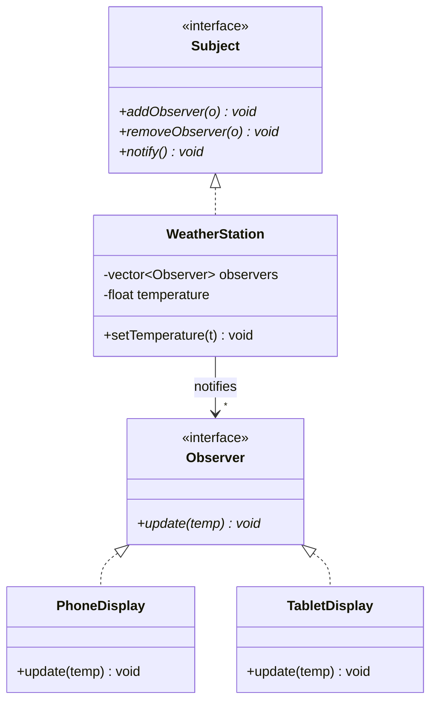
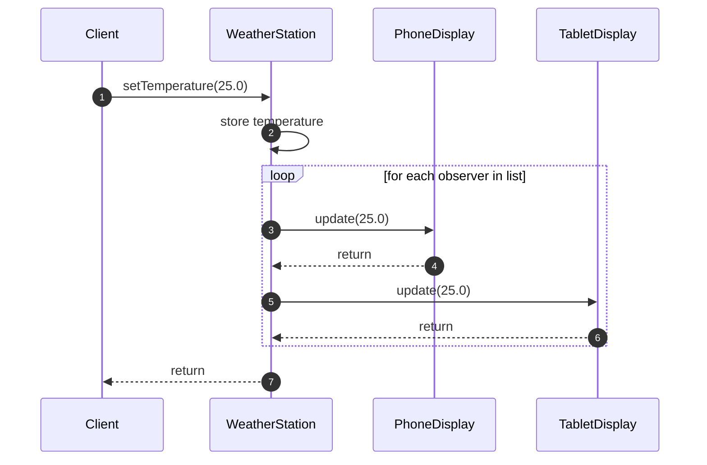

## Overview

Defines a **one-to-many dependency** between objects so that when one object (the subject) changes state, all its dependents (observers) are notified and updated automatically.

![[Pasted image 20261030135108.png|center]]

**The problem without it**

1. A `WeatherStation` reads the temperature. A `PhoneDisplay` wants to show it, and so does a `TabletDisplay`.
2. &rarr; Each display polls the station on a timer, or the station has hard-coded calls to every display: `phone.show(t); tablet.show(t);`.
3. &rarr; Adding a third display means editing the station. Removing one means editing it again. The station knows every consumer by name.

**The fix:** the station keeps a list of **observers** and notifies them all through a single interface (`update`). Displays register themselves; the station doesn't know *what* they are, only that they implement `update`. Adding or removing a display never touches the station's code.

**What varies:** which objects listen and what they do when notified.

| Principle ([[Foundational Principles]]) | How Observer applies it |
|---|---|
| Encapsulate what varies | The reaction to a change moves into observer objects |
| Program to an interface | The subject depends on the `Observer` interface, never on `PhoneDisplay` or `TabletDisplay` |
| Loose coupling | The subject knows only that its observers implement `update()`. It never calls display-specific methods |

````ad-note
**Observer Pattern** — direct connection. The subject (publisher) keeps a list of observers and calls them directly when something changes.

```
Button  ──notify()──►  DialogBox
        ──notify()──►  Logger
```

The button _knows_ its observers. They're tightly coupled.

**Publish-Subscribe Pattern** — indirect connection via a middleman (message broker/event bus). Publishers send messages to a topic/channel, subscribers listen to topics they care about. Neither side knows the other exists.

```
Button  ──"click"──►  [Event Bus]  ──►  DialogBox (subscribed to "click")
                                   ──►  Logger (subscribed to "click")
                                   ╌╌╌  Analytics (subscribed to "purchase", ignores "click")
```

Key differences:

||Observer|Pub-Sub|
|---|---|---|
|Coupling|Subject knows its observers|Publisher doesn't know subscribers|
|Middleman|None|Message broker / event bus|
|Filtering|All observers get everything|Subscribers pick which topics|
|Scale|In-process, same app|Can work across apps/servers|

**C# analogy:** C# `event` is Observer pattern — the class raising the event holds the delegate list directly. Something like RabbitMQ or Azure Service Bus is Pub-Sub — the sender posts a message and has no idea who reads it.
````

## Structure



### Participants

| Role | Class in the example | Responsibility |
|---|---|---|
| Observer | `Observer` | Declares the `update()` interface that concrete observers implement |
| Subject | `Subject` | Maintains the observer list and provides `addObserver()`, `removeObserver()`, `notify()` |
| ConcreteSubject | `WeatherStation` | Stores the state (temperature) and calls `notify()` when it changes |
| ConcreteObserver | `PhoneDisplay`, `TabletDisplay` | Reacts to the notification by reading the subject's new state |

## How It Works

Scenario: two displays are registered. The station's temperature changes to 25.0.



1. The client changes the station's temperature.
2. The station stores the new value internally.
3. It walks its observer list and calls `update()` on each one.
4. `PhoneDisplay` receives the new temperature and refreshes its screen.
5. `TabletDisplay` does the same, independently.
6. Control returns to the caller. Neither display knew about the other.

### Push vs Pull

| | Push model | Pull model |
|---|---|---|
| What `update()` receives | The data itself: `update(25.0)` | A reference to the subject: `update(station)` |
| Observer's work | Use the argument directly | Call back: `station.getTemperature()` |
| Coupling | Observer must accept the right argument types | Observer must know the subject's getter API |
| Efficiency | May send data the observer doesn't need | Observer fetches only what it needs |

The C++ example below uses the push model. .NET `INotifyPropertyChanged` uses a pull model: the event args carry the *property name*, and the listener reads the new value itself.

## When to Use

- Event systems, pub/sub
- UI updates when model data changes (MVC)
- Any scenario where multiple objects need to react to state changes

Signals in your code:

- A class calls specific methods on several other objects whenever its state changes (`phone.show(t); tablet.show(t); logger.log(t);`) &rarr; those objects are observers; give the class a subscriber list.
- Adding a new listener requires editing the source class &rarr; introduce an observer interface so listeners register themselves.
- A UI control must stay in sync with a model but shouldn't import the model's module &rarr; the model fires events, the control subscribes.
- You need to decouple a "something happened" producer from an unknown number of consumers &rarr; Observer or, at larger scale, a message broker ([[Publish-Subscribe]]).

## C++ Example

```cpp
#include <algorithm>
#include <iostream>
#include <string>
#include <vector>

class Observer {
public:
    virtual ~Observer() = default;
    virtual void update(float temperature) = 0;
};

class WeatherStation {
    std::vector<Observer*> observers;
    float temperature = 0.0f;
public:
    void addObserver(Observer* o) { observers.push_back(o); }
    void removeObserver(Observer* o) {
        observers.erase(
            std::remove(observers.begin(), observers.end(), o),
            observers.end());
    }
    void setTemperature(float t) {
        temperature = t;
        for (auto* o : observers)
            o->update(temperature); // notify all
    }
    float getTemperature() const { return temperature; }
};

class PhoneDisplay : public Observer {
public:
    void update(float temperature) override {
        std::cout << "Phone: " << temperature << " degrees\n";
    }
};

class TabletDisplay : public Observer {
public:
    void update(float temperature) override {
        std::cout << "Tablet: " << temperature << " degrees\n";
    }
};
```

Usage:

```cpp
int main() {
    WeatherStation station;
    PhoneDisplay phone;
    TabletDisplay tablet;

    station.addObserver(&phone);
    station.addObserver(&tablet);
    station.setTemperature(25.0f);   // both displays print
    // Phone: 25 degrees
    // Tablet: 25 degrees

    station.removeObserver(&tablet);
    station.setTemperature(30.0f);   // only phone prints
    // Phone: 30 degrees
}
```

````ad-warning
title: Dangling observer
If an observer is destroyed without calling `removeObserver`, the subject's list holds a dangling pointer. The next `notify()` is **undefined behavior**. In C++ you must ensure observers unregister in their destructor, or use `std::weak_ptr` so the subject can detect that the observer is gone. In .NET, event handlers that capture `this` prevent garbage collection of the subscriber, causing a **memory leak** — unsubscribe (`-=`) in `Dispose()` or use a [[Weak References|weak-event pattern]].
````

## In .NET / C#

C# has the pattern wired into the language through **events and delegates**:

- A `delegate` is the observer interface. `EventHandler<TEventArgs>` is the standard one.
- An `event` keyword on a delegate field is the subject's observer list. `+=` subscribes, `-=` unsubscribes.
- Raising the event (`OnTemperatureChanged?.Invoke(...)`) is the `notify()` call.
- See [[Events and Delegates]].

```csharp
public class TemperatureChangedEventArgs : EventArgs
{
    public float Temperature { get; }
    public TemperatureChangedEventArgs(float temp) => Temperature = temp;
}

public class WeatherStation                                   // Subject
{
    public event EventHandler<TemperatureChangedEventArgs>? TemperatureChanged;

    private float _temperature;
    public void SetTemperature(float t)
    {
        _temperature = t;
        TemperatureChanged?.Invoke(this, new TemperatureChangedEventArgs(t));
    }
}

public class PhoneDisplay                                     // ConcreteObserver
{
    public PhoneDisplay(WeatherStation station)
        => station.TemperatureChanged += OnTemperatureChanged;

    private void OnTemperatureChanged(object? sender, TemperatureChangedEventArgs e)
        => Console.WriteLine($"Phone: {e.Temperature} degrees");
}

// Usage
var station = new WeatherStation();
var phone = new PhoneDisplay(station);     // subscribes in the constructor
station.SetTemperature(25.0f);             // prints "Phone: 25 degrees"
```

.NET also offers `IObservable<T>` / `IObserver<T>` (the **reactive** model from .NET 4+). The subject is `IObservable<T>` and pushes items, errors, and a completion signal. System.Reactive (Rx) builds LINQ-style operators on top:

```csharp
IObservable<float> temps = station.TemperatureStream();
temps
    .Where(t => t > 30)
    .Subscribe(t => Console.WriteLine($"Heat warning: {t}"));
```

```ad-tip
title: Where else you meet it
- **WPF / MAUI data binding.** A view model implements `INotifyPropertyChanged`. The binding engine subscribes to `PropertyChanged` and refreshes the control when the property name matches. See [[INotifyPropertyChanged]].
- **EF Core change tracking.** The `ChangeTracker` watches entities. When you set `entity.Name = "new"`, it records the change so `SaveChanges()` knows what to write.
- **`IObservable<T>` in ASP.NET Core.** `IOptionsMonitor<T>.OnChange()` notifies you when a configuration section reloads.
- **Domain events.** A domain entity raises an event (e.g. `OrderPlaced`); handlers in the same process react. MediatR's `INotification` / `INotificationHandler<T>` is this pattern.
```

## Trade-offs

| Pros | Cons |
|---|---|
| Subject and observers are loosely coupled: new observers need no changes to the subject | Notification order is undefined; observers must not depend on being called before or after each other |
| Observers register and unregister at runtime | A long observer list slows every state change: each `update()` runs synchronously in the default model |
| Enables reactive and event-driven architectures | Hard to debug: "who subscribed?" is invisible at the call site |
| Subjects can broadcast to any number of observers, including zero | Memory leaks if observers forget to unsubscribe (C# events prevent GC of the subscriber) |

````ad-warning
title: Common misuse -- update storm
If observer A's `update()` changes the subject, the subject notifies again, including observer A. This can loop. Guard against re-entrant notification:
- Defer changes: collect them and apply after the current notification round.
- Flag: set `_isNotifying = true` and skip `notify()` while it is set.
- In .NET, raising an event inside another event's handler is the same trap.
````

## Related Patterns

- [[08 - Mediator|Mediator]]: Mediator centralizes communication instead of direct observer subscriptions. Observer is *decentralized* — each subject manages its own list. Mediator is *centralized* — a single object routes all messages.
- [[07 - Chain of Responsibility|Chain of Responsibility]]: Observer delivers a notification to *every* subscriber. A classic chain delivers a request to *one* handler, the first that accepts it.
- [[02 - Strategy|Strategy]]: an observer *could* be a strategy (an object the subject calls), but the intent differs. Strategy replaces *one* algorithm. Observer notifies *many* listeners.
- [[03 - Command|Command]]: commands can be used as the notification objects that observers receive. The subject pushes a command, and each observer executes it.

```ad-summary
- Observer lets a subject broadcast state changes to any number of listeners through a shared interface, without knowing who they are.
- In C++ watch for dangling observers; in C# watch for event-handler memory leaks — always unsubscribe.
- .NET builds it in: `event` + `EventHandler<T>` for simple cases, `IObservable<T>` + Rx for streaming and composition.
- Keep notification handlers fast and side-effect-free to avoid update storms and ordering bugs.
```
