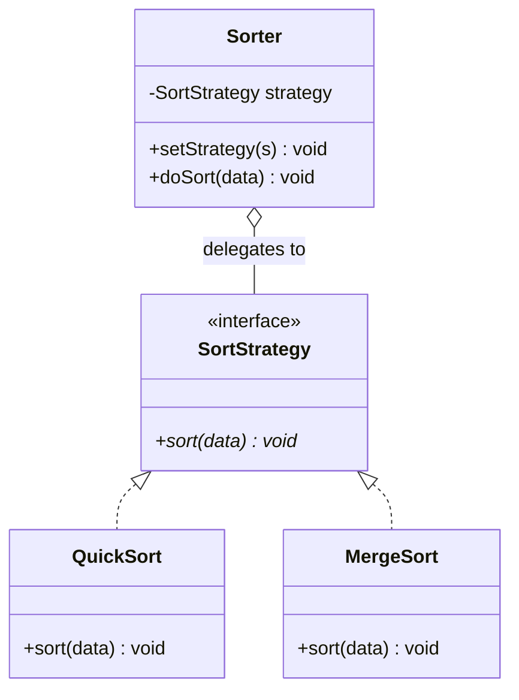
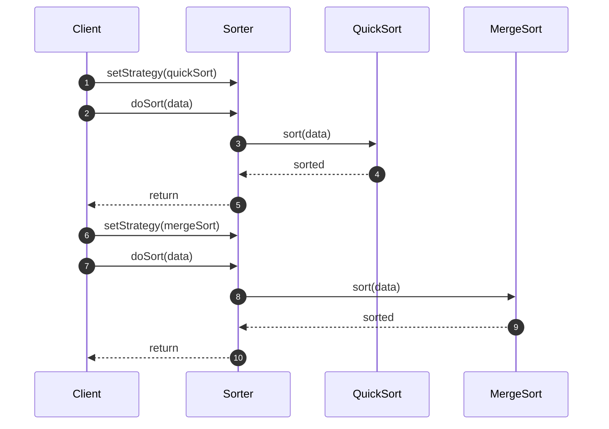

## Overview

Defines a **family of algorithms**, encapsulates each one, and makes them **interchangeable**. Strategy lets the algorithm vary independently from the clients that use it.

**The problem without it**

1. A `Sorter` class needs to support quicksort, mergesort, and heapsort. It puts all three in one method behind a `switch`.
2. &rarr; Adding bubble sort means editing `Sorter`. Every algorithm lives in the same class, even though they vary independently.
3. &rarr; The client can't swap algorithms at runtime without another flag and another branch.

**The fix:** extract each algorithm into its own class behind a common interface (`SortStrategy`). The `Sorter` holds a pointer to the current strategy and delegates to it. Swapping algorithms is a one-line setter call — no conditionals, no recompilation.

**What varies:** the algorithm used to perform a task.

| Principle ([[Foundational Principles]]) | How Strategy applies it |
|---|---|
| Encapsulate what varies | Each algorithm is in its own class, not a branch in a `switch` |
| Program to an interface | `Sorter` depends on `SortStrategy`, never on `QuickSort` or `MergeSort` |
| Favor composition over inheritance | The client *has-a* strategy, not *is-a* strategy. Swap at runtime instead of subclassing |

## Structure



### Participants

| Role | Class in the example | Responsibility |
|---|---|---|
| Strategy | `SortStrategy` | Declares the interface common to all algorithms |
| ConcreteStrategy | `QuickSort`, `MergeSort` | Implements one algorithm |
| Context | `Sorter` | Holds a reference to a `SortStrategy` and delegates the work to it |

## How It Works

Scenario: the client starts with quicksort, then switches to mergesort at runtime.



1. The client sets the strategy to `QuickSort`.
2. It calls `doSort()` on the `Sorter`.
3. The `Sorter` delegates to whichever strategy it holds — here, `QuickSort::sort()`.
4. The sorted result comes back.
5. Later, the client swaps the strategy to `MergeSort` — one setter call, no conditionals.
6. The next `doSort()` call goes to `MergeSort::sort()` instead. The `Sorter` code didn't change.

### Strategy vs simple function pointers

| | Strategy object | Function / delegate |
|---|---|---|
| State | Can hold its own fields (threshold, config) | Captures via closure |
| Multiple methods | One interface can declare several methods | One callable per slot |
| Identity | You can ask `dynamic_cast` / `is` what it is | Anonymous |
| When to prefer | The algorithm is complex or needs configuration | The algorithm is a one-liner |

In modern C++ and C#, a lambda or `Func<T>` is often enough. Use the full class-based pattern when the strategy carries state or the interface has more than one method.

## When to Use

- When you have multiple ways of doing the same thing (sorting, compression, routing, payment) and want to switch between them at runtime

Signals in your code:

- A method has a `switch` or `if/else` chain selecting between algorithms, and new cases keep appearing &rarr; each branch is a strategy.
- A class does the same job but with slight algorithm variations across subclasses &rarr; pull the varying part into a strategy instead of subclassing.
- You pass a `mode` or `type` enum to control which algorithm runs &rarr; replace the enum with a strategy object.
- Test code can't exercise one algorithm without constructing the whole class &rarr; injecting a strategy makes the algorithm testable in isolation.

## C++ Example

```cpp
#include <algorithm>
#include <iostream>
#include <memory>
#include <vector>

class SortStrategy {
public:
    virtual ~SortStrategy() = default;               // fix: virtual destructor
    virtual void sort(std::vector<int>& data) = 0;
};

class QuickSort : public SortStrategy {
public:
    void sort(std::vector<int>& data) override {
        std::sort(data.begin(), data.end());          // std::sort is introsort (quicksort-based)
    }
};

class MergeSort : public SortStrategy {
public:
    void sort(std::vector<int>& data) override {
        std::stable_sort(data.begin(), data.end());   // stable_sort is merge-sort-based
    }
};

class Sorter {
    SortStrategy* strategy = nullptr;                 // fix: initialize to nullptr
public:
    void setStrategy(SortStrategy* s) { strategy = s; }
    void doSort(std::vector<int>& data) {
        if (!strategy) return;                        // fix: guard against null
        strategy->sort(data);
    }
};
```

Usage:

```cpp
int main() {
    QuickSort qs;
    MergeSort ms;
    Sorter sorter;

    std::vector<int> data = {5, 2, 8, 1, 9};

    sorter.setStrategy(&qs);
    sorter.doSort(data);        // uses quicksort
    for (int n : data) std::cout << n << ' ';   // 1 2 5 8 9
    std::cout << '\n';

    data = {5, 2, 8, 1, 9};
    sorter.setStrategy(&ms);
    sorter.doSort(data);        // uses mergesort
    for (int n : data) std::cout << n << ' ';   // 1 2 5 8 9
    std::cout << '\n';

    sorter.setStrategy(nullptr);
    sorter.doSort(data);        // safe: guard skips the call
}
```

````ad-warning
title: Two bugs in the original code
The unfixed version had two issues:

1. **No virtual destructor on `SortStrategy`.** Deleting a `QuickSort` through a `SortStrategy*` (e.g. via `std::unique_ptr<SortStrategy>`) skips the derived destructor — **undefined behavior**.
2. **Uninitialized `strategy` pointer.** Calling `doSort` before `setStrategy` dereferences an indeterminate pointer — **undefined behavior**. Initialize to `nullptr` and guard in `doSort`.

Both are now fixed in the code above.
````

## In .NET / C#

The pattern shows up everywhere in .NET, often disguised as a delegate or interface injection:

- **`IComparer<T>` / `Comparison<T>`.** `List<T>.Sort(IComparer<T>)` accepts a strategy that defines the ordering. `Comparer<T>.Create(comparison)` wraps a lambda.
- **Dependency injection.** Registering `services.AddSingleton<IPaymentGateway, StripeGateway>()` is choosing a strategy at startup. Controllers receive it through their constructor and never know the concrete class. See [[07 - Dependency Injection]].
- **`Func<T>` / `Action<T>` parameters.** LINQ's `Where(Func<T, bool>)` takes a predicate strategy. `OrderBy(Func<T, TKey>)` takes a key-selector strategy. These are strategies without the ceremony of a class.
- **Policy-based patterns.** Polly's retry/circuit-breaker policies are strategies injected into `HttpClient` pipelines. ASP.NET Core authorization policies (`AddPolicy("Admin", ...)`) select a requirement strategy.

```csharp
// Interface-based strategy — the GoF form
public interface ISortStrategy
{
    void Sort<T>(List<T> data) where T : IComparable<T>;
}

public class QuickSortStrategy : ISortStrategy
{
    public void Sort<T>(List<T> data) where T : IComparable<T>
        => data.Sort();                                       // List.Sort uses introsort
}

public class StableSortStrategy : ISortStrategy
{
    public void Sort<T>(List<T> data) where T : IComparable<T>
    {
        var sorted = data.OrderBy(x => x).ToList();           // LINQ OrderBy is stable
        data.Clear();
        data.AddRange(sorted);
    }
}

public class Sorter
{
    private ISortStrategy _strategy;
    public Sorter(ISortStrategy strategy) => _strategy = strategy;
    public void SetStrategy(ISortStrategy s) => _strategy = s;
    public void DoSort<T>(List<T> data) where T : IComparable<T>
        => _strategy.Sort(data);
}

// Usage
var sorter = new Sorter(new QuickSortStrategy());
var data = new List<int> { 5, 2, 8, 1, 9 };
sorter.DoSort(data);           // quicksort

sorter.SetStrategy(new StableSortStrategy());
sorter.DoSort(data);           // stable sort

// Delegate-based strategy — the lightweight form
data.Sort((a, b) => b.CompareTo(a));  // descending: the lambda IS the strategy
```

```ad-tip
title: Where else you meet it
- **`JsonSerializerOptions.Converters`** — each `JsonConverter<T>` is a serialization strategy for a type. Add your own to change how a type is read and written.
- **`ILogger` / `ILoggerProvider`** — the logging framework lets you plug in Console, Debug, Serilog, NLog as interchangeable strategies.
- **`IDistributedCache`** — Redis, SQL Server, or in-memory: the caching strategy is swapped at registration time, and the consumer never knows.
- **LINQ `OrderBy` vs `OrderByDescending`** — choosing which one to call is choosing a comparison strategy.
```

## Trade-offs

| Pros | Cons |
|---|---|
| Algorithms are interchangeable at runtime without conditionals | More classes (one per algorithm), though lambdas reduce this |
| Each strategy is testable in isolation | The client must know which strategies exist and choose one |
| Adding a new algorithm never touches existing code ([[2 - Open-Closed Principle|OCP]]) | If strategies need data from the context, the interface may grow wide or the context must expose internals |
| Eliminates `switch`/`if-else` chains over algorithm types | Overkill when there are only two algorithms that will never grow |

```ad-warning
title: Common misuse -- strategy for a single algorithm
If there is only one concrete strategy and no foreseeable second one, the interface adds indirection for no benefit. Start with a direct call and extract a strategy when a second algorithm actually appears. See [[YAGNI]].
```

## Related Patterns

- [[04 - State|State]]: State swaps behavior automatically based on internal state; Strategy lets the *client* choose the behavior. Structurally identical — both delegate to an object behind an interface. The difference is *who decides* to switch.
- [[05 - Template Method|Template Method]]: Template Method customizes *steps within* a fixed skeleton via inheritance. Strategy replaces the *entire algorithm* via composition.
- [[03 - Command|Command]]: a command encapsulates a *single request*. A strategy encapsulates a *reusable algorithm*. Commands are often one-shot; strategies are long-lived.
- [[02 - Decorator|Decorator]]: Decorator wraps an object to add behavior. Strategy replaces an object's algorithm. Use Decorator when you want to *layer* behavior, Strategy when you want to *swap* it.

```ad-summary
- Strategy extracts a family of algorithms into interchangeable objects behind a common interface, eliminating switch chains.
- The context holds a reference to the current strategy and delegates work to it. Swapping is a setter call.
- In .NET you meet it as `IComparer<T>`, `Func<T>` parameters, DI-registered services, and policy objects.
- Use the full class form when the algorithm carries state or has multiple methods; use a lambda or delegate when it is a one-liner.
```
