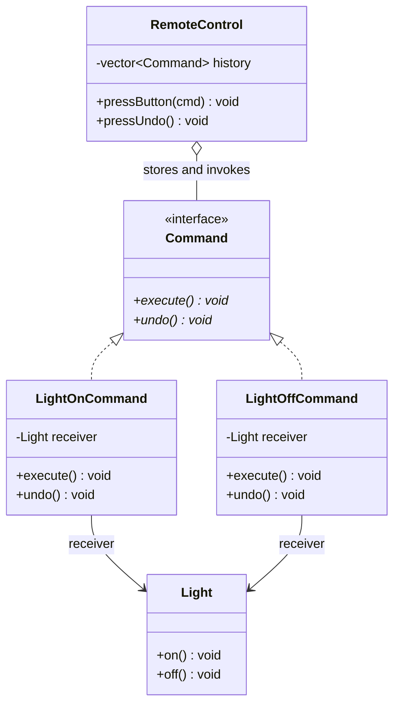
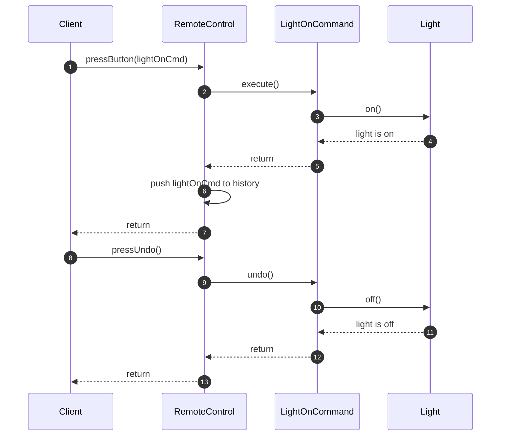

## Overview

Encapsulates a **request as an object**, thereby allowing you to parameterize clients with different requests, queue requests, log them, and support undoable operations.

**The problem without it**

1. A `RemoteControl` has seven buttons. Each one calls a specific method on a specific object: `light.on()`, `fan.high()`, `door.close()`.
2. &rarr; The remote is hard-wired to every device. Adding a sprinkler means editing the remote.
3. &rarr; Undo is impossible because the remote doesn't remember what it did — it just called a method and moved on.

**The fix:** wrap each action in a **command object** with `execute()` and `undo()`. The remote stores commands in its slots and doesn't know what they do. To undo, it calls `undo()` on the last command. The remote and the devices never meet directly.

**What varies:** the action performed when a button is pressed, and whether it can be undone.

| Principle ([[Foundational Principles]]) | How Command applies it |
|---|---|
| Encapsulate what varies | The action is inside a command object, not hard-coded in the invoker |
| Program to an interface | The remote depends only on `Command`, never on `Light` or `Fan` |
| [[1 - Single Responsibility Principle\|Single Responsibility]] | The invoker triggers commands; each command knows one action; the receiver does the real work |

## Structure



### Participants

| Role | Class in the example | Responsibility |
|---|---|---|
| Command | `Command` | Declares `execute()` and `undo()` |
| ConcreteCommand | `LightOnCommand`, `LightOffCommand` | Binds a receiver to an action. `execute()` calls the receiver; `undo()` reverses it |
| Receiver | `Light` | Does the actual work (`on()`, `off()`) |
| Invoker | `RemoteControl` | Stores commands, calls `execute()`, keeps a history for undo |
| Client | `main()` | Creates commands, binds them to receivers, and loads them into the invoker |

## How It Works

Scenario: the user presses the "light on" button, then presses undo.



1. The client tells the remote to press a button, passing the pre-loaded command.
2. The remote calls `execute()` on the command.
3. The command calls `on()` on the `Light` receiver — it *knows* which receiver and which action.
4. The light turns on.
5. The remote pushes the command onto its history stack.
6. Later, the client presses undo.
7. The remote pops the last command and calls `undo()`.
8. The command calls `off()` on the same light. The remote never knew it was a light.

### Macro commands

A **MacroCommand** holds a list of commands and executes them in sequence. Undo reverses them in reverse order. This is the [[05 - Composite|Composite]] pattern applied to commands.

## When to Use

- Undo/redo functionality
- Task queues
- Macro recording
- Callback abstraction

Signals in your code:

- A UI button directly calls business logic (`button.Click += () => order.Submit()`) and you later need undo or logging &rarr; insert a command between the button and the action.
- You need to queue, schedule, or serialize operations for later execution &rarr; commands are data and can be stored.
- Several operations must execute as a group and roll back as a group &rarr; a MacroCommand or a transactional command.
- You want to decouple "when to do it" from "what to do" (the invoker doesn't know the receiver) &rarr; Command is the decoupling object.

## C++ Example

```cpp
#include <iostream>
#include <memory>
#include <string>
#include <vector>

class Command {
public:
    virtual ~Command() = default;
    virtual void execute() = 0;
    virtual void undo() = 0;
};

class Light {
    std::string location;
public:
    explicit Light(std::string loc) : location(std::move(loc)) {}
    void on()  { std::cout << location << " light ON\n"; }
    void off() { std::cout << location << " light OFF\n"; }
};

class LightOnCommand : public Command {
    Light* light;
public:
    explicit LightOnCommand(Light* l) : light(l) {}
    void execute() override { light->on(); }
    void undo()    override { light->off(); }
};

class LightOffCommand : public Command {
    Light* light;
public:
    explicit LightOffCommand(Light* l) : light(l) {}
    void execute() override { light->off(); }
    void undo()    override { light->on(); }
};

class RemoteControl {
    std::vector<Command*> history;
public:
    void pressButton(Command* cmd) {
        cmd->execute();
        history.push_back(cmd);
    }
    void pressUndo() {
        if (!history.empty()) {
            history.back()->undo();
            history.pop_back();
        }
    }
};
```

Usage:

```cpp
int main() {
    Light living("Living Room");
    Light kitchen("Kitchen");

    LightOnCommand  livingOn(&living);
    LightOffCommand livingOff(&living);
    LightOnCommand  kitchenOn(&kitchen);

    RemoteControl remote;
    remote.pressButton(&livingOn);    // Living Room light ON
    remote.pressButton(&kitchenOn);   // Kitchen light ON
    remote.pressUndo();               // Kitchen light OFF  (undo last)
    remote.pressUndo();               // Living Room light OFF
}
```

````ad-warning
title: Undo with state
The example works because `on` and `off` are symmetric. When the undo isn't simply the inverse — for example, a `Fan` with `high()`, `medium()`, `low()`, `off()` — the command must **store the previous state** before `execute()` and restore it in `undo()`. This is where [[09 - Memento|Memento]] helps: save a snapshot before executing, restore it on undo.

```cpp
class FanHighCommand : public Command {
    Fan* fan;
    Fan::Speed prevSpeed;           // saved state
public:
    void execute() override {
        prevSpeed = fan->getSpeed(); // remember
        fan->high();
    }
    void undo() override {
        fan->setSpeed(prevSpeed);    // restore
    }
};
```
````

## In .NET / C#

The pattern powers undo stacks, queued work, and transactional operations across .NET:

- **`ICommand` in WPF / MAUI.** A button's `Command` property binds to an `ICommand` implementation. `Execute()` does the work, `CanExecute()` enables or disables the button. `RelayCommand` (MVVM Toolkit) wraps a delegate. See [[Data Binding]] and [[MVVM]].
- **MediatR `IRequest` / `IRequestHandler`.** Each request is a command object. The mediator dispatches it to the right handler. Pipeline behaviors wrap the handler for logging, validation, or transactions.
- **Background job queues.** Hangfire, Quartz.NET, and `IHostedService` + `Channel<T>` dequeue command objects and call `Execute()`.
- **`Func<Task>` as a lightweight command.** When you don't need undo or state, a delegate is enough: `Action execute = () => light.On();`.

```csharp
using System.Windows.Input;         // ICommand lives here in WPF

public class Light
{
    public string Location { get; }
    public Light(string location) => Location = location;
    public void On()  => Console.WriteLine($"{Location} light ON");
    public void Off() => Console.WriteLine($"{Location} light OFF");
}

public class LightOnCommand : ICommand     // WPF-compatible command
{
    private readonly Light _light;
    public LightOnCommand(Light light) => _light = light;

    public event EventHandler? CanExecuteChanged;
    public bool CanExecute(object? parameter) => true;
    public void Execute(object? parameter) => _light.On();
}

// Undo-capable command (richer than ICommand)
public interface IUndoableCommand
{
    void Execute();
    void Undo();
}

public class LightToggleCommand : IUndoableCommand
{
    private readonly Light _light;
    private bool _wasOn;
    public LightToggleCommand(Light light) => _light = light;
    public void Execute() { _wasOn = false; _light.On(); }
    public void Undo()    { _light.Off(); }
}

public class RemoteControl
{
    private readonly Stack<IUndoableCommand> _history = new();
    public void Press(IUndoableCommand cmd) { cmd.Execute(); _history.Push(cmd); }
    public void Undo()  { if (_history.TryPop(out var cmd)) cmd.Undo(); }
}

// Usage
var remote = new RemoteControl();
var light = new Light("Living Room");
remote.Press(new LightToggleCommand(light));   // Living Room light ON
remote.Undo();                                  // Living Room light OFF
```

```ad-tip
title: Where else you meet it
- **Text editors and IDEs.** Every edit is a command. Ctrl+Z walks the undo stack backwards, Ctrl+Y walks the redo stack forwards.
- **Database migrations.** EF Core migrations have `Up()` (execute) and `Down()` (undo). Each migration is a command applied to the schema.
- **`System.Transactions.TransactionScope`.** Everything inside the scope is part of a command that either commits or rolls back.
- **CQRS.** In Command Query Responsibility Segregation, the "C" is literally Command objects dispatched to write-side handlers.
```

## Trade-offs

| Pros | Cons |
|---|---|
| Decouples invoker from receiver: buttons, menus, shortcuts all share the same commands | One class per action is heavy for simple cases; delegates reduce this |
| Enables undo, redo, replay, and macro recording by storing executed commands | Undo is only as reliable as the state you save. Complex undo may need full snapshots ([[09 - Memento\|Memento]]) |
| Commands can be serialized, queued, logged, or scheduled for later | The command must know enough about the receiver to call the right method, which can leak receiver details |
| Supports composite commands (macros) via the Composite pattern | History stacks grow unboundedly unless you set a depth limit |

```ad-warning
title: Common misuse -- undo without saving state
If `execute()` is destructive and `undo()` tries to reverse it from the current state alone, information is lost. Always capture the state *before* execution. For large state, Memento stores a snapshot; for small state, a field in the command is enough.
```

## Related Patterns

- [[09 - Memento|Memento]]: Memento stores state snapshots that Command's undo needs. When `undo()` must restore complex state, Memento provides the snapshot.
- [[02 - Strategy|Strategy]]: both encapsulate behavior in an object. Strategy encapsulates an *algorithm* the context uses repeatedly. Command encapsulates a *one-shot request* that can be stored and undone.
- [[07 - Chain of Responsibility|Chain of Responsibility]]: Command encapsulates a request as an object. Chain of Responsibility routes it through handlers. They combine well: a command is created, then passed through a chain.
- [[05 - Composite|Composite]]: a MacroCommand is a Composite of commands. `execute()` calls `execute()` on each child.
- [[01 - Observer|Observer]]: commands can serve as the notification payload in an observer system. The subject pushes a command, each observer executes it.

```ad-summary
- Command wraps a request as an object with `execute()` and `undo()`, decoupling the invoker from the receiver.
- It enables undo, redo, queueing, logging, and macro recording because the request is data, not just a call.
- In .NET: WPF `ICommand` for UI, MediatR `IRequest` for CQRS, Hangfire/Quartz for background jobs, EF migrations for schema changes.
- Always save state before execution if you need a reliable undo — a command without saved state can only guess how to reverse itself.
```
