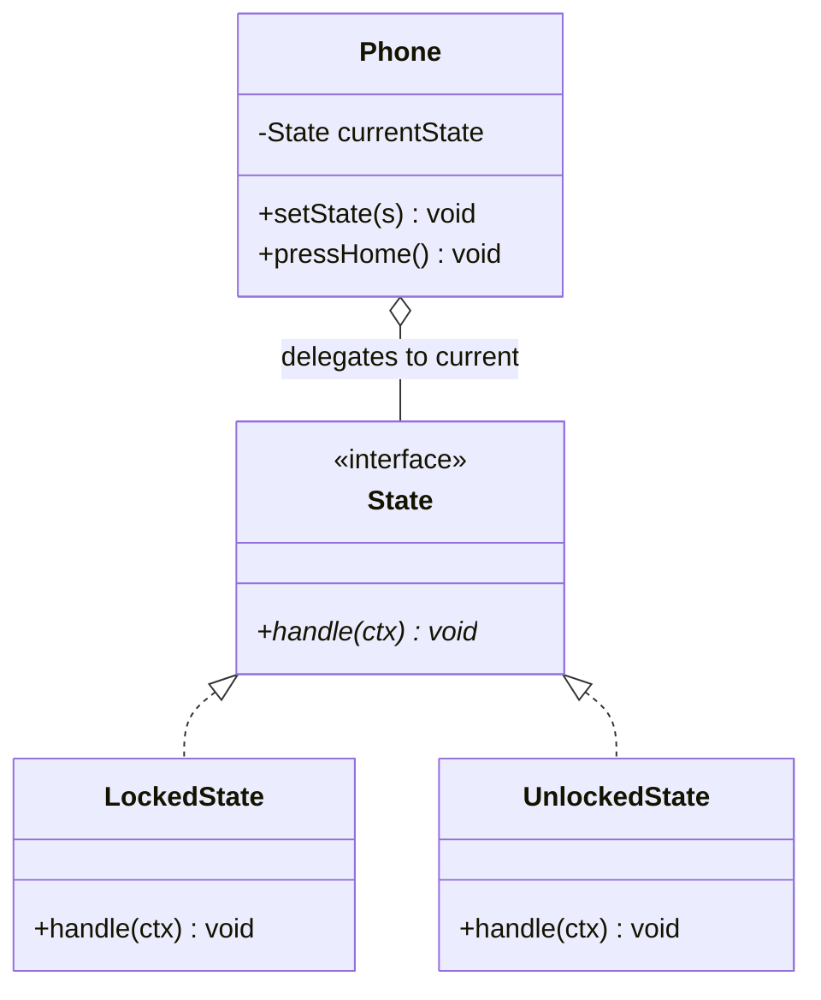
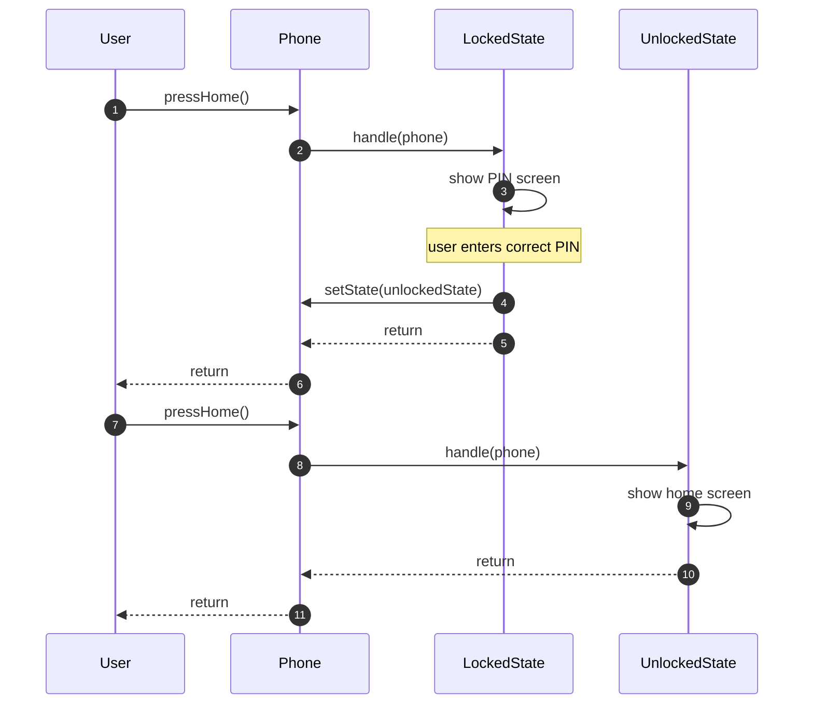

## Overview

Allows an object to **alter its behavior when its internal state changes**. The object will appear to change its class.

Instead of massive `if/else` or `switch` blocks checking state, each state becomes its own class.

**The problem without it**

1. A `GumballMachine` has four states: no quarter, has quarter, sold, sold out. Every method (`insertQuarter()`, `turnCrank()`, `dispense()`) begins with a `switch` on the current state.
2. &rarr; Adding a "winner" state means editing *every* method's `switch`. Miss one branch and you have a silent bug.
3. &rarr; The state logic is scattered across the entire class instead of being organized by state.

**The fix:** extract each state into its own class behind a common `State` interface. The machine delegates every action to its *current state object*. When the state changes, the machine swaps the state object. Each state class encapsulates *all behavior for that state* in one place.

**What varies:** what happens when an action is called — determined by the current state, not by a conditional.

| Principle ([[Foundational Principles]]) | How State applies it |
|---|---|
| Encapsulate what varies | Each state is its own class, not a branch in every method |
| [[2 - Open-Closed Principle\|Open-Closed]] | A new state is a new class; existing states and the context don't change |
| [[1 - Single Responsibility Principle\|Single Responsibility]] | Each state class owns *all* the behavior for that one state |

## Structure



### Participants

| Role | Class in the example | Responsibility |
|---|---|---|
| State | `State` | Declares the interface for state-specific behavior |
| ConcreteState | `LockedState`, `UnlockedState` | Implements the behavior for one state and triggers transitions by calling `context.setState()` |
| Context | `Phone` | Holds the current state, delegates actions to it, and exposes `setState()` for transitions |

## How It Works

Scenario: the phone is locked. The user presses home, enters the correct PIN, and the phone unlocks.



1. The user presses home. The phone delegates to its current state: `LockedState`.
2. `LockedState` shows the PIN screen.
3. After the correct PIN, `LockedState` tells the phone to transition: `phone.setState(unlockedState)`.
4. The phone's current state is now `UnlockedState`.
5. The next `pressHome()` call goes to `UnlockedState`, which shows the home screen.
6. The phone's *code* didn't change — only the object it delegates to.

### Who drives transitions?

| Approach | How | Trade-off |
|---|---|---|
| State drives | `LockedState` calls `context.setState(new UnlockedState)` | States know each other, but transitions are next to the logic that triggers them |
| Context drives | The `Phone` checks the state's return value and picks the next state | States are independent, but the context needs a `switch` on the result |
| Transition table | A lookup table maps `(currentState, event)` to `nextState` | Very flexible, easy to serialize, but behavior must be in the states anyway |

GoF and *Head First* both prefer the first approach: the state knows which state comes next.

## When to Use

- When an object's behavior depends on its state and it must change behavior at runtime
- When operations have large conditional statements that depend on the object's state

Signals in your code:

- A class has a `status` or `state` field that appears in `switch`/`if` checks in *multiple* methods &rarr; each branch of each method becomes one state class.
- New states keep being added and each one requires edits in multiple methods &rarr; State localizes all behavior for one state in one class.
- You draw the object's lifecycle as a state-machine diagram and the arrows are clear &rarr; the diagram maps directly to State objects and transitions.
- Boolean flags like `isStarted`, `isPaused`, `isStopped` combine into `2^n` states and some combinations are invalid &rarr; replace the flags with explicit state objects.

## C++ Example

```cpp
#include <iostream>
#include <memory>
#include <string>

class Phone;   // forward declaration

class State {
public:
    virtual ~State() = default;
    virtual void handle(Phone& phone) = 0;
    virtual std::string name() const = 0;
};

class Phone {
    std::unique_ptr<State> state;
public:
    explicit Phone(std::unique_ptr<State> initial) : state(std::move(initial)) {}
    void setState(std::unique_ptr<State> s) { state = std::move(s); }
    void pressHome() { state->handle(*this); }
    std::string stateName() const { return state->name(); }
};

class UnlockedState : public State {
public:
    void handle(Phone& phone) override {
        std::cout << "Showing home screen\n";
        // already unlocked, stay in this state
    }
    std::string name() const override { return "Unlocked"; }
};

class LockedState : public State {
public:
    void handle(Phone& phone) override {
        std::cout << "Showing PIN screen... correct PIN entered\n";
        phone.setState(std::make_unique<UnlockedState>());  // transition
    }
    std::string name() const override { return "Locked"; }
};
```

Usage:

```cpp
int main() {
    Phone phone(std::make_unique<LockedState>());
    std::cout << "State: " << phone.stateName() << '\n';   // Locked

    phone.pressHome();                                      // shows PIN screen, transitions
    // Showing PIN screen... correct PIN entered

    std::cout << "State: " << phone.stateName() << '\n';   // Unlocked

    phone.pressHome();                                      // shows home screen
    // Showing home screen
}
```

````ad-warning
title: State identity and flyweight
If state objects carry no per-instance data, you can share a single instance of each state (the [[07 - Flyweight|Flyweight]] pattern). GoF mentions this. In the `GumballMachine` example from *Head First*, all four states are created once in the constructor and reused. Creating a new state on every transition allocates needlessly.

```cpp
// Shared states: each one is created once
class Phone {
    static inline UnlockedState unlocked;
    static inline LockedState locked;
    State* state = &locked;   // no allocation on transition
public:
    void setState(State* s) { state = s; }
};
```
````

## In .NET / C#

C# doesn't have a built-in State pattern, but the shape appears in UI frameworks, workflow engines, and game loops:

- **Stateless library.** The most popular .NET state-machine library. You define states, triggers, and transitions in a fluent API, and it enforces allowed transitions for you.
- **Workflow Foundation / Elsa.** Workflow engines where each activity is a state that decides the next step.
- **Game dev.** Unity game objects frequently switch behavior through state scripts: `IdleState`, `AttackState`, `DeadState`.
- **WPF `VisualStateManager`.** UI controls define visual states (`Normal`, `PointerOver`, `Pressed`) and transition between them with animations. The state pattern controls what the control looks like.

```csharp
public interface IPhoneState
{
    void Handle(Phone phone);
    string Name { get; }
}

public class LockedState : IPhoneState
{
    public string Name => "Locked";
    public void Handle(Phone phone)
    {
        Console.WriteLine("Showing PIN screen... correct PIN entered");
        phone.SetState(new UnlockedState());     // transition
    }
}

public class UnlockedState : IPhoneState
{
    public string Name => "Unlocked";
    public void Handle(Phone phone)
    {
        Console.WriteLine("Showing home screen");
    }
}

public class Phone
{
    private IPhoneState _state;
    public Phone(IPhoneState initial) => _state = initial;
    public void SetState(IPhoneState s) => _state = s;
    public void PressHome() => _state.Handle(this);
    public string StateName => _state.Name;
}

// Usage
var phone = new Phone(new LockedState());
Console.WriteLine(phone.StateName);    // Locked
phone.PressHome();                     // PIN screen, transitions to Unlocked
Console.WriteLine(phone.StateName);    // Unlocked
phone.PressHome();                     // home screen
```

Using the **Stateless** library for the same scenario:

```csharp
using Stateless;

enum PhoneState  { Locked, Unlocked }
enum Trigger     { PressHome, Lock }

var machine = new StateMachine<PhoneState, Trigger>(PhoneState.Locked);

machine.Configure(PhoneState.Locked)
    .Permit(Trigger.PressHome, PhoneState.Unlocked)
    .OnEntry(() => Console.WriteLine("Show PIN screen"));

machine.Configure(PhoneState.Unlocked)
    .Permit(Trigger.Lock, PhoneState.Locked)
    .OnEntry(() => Console.WriteLine("Show home screen"));

machine.Fire(Trigger.PressHome);  // transitions to Unlocked, prints "Show home screen"
```

```ad-tip
title: Where else you meet it
- **`HttpClient` handler state.** A `SocketsHttpHandler` manages socket state internally: idle, sending, receiving, draining. Different states handle the same `SendAsync` call differently.
- **EF Core entity states.** `EntityState.Added`, `Modified`, `Deleted`, `Unchanged`, `Detached`. `SaveChanges()` behaves differently for each state.
- **ASP.NET Core request lifecycle.** The Kestrel connection goes through states: `ConnectionStarted`, `HeadersReceived`, `RequestBodyStarted`, `ResponseStarted`, `Completed`. Calling `Response.WriteAsync` in the wrong state throws `InvalidOperationException`.
- **`Task` / `Task<T>` status.** A task transitions through `Created`, `WaitingToRun`, `Running`, `RanToCompletion`, `Faulted`, `Canceled`. Calling `.Result` in the wrong state blocks or throws.
```

## Trade-offs

| Pros | Cons |
|---|---|
| All behavior for one state is in one class, not spread across multiple methods | More classes: one per state, which can be heavy for simple machines |
| Adding a new state requires no changes to existing state classes or the context | States that know their successors are coupled to each other |
| No `switch`/`if-else` on state in every method | If there are only two states and they won't grow, the pattern is overkill |
| State transitions are explicit and easy to trace | The context's public interface (`setState`) lets external code force an invalid transition unless you protect it |

```ad-warning
title: Common misuse -- exposing setState to the world
If `setState()` is public and any caller can force an arbitrary state, you lose the guarantees the state machine provides. In production code, make `setState()` internal or accessible only to state classes (in C++, a `friend`; in C#, `internal` or pass a transition token).
```

## Related Patterns

- [[02 - Strategy|Strategy]]: structurally identical to State — both delegate to an object behind an interface. The difference: in State, the *state object* decides when to switch (automatic). In Strategy, the *client* decides (explicit).
- [[07 - Flyweight|Flyweight]]: state objects that carry no per-instance data can be shared as flyweights. GoF suggests this optimization.
- [[01 - Observer|Observer]]: state changes can fire notifications. The context notifies observers when it transitions, so the UI can update.
- [[05 - Template Method|Template Method]]: Template Method fixes the skeleton and varies the steps. State fixes the interface and varies the *entire behavior* per state.

```ad-summary
- State replaces `switch`/`if-else` on a status field with one class per state, each implementing the same interface.
- The context delegates every action to its current state object. State classes drive transitions by calling `context.setState()`.
- In .NET: the Stateless library for explicit machines, `VisualStateManager` for UI states, EF Core's `EntityState` for tracking.
- Keep `setState()` internal to the state machine to prevent external code from forcing invalid transitions.
```
