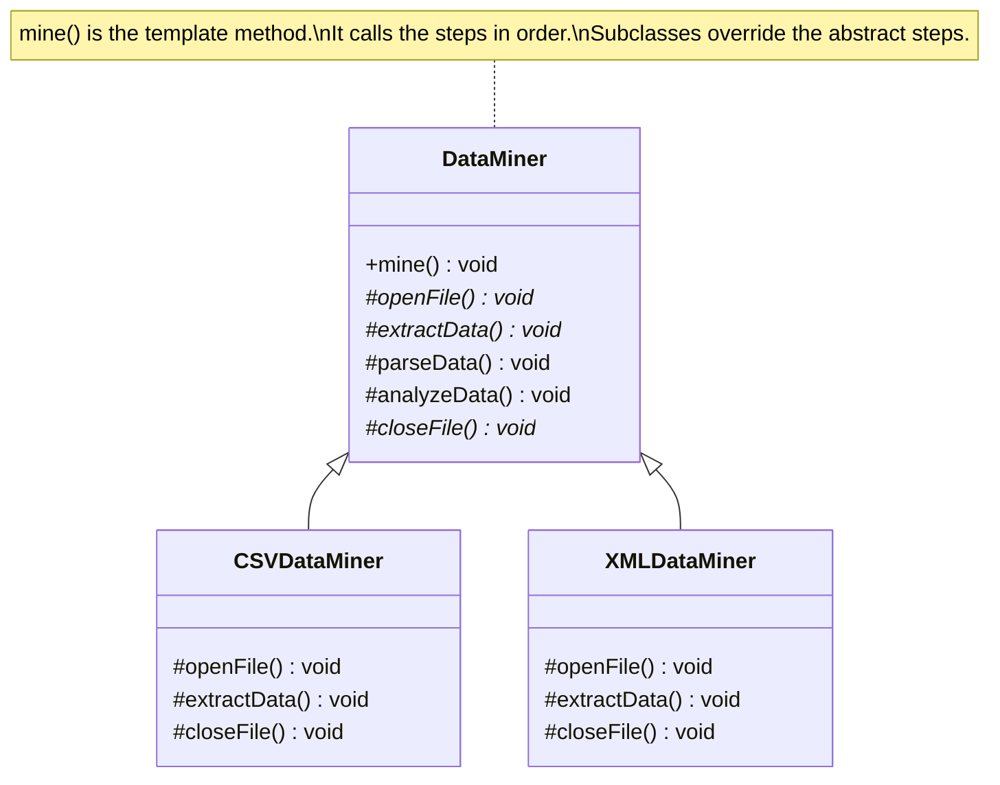
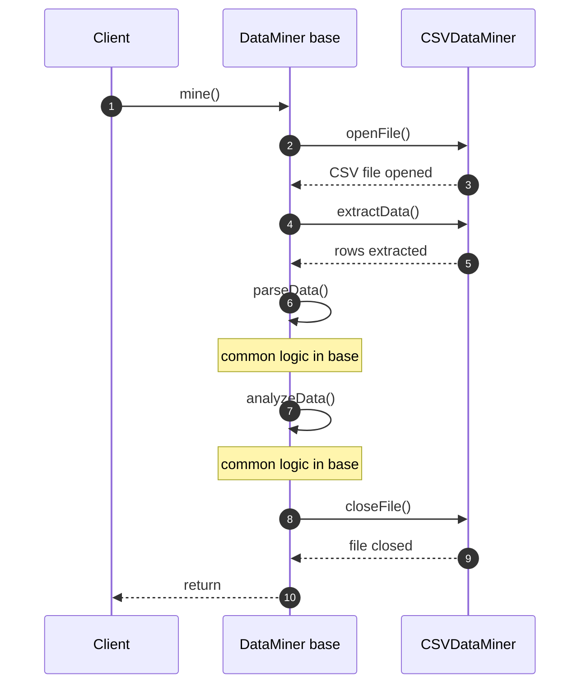

## Overview

Defines the **skeleton of an algorithm** in a base class, deferring some steps to subclasses. Lets subclasses redefine certain steps without changing the algorithm's structure.

**The problem without it**

1. `CSVDataMiner` and `XMLDataMiner` both follow the same five steps: open, extract, parse, analyze, close. Each class duplicates the step sequence in its own `mine()` method.
2. &rarr; A third miner (`JSONDataMiner`) copies the sequence again. A bug in the ordering must be fixed in all three.
3. &rarr; Adding a step (e.g., logging) means editing every miner, even though the step is identical across all of them.

**The fix:** put the algorithm skeleton in a base-class method (`mine()`). Mark the steps that vary as `virtual` (or pure virtual) so subclasses override *only those steps*. The order, common steps, and hooks stay in the base. Subclasses fill in the blanks without repeating the recipe.

**What varies:** specific steps of the algorithm, not the algorithm's structure.

| Principle ([[Foundational Principles]]) | How Template Method applies it |
|---|---|
| Encapsulate what varies | The varying steps are `virtual` overrides; the fixed skeleton is in the base |
| [[Don't Repeat Yourself\|DRY]] | The step sequence is written once in the base class, not duplicated in every subclass |
| [[Hollywood Principle]] | "Don't call us, we'll call you." The base class calls the subclass steps, not the other way around |

### The three kinds of steps

| Kind | Who implements it | Purpose |
|---|---|---|
| Abstract step | Subclass (must override) | A step that *must* vary: `openFile()`, `extractData()` |
| Concrete step | Base class (not overridden) | A step that is the same everywhere: `parseData()`, `analyzeData()` |
| Hook | Base class with a default (may override) | An optional extension point. Default is usually empty or returns a safe value. Subclass overrides only if it needs to |

````ad-note
A **hook** is a method with a default (often empty) body in the base class. Subclasses *may* override it but don't have to. Common uses:
- **Before/after hooks:** `beforeParse()`, `afterAnalyze()` — let subclasses inject logging or validation without touching the skeleton.
- **Guard hooks:** `bool shouldAnalyze()` — the skeleton checks the return and skips a step if the subclass says no.

```cpp
class DataMiner {
public:
    void mine() {
        openFile();
        extractData();
        if (shouldParse())      // guard hook
            parseData();
        analyzeData();
        closeFile();
    }
protected:
    virtual bool shouldParse() { return true; }   // hook: subclass may override
    virtual void openFile() = 0;                  // abstract step
    // ...
};
```
````

## Structure



### Participants

| Role | Class in the example | Responsibility |
|---|---|---|
| AbstractClass | `DataMiner` | Defines `mine()` (the template method) and declares abstract steps. Implements common steps. |
| ConcreteClass | `CSVDataMiner`, `XMLDataMiner` | Overrides the abstract steps (`openFile`, `extractData`, `closeFile`) for its format |

## How It Works

Scenario: the client calls `mine()` on a `CSVDataMiner`.



1. The client calls `mine()`. This is the **template method** — it lives in the base class and is *not* virtual.
2. `mine()` calls `openFile()`. The base has no implementation, so the call lands in `CSVDataMiner::openFile()`.
3. The CSV file is opened.
4. `extractData()` similarly dispatches to the CSV subclass.
5. `parseData()` and `analyzeData()` are concrete steps in the base — they run the same logic for every format.
6. `closeFile()` dispatches to the CSV subclass again.
7. Control returns. The *order* was locked by the base class; the *format-specific work* was filled in by the subclass.

## When to Use

- When multiple classes share the same algorithm structure but differ in specific steps

Signals in your code:

- Two or more classes have methods that follow the same sequence of steps but differ in a few of them &rarr; pull the sequence into a base class template method.
- You copy-paste an algorithm and change only a few lines &rarr; the changed lines are abstract steps; the rest is the template.
- You want to let subclasses customize a framework operation without changing its overall flow (e.g., a test fixture's `setUp` / `tearDown`, an ASP.NET `Controller`'s lifecycle) &rarr; the framework defines the template; you override the hooks.
- You want to enforce an ordering (e.g., "always validate before saving") that subclasses must not break &rarr; the template method is non-virtual and calls validation before the virtual save step.

## C++ Example

```cpp
#include <iostream>
#include <string>

class DataMiner {
public:
    virtual ~DataMiner() = default;

    // Template method — defines the skeleton. Not virtual.
    void mine() {
        openFile();
        extractData();
        parseData();
        analyzeData();
        closeFile();
    }

protected:
    virtual void openFile() = 0;       // abstract step: must override
    virtual void extractData() = 0;    // abstract step: must override
    void parseData() {                 // concrete step: same for all
        std::cout << "  Parsing data...\n";
    }
    void analyzeData() {               // concrete step: same for all
        std::cout << "  Analyzing data...\n";
    }
    virtual void closeFile() = 0;      // abstract step: must override
};

class CSVDataMiner : public DataMiner {
protected:
    void openFile() override    { std::cout << "  Opening CSV file\n"; }
    void extractData() override { std::cout << "  Reading CSV rows\n"; }
    void closeFile() override   { std::cout << "  Closing CSV file\n"; }
};

class XMLDataMiner : public DataMiner {
protected:
    void openFile() override    { std::cout << "  Opening XML file\n"; }
    void extractData() override { std::cout << "  Parsing XML nodes\n"; }
    void closeFile() override   { std::cout << "  Closing XML file\n"; }
};
```

Usage:

```cpp
int main() {
    CSVDataMiner csv;
    XMLDataMiner xml;

    std::cout << "CSV mining:\n";
    csv.mine();
    //   Opening CSV file
    //   Reading CSV rows
    //   Parsing data...
    //   Analyzing data...
    //   Closing CSV file

    std::cout << "\nXML mining:\n";
    xml.mine();
    //   Opening XML file
    //   Parsing XML nodes
    //   Parsing data...
    //   Analyzing data...
    //   Closing XML file
}
```

| Step type | C++ mechanism | Example |
|---|---|---|
| Abstract step | `virtual void f() = 0;` | `openFile()` — subclass must implement |
| Concrete step | Non-virtual method | `parseData()` — base owns, subclass can't override |
| Hook | `virtual void f() {}` (empty body) | `beforeParse()` — subclass *may* override |

````ad-warning
title: Making the template method non-overridable
In C++, `mine()` is not `virtual`, so subclasses *can't* override it — the skeleton is locked. But if someone calls it through a pointer to the derived class, they get the base version anyway because it's non-virtual. In C# the equivalent is `sealed` on a `virtual` method, or simply not marking it `virtual` in the first place.

If you accidentally make the template method `virtual`, a subclass can override it and break the guaranteed step order.
````

## In .NET / C#

The pattern is pervasive in .NET frameworks. Whenever you override a method in a framework class and the framework calls it for you, you are filling in a template method step:

- **ASP.NET Core `Controller` lifecycle.** `OnActionExecuting`, `OnActionExecuted`, `OnResultExecuting`, `OnResultExecuted` are hooks. The MVC pipeline is the template method. See [[01 - Filter Pipeline]].
- **xUnit / NUnit test fixtures.** The test runner calls `SetUp()` &rarr; `Test()` &rarr; `TearDown()`. You override `SetUp` and `TearDown`; the runner owns the sequence.
- **`Stream` class.** `Stream.Read()` and `Stream.Write()` are template methods that call `ReadByte()`, `WriteByte()`, etc. Subclasses like `FileStream` or `MemoryStream` override the byte-level methods.
- **`HttpMessageHandler.SendAsync`.** The base defines the send pipeline; `DelegatingHandler` subclasses override to add behavior before/after calling `base.SendAsync`.

```csharp
public abstract class DataMiner                          // AbstractClass
{
    // Template method — sealed so subclasses can't override the skeleton
    public void Mine()
    {
        OpenFile();
        ExtractData();
        ParseData();     // concrete step
        AnalyzeData();   // concrete step
        CloseFile();
    }

    protected abstract void OpenFile();                  // abstract step
    protected abstract void ExtractData();               // abstract step
    protected virtual void ParseData()                   // concrete step (could be hook)
        => Console.WriteLine("  Parsing data...");
    protected virtual void AnalyzeData()                 // concrete step (could be hook)
        => Console.WriteLine("  Analyzing data...");
    protected abstract void CloseFile();                 // abstract step
}

public class CsvDataMiner : DataMiner                    // ConcreteClass
{
    protected override void OpenFile()    => Console.WriteLine("  Opening CSV file");
    protected override void ExtractData() => Console.WriteLine("  Reading CSV rows");
    protected override void CloseFile()   => Console.WriteLine("  Closing CSV file");
}

public class XmlDataMiner : DataMiner                    // ConcreteClass
{
    protected override void OpenFile()    => Console.WriteLine("  Opening XML file");
    protected override void ExtractData() => Console.WriteLine("  Parsing XML nodes");
    protected override void CloseFile()   => Console.WriteLine("  Closing XML file");
}

// Usage
DataMiner miner = new CsvDataMiner();
miner.Mine();
//   Opening CSV file
//   Reading CSV rows
//   Parsing data...
//   Analyzing data...
//   Closing CSV file
```

```ad-tip
title: Where else you meet it
- **`BackgroundService.ExecuteAsync`** in ASP.NET Core. You override `ExecuteAsync`; the host calls `StartAsync` &rarr; `ExecuteAsync` &rarr; `StopAsync`. The host is the template; your override is one step.
- **Windows Forms `OnPaint`, `OnClick`, `OnLoad`.** The framework raises events and calls virtual `On*` methods in a fixed order. You override the step you care about.
- **WPF `MeasureOverride` / `ArrangeOverride`.** The layout engine calls `Measure` &rarr; `Arrange` &rarr; `Render`. Custom panels override the measure and arrange steps.
- **`IDisposable` dispose pattern.** The public `Dispose()` calls `Dispose(true)` and `GC.SuppressFinalize`. The subclass overrides `Dispose(bool disposing)`. This is a template method in disguise.
```

## Trade-offs

| Pros | Cons |
|---|---|
| Algorithm structure is defined once, not duplicated across subclasses | Relies on inheritance, which is rigid. Strategy uses composition and is more flexible |
| Subclasses override only the steps they need (hooks have defaults) | A deep hierarchy makes it hard to see which step runs where (the "yo-yo" problem) |
| Enforces an ordering that subclasses cannot break | Adding a new abstract step is a breaking change: every subclass must implement it |
| Framework authors use it to let users customize behavior without exposing internals | Subclasses are tightly coupled to the base class's protected interface |

```ad-warning
title: Template Method vs Strategy -- when to pick which
Both let you vary part of an algorithm. The trade-off:

- **Template Method** (inheritance): the skeleton is fixed at compile time. Good when the overall algorithm is stable and you vary a few steps. One class = one combination of steps.
- **Strategy** (composition): the algorithm is a pluggable object. Good when you want to swap behaviors at runtime or mix-and-match independently. Multiple strategies can be combined.

*Head First* recommends: "Favor composition over inheritance" — start with Strategy. Fall back to Template Method when the skeleton is genuinely fixed and shared logic is large.
```

## Related Patterns

- [[02 - Strategy|Strategy]]: Strategy replaces the *entire algorithm* via composition. Template Method customizes *steps within* a fixed skeleton via inheritance. Strategy is more flexible; Template Method is simpler when the skeleton is stable.
- [[02 - Factory Method|Factory Method]]: Factory Method is often *called by* a template method. The template method defines a process, and one of its steps is a factory method that creates an object whose concrete type varies by subclass.
- [[01 - Observer|Observer]]: hooks in a template method can fire events to observers. The base class calls the hook; the hook notifies subscribers.
- [[03 - Command|Command]]: Template Method structures a process with fixed and variable steps. Command encapsulates a single step as an object. A template method might execute a sequence of commands.

```ad-summary
- Template Method locks the algorithm's structure in a base class and lets subclasses override specific steps without changing the order.
- Three kinds of steps: abstract (must override), concrete (base owns), and hooks (may override).
- In .NET you use it constantly: `Controller` lifecycle, test fixtures, `Stream` subclasses, `BackgroundService`, the dispose pattern.
- Prefer Strategy when you need runtime swappability or when the number of varying steps makes inheritance unwieldy.
```
