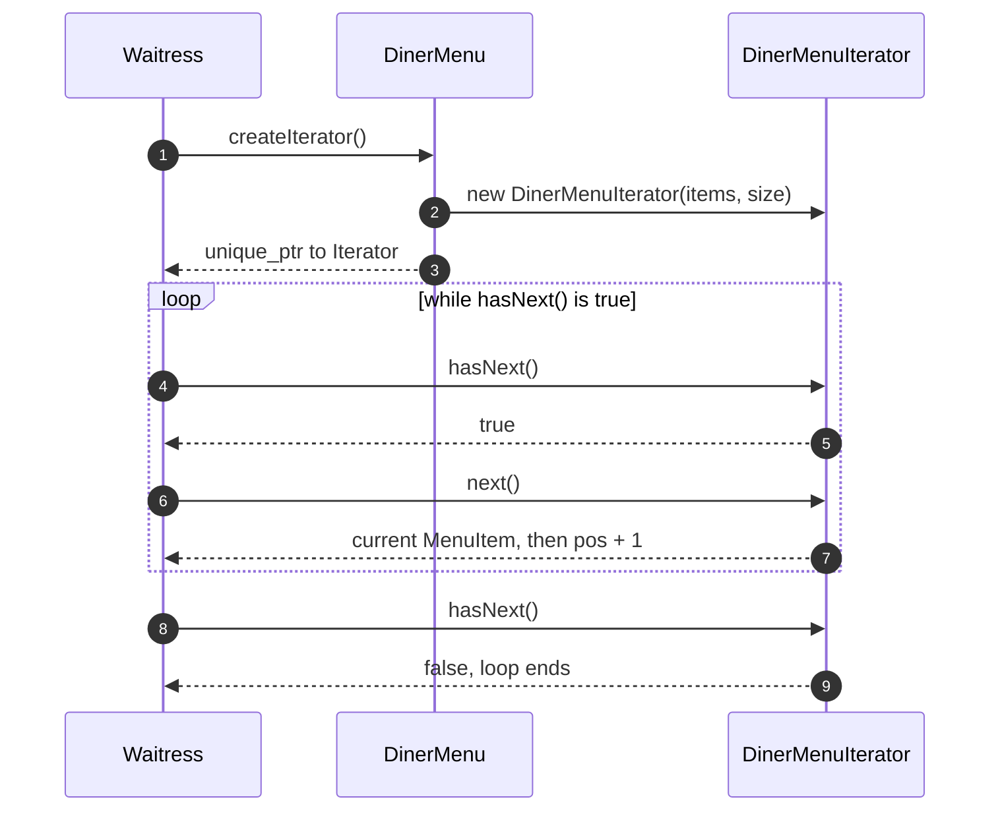

## Overview

Provides a way to **access elements of a collection sequentially** without exposing its underlying representation (array, linked list, tree, etc.).

**The problem without it**

1. `DinerMenu` keeps its items in a fixed array; `PancakeMenu` keeps them in a `std::vector`.
2. → The `Waitress` needs a different loop for each menu, written against each menu's internals.
3. → A menu changes its container and every loop that touched it breaks. A third menu means a third loop.

**The fix:** each collection hands out an **iterator**, a small object that remembers *where you are* and offers the same two methods, `hasNext()` and `next()`. The client walks any collection through that interface and never learns how the items are stored. Each iterator keeps its own position, so several traversals of one collection can run at the same time.

**What varies:** how the elements are stored and walked.

| Principle ([[Foundational Principles]]) | How Iterator applies it |
|---|---|
| Encapsulate what varies | Traversal moves out of the client and into an iterator object |
| Program to an interface | `Waitress` depends only on `Menu` and `Iterator`, never on an array or a vector |
| [[1 - Single Responsibility Principle\|Single Responsibility]] | The collection *stores* items, the iterator *walks* them. *Head First* introduces this principle in its Iterator chapter |

## Structure

```mermaid
classDiagram
    class Menu {
        <<interface>>
        +createIterator() Iterator*
    }
    class Iterator {
        <<interface>>
        +hasNext() bool*
        +next() MenuItem*
    }
    class DinerMenu {
        -MenuItem[] items
    }
    class PancakeMenu {
        -vector~MenuItem~ items
    }
    class DinerMenuIterator {
        -size_t pos
    }
    class PancakeMenuIterator {
        -size_t pos
    }
    class Waitress {
        +print(menu) void
    }
    Menu <|.. DinerMenu
    Menu <|.. PancakeMenu
    Iterator <|.. DinerMenuIterator
    Iterator <|.. PancakeMenuIterator
    DinerMenu ..> DinerMenuIterator : creates
    PancakeMenu ..> PancakeMenuIterator : creates
    Waitress ..> Menu : asks for iterator
    Waitress ..> Iterator : walks items
```



### Participants

| Role | Class in the example | Responsibility |
|---|---|---|
| Iterator | `Iterator` | Declares the traversal interface: `hasNext()`, `next()` |
| ConcreteIterator | `DinerMenuIterator`, `PancakeMenuIterator` | Keeps the current position for one storage layout |
| Aggregate | `Menu` | Declares `createIterator()`, a factory method for iterators |
| ConcreteAggregate | `DinerMenu`, `PancakeMenu` | Stores the items and returns the iterator that understands that storage |
| Client | `Waitress` | Walks any `Menu` using only the `Iterator` interface |

## How It Works

Scenario: the `Waitress` prints the `DinerMenu`.



1. The waitress asks the menu for an iterator. She doesn't know which concrete class she will get.
2. `DinerMenu` creates a `DinerMenuIterator` over its array, starting at position 0.
3. It returns the iterator as a plain `Iterator`.
4. `hasNext()` compares the position with the array size…
5. …and answers `true`.
6. `next()` asks for the current item…
7. …which comes back while the position moves forward by one.
8. Once the position reaches the end, `hasNext()`…
9. …returns `false` and the loop stops. `PancakeMenu` runs the exact same loop with a different iterator class.

### External vs internal iterators

| | External: the client drives | Internal: the collection drives |
|---|---|---|
| C++ | Iterators, range-`for` | `std::for_each(v.begin(), v.end(), f)` |
| C# | `IEnumerator<T>`, `foreach` | `List<T>.ForEach(action)` |
| Stop early, or compare two collections | Easy | Awkward |

GoF describes both kinds and calls external iterators the more flexible one: comparing two collections element by element is easy with them and nearly impossible with internal ones.

## When to Use

- When you want to traverse a collection without exposing its internals
- When you need multiple traversal algorithms over the same collection

Signals in your code:

- Client code indexes into another class's container (`menu.items[i]`) → give that class an iterator, or make it `IEnumerable<T>`.
- A class exposes its internal `List<T>` only so callers can loop → return `IEnumerable<T>` or `IReadOnlyList<T>` instead.
- Items must be streamed one at a time (file lines, database rows, paged API results) without loading them all → a lazy iterator (`yield return`).
- One structure needs several walking orders (a tree: in-order, pre-order, level-order) → one iterator per order. See [[Tree Traversals]].

```ad-note
In C++, the STL already implements the Iterator pattern extensively via `begin()`, `end()`, and range-based for loops. You rarely need to implement this from scratch in modern C++.
```

## C++ Example

The hand-rolled GoF version, using the *Head First* diner and pancake house menus:

```cpp
#include <cstddef>
#include <iostream>
#include <memory>
#include <string>
#include <vector>

struct MenuItem { std::string name; double price; };

class Iterator {                                   // Iterator
public:
    virtual ~Iterator() = default;
    virtual bool hasNext() const = 0;
    virtual const MenuItem& next() = 0;
};

class Menu {                                       // Aggregate
public:
    virtual ~Menu() = default;
    virtual std::unique_ptr<Iterator> createIterator() const = 0;
};

class DinerMenuIterator : public Iterator {        // knows how to walk a plain array
    const MenuItem* items;
    std::size_t count;
    std::size_t pos = 0;
public:
    DinerMenuIterator(const MenuItem* a, std::size_t n) : items(a), count(n) {}
    bool hasNext() const override { return pos < count; }
    const MenuItem& next() override { return items[pos++]; }
};

class DinerMenu : public Menu {                    // stores items in a fixed array
    MenuItem items[2] = {{"BLT", 2.99}, {"Soup", 3.29}};
public:
    std::unique_ptr<Iterator> createIterator() const override {
        return std::make_unique<DinerMenuIterator>(items, std::size(items));
    }
};

class PancakeMenuIterator : public Iterator {      // knows how to walk a std::vector
    const std::vector<MenuItem>& items;
    std::size_t pos = 0;
public:
    explicit PancakeMenuIterator(const std::vector<MenuItem>& v) : items(v) {}
    bool hasNext() const override { return pos < items.size(); }
    const MenuItem& next() override { return items[pos++]; }
};

class PancakeMenu : public Menu {                  // stores items in a std::vector
    std::vector<MenuItem> items{{"Pancakes", 2.99}, {"Waffles", 3.59}};
public:
    std::unique_ptr<Iterator> createIterator() const override {
        return std::make_unique<PancakeMenuIterator>(items);
    }
};

class Waitress {                                   // Client: sees only Menu and Iterator
public:
    void print(const Menu& menu) const {
        auto it = menu.createIterator();
        while (it->hasNext()) {
            const MenuItem& item = it->next();
            std::cout << item.name << "  " << item.price << '\n';
        }
    }
};
```

Usage, plus the STL form you would write in real code:

```cpp
int main() {
    DinerMenu diner;
    PancakeMenu pancakes;
    Waitress waitress;
    waitress.print(diner);      // array inside
    waitress.print(pancakes);   // vector inside, same loop

    // STL containers are aggregates already; range-for is the client loop
    std::vector<MenuItem> specials{{"Chili", 3.99}, {"Pie", 2.49}};
    for (const auto& item : specials)                              // what you write
        std::cout << item.name << '\n';
    for (auto it = specials.begin(); it != specials.end(); ++it)   // roughly what it becomes
        std::cout << it->name << '\n';
}
```

| GoF | C++ STL | .NET |
|---|---|---|
| `Aggregate::createIterator()` | `begin()` / `end()` | `IEnumerable<T>.GetEnumerator()` |
| `Iterator::hasNext()` | `it != end` | `MoveNext()` (advances, returns `false` at the end) |
| `Iterator::next()` | `*it`, then `++it` | `Current` (read after `MoveNext()`) |
| ConcreteIterator | `std::vector<T>::iterator`, … | The class the compiler generates for `yield return` |

```ad-warning
title: Iterator invalidation
Changing a container while you iterate over it can break the iterator. In C++, `push_back` on a `std::vector` inside a range-`for` may reallocate the storage, and using the old iterator afterwards is **undefined behavior**. Most .NET collections detect the change instead and throw `InvalidOperationException` ("Collection was modified").
```

## In .NET / C#

.NET builds the pattern into the language:

- **`IEnumerable<T>`** is the Aggregate. Its one method, `GetEnumerator()`, is `createIterator()`.
- **`IEnumerator<T>`** is the Iterator. `MoveNext()` advances and reports whether there is an element, `Current` returns it, `Dispose()` cleans up.
- **`foreach`** compiles to `GetEnumerator()`, a `while (e.MoveNext())` loop, and `Dispose()` in a `finally`. See [[IEnumerable and IEnumerator Interfaces]].
- **`yield return`** makes the compiler write the ConcreteIterator for you, as a hidden state-machine class. See [[Yield and State Machine]] and [[Iterator|C# iterator methods]].
- **LINQ** operators (`Where`, `Select`, …) are iterators wrapped around iterators. Nothing runs until something pulls elements: [[Deferred Execution in LINQ]].

```csharp
using System.Collections;

var menu = new DinerMenu();
foreach (var item in menu)                          // GetEnumerator, MoveNext, Current
    Console.WriteLine($"{item.Name} {item.Price}");

var cheap = menu.Where(i => i.Price < 3m);          // LINQ: nothing runs yet
Console.WriteLine(cheap.Count());                   // enumerates now: 1

public record MenuItem(string Name, decimal Price);

public class DinerMenu : IEnumerable<MenuItem>      // Aggregate
{
    private readonly MenuItem[] _items = { new("BLT", 2.99m), new("Soup", 3.29m) };

    public IEnumerator<MenuItem> GetEnumerator()    // createIterator()
    {
        foreach (var item in _items)
            yield return item;                      // compiler generates the iterator class
    }

    IEnumerator IEnumerable.GetEnumerator() => GetEnumerator();
}
```

```ad-tip
title: Where else you meet it
- **WPF**: `ItemsControl.ItemsSource` is typed `IEnumerable`. A `ListBox` or `DataGrid` walks whatever enumerable you give it.
- **ADO.NET**: [[DbDataReader]] is a forward-only cursor over result rows. `Read()` moves to the next row and returns `false` at the end, like `MoveNext()`.
- **Async streams**: `IAsyncEnumerable<T>` with `await foreach` iterates data that arrives over time. EF Core's `AsAsyncEnumerable()` and ASP.NET Core actions can stream results this way.
- `foreach` is pattern-based: any type with a public `GetEnumerator()` works, no interface needed. `List<T>.Enumerator` is a `struct`, so a loop over a variable typed `List<T>` allocates nothing (through `IEnumerable<T>` the enumerator gets boxed).
```

## Trade-offs

| Pros | Cons |
|---|---|
| Client code doesn't care how items are stored: swap an array for a list without touching a loop | Extra classes. For simple collections the language's built-in iterator support is enough |
| Several traversals at once, because each iterator keeps its own position | Modifying the collection mid-loop breaks the iterator |
| New traversal orders without changing the collection | Lazy iterators re-run on every enumeration, so a LINQ-to-EF query enumerated twice hits the database twice |
| Enables lazy and even infinite sequences | A virtual `hasNext()` / `next()` call per element is slower than an indexed loop in hot code |

```ad-warning
title: Common misuse: enumerating a lazy sequence twice
`var open = db.Orders.Where(o => o.IsOpen);` followed by `open.Count()` and `foreach (var o in open)` runs **two** SQL queries, and the two results can disagree. Materialize once with `ToList()` when you need the data more than once. See [[Immediate Execution in LINQ]].
```

## Related Patterns

- [[05 - Composite|Composite]]: iterators often walk Composite trees. *Head First* teaches the two in the same chapter.
- [[02 - Factory Method|Factory Method]]: `createIterator()` / `GetEnumerator()` is a factory method. Each collection decides which iterator class to create.
- [[09 - Memento|Memento]]: an iterator can save its position in a memento so a traversal can pause and resume (GoF).
- [[10 - Visitor|Visitor]]: often confused with Iterator. Iterator only *walks* the elements. Visitor *runs a type-specific operation* on each element, and often uses an iterator to reach them.

```ad-summary
- Iterator gives every collection the same "is there another one / give me the next one" interface, so clients loop without knowing the storage.
- Each iterator holds its own position, so traversals are independent and can run at the same time.
- C++ (`begin` / `end`, range-`for`) and .NET (`IEnumerable<T>`, `foreach`, `yield return`, LINQ) build it in. Hand-roll it only for custom structures.
- Watch for invalidation (modifying while iterating) and for enumerating lazy sequences more than once.
```
