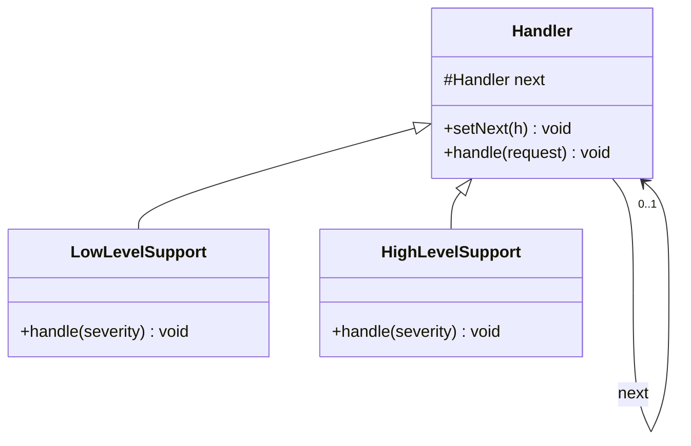
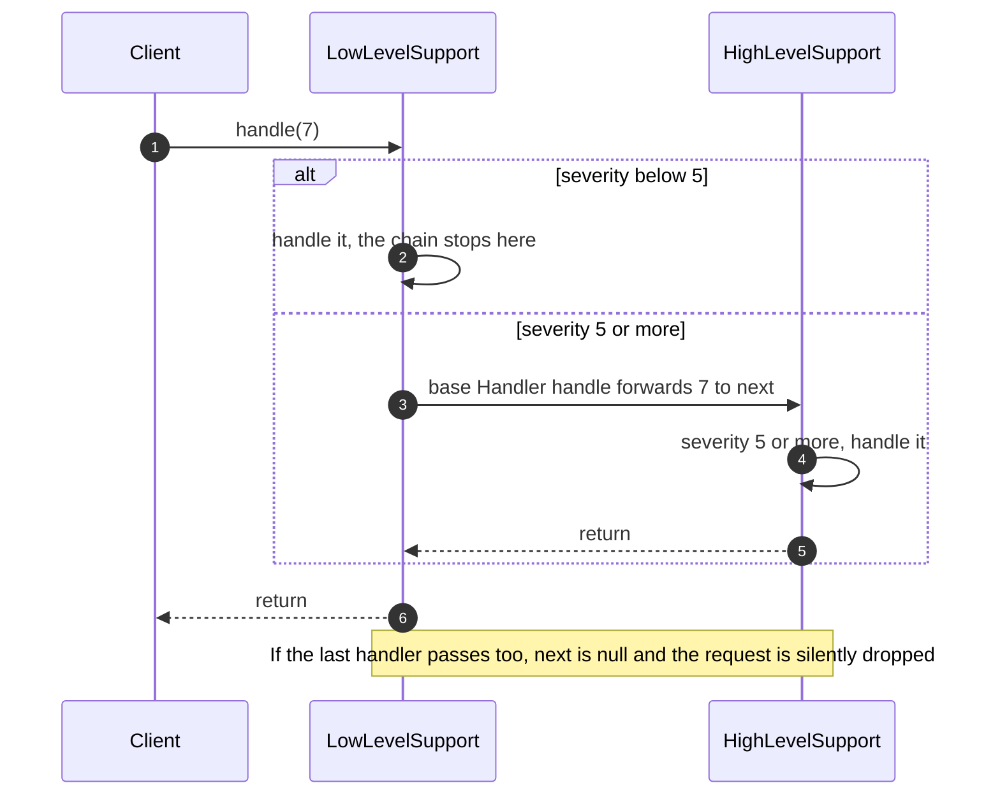

## Overview

Passes a request along a **chain of handlers**. Each handler decides either to process the request or to pass it to the next handler in the chain.

**The problem without it**

1. A support ticket arrives with a severity. The receiving code routes it itself: `if (severity < 5) low.handle(t); else high.handle(t);`
2. → The sender knows every support level and every routing rule.
3. → Adding a level or changing the escalation order means editing the sender, and every other place that copied the `if` ladder.

**The fix:** line the handlers up in a chain. The sender gives the request to the *first* handler and is done. Each handler knows only its successor. It either handles the request or passes it on.

**What varies:** which object handles a request, and in what order the candidates get a chance. The chain is assembled at runtime, so both can change without touching the sender.

| Principle | How the chain applies it |
|---|---|
| Loose coupling ([[Foundational Principles]]) | The sender knows only "a handler", never which one will act |
| [[2 - Open-Closed Principle\|Open-Closed]] | A new rule is a new handler linked into the chain, with no edits to existing handlers |
| [[1 - Single Responsibility Principle\|Single Responsibility]] | Each handler owns one rule or one step |

### Two variants

| | Classic chain (GoF) | Pipeline (middleware style) |
|---|---|---|
| Who handles the request | One handler: the first that can | Every handler does its part |
| When a handler calls `next` | Only when it can't handle the request | Always, unless it decides to stop (**short-circuit**) |
| Work after `next` returns | Rare | Common: timing, logging the response, cleanup |
| End of the chain | The request may be dropped silently | A terminal handler (the endpoint) produces the result |
| Examples | Support escalation, WPF routed events, WinForms `ProcessCmdKey` | ASP.NET Core middleware, `DelegatingHandler`, MVC filters, MediatR behaviors |

## Structure



### Participants

| Role | Class in the example | Responsibility |
|---|---|---|
| Handler | `Handler` | Holds the link to the successor (`next`), offers `setNext()`, and by default forwards `handle()` to `next` |
| ConcreteHandler | `LowLevelSupport` | Handles severity below 5, passes everything else on |
| ConcreteHandler | `HighLevelSupport` | Handles severity 5 and above, passes everything else on |
| Client | `main()` in the usage snippet | Builds the chain and sends each request to the first handler only |

## How It Works

Scenario: the chain is `LowLevelSupport → HighLevelSupport`, and the client sends a ticket with severity 7.



1. The client sends the request to the first handler only. It doesn't know who will end up handling it.
2. If the severity were below 5, `LowLevelSupport` would handle it and nothing else would happen.
3. Severity 7 is too high, so `LowLevelSupport` calls `Handler::handle`, which forwards to `next`.
4. `HighLevelSupport` checks: 7 is 5 or more, so it handles the ticket.
5. Control returns back along the chain…
6. …to the client. Nobody tells the client *which* handler acted. If it needs to know, `handle()` must return a result.

## When to Use

- When multiple objects may handle a request and the handler isn't known in advance
- When you want to decouple sender from receiver (e.g., middleware pipelines, event bubbling, logging levels)

Signals in your code:

- A growing `if / else if` ladder routes requests to different processors (approval limits, support tiers, file-format parsers) → each branch becomes a handler.
- The set or order of processors must change per configuration or at runtime → build the chain at startup.
- Several cross-cutting steps (logging, auth, validation, retry) wrap one core operation → the pipeline variant.
- An unhandled request should "bubble up" to a parent (UI controls, nested scopes) → chain along the parent links. See [[Event Bubbling]] for the browser version.

## C++ Example

```cpp
class Handler {
protected:
    Handler* next = nullptr;
public:
    virtual ~Handler() = default;   // fix: handlers are deleted through Handler pointers
    void setNext(Handler* h) { next = h; }
    virtual void handle(int request) {
        if (next) next->handle(request);
    }
};

class LowLevelSupport : public Handler {
public:
    void handle(int severity) override {
        if (severity < 5) { /* handle it */ }
        else Handler::handle(severity); // pass up the chain
    }
};

class HighLevelSupport : public Handler {
public:
    void handle(int severity) override {
        if (severity >= 5) { /* handle it */ }
        else Handler::handle(severity);
    }
};
```

Usage: a `std::vector` owns the handlers and the chain links are non-owning pointers.

```cpp
#include <cstddef>
#include <memory>
#include <vector>

int main() {
    std::vector<std::unique_ptr<Handler>> chain;
    chain.push_back(std::make_unique<LowLevelSupport>());
    chain.push_back(std::make_unique<HighLevelSupport>());
    for (std::size_t i = 0; i + 1 < chain.size(); ++i)
        chain[i]->setNext(chain[i + 1].get());    // low -> high

    chain.front()->handle(3);   // LowLevelSupport handles it
    chain.front()->handle(8);   // LowLevelSupport passes it on, HighLevelSupport handles it
}   // each unique_ptr<Handler> deletes a derived object through a base pointer
```

```ad-warning
title: Why the destructor fix matters
`std::unique_ptr<Handler>` destroys a `LowLevelSupport` through a `Handler*`. Without `virtual ~Handler()`, that is **undefined behavior**: the derived part's destructor never runs. Any polymorphic base class needs a public virtual destructor (or a protected non-virtual one, which forbids deleting through the base).
```

## In .NET / C#

Most chains you meet in .NET are the **pipeline** variant: each link does its part and calls the next.

- **ASP.NET Core middleware.** Each middleware receives `next` (a `RequestDelegate`), works on the request, calls `await next(context)`, then works on the response. Not calling `next` short-circuits the pipeline. See [[03 - The Request Pipeline -- Delegate Chain]], [[03 - Short-Circuiting]] and [[08 - Why Order Matters]].
- **`DelegatingHandler`.** The same idea for *outgoing* `HttpClient` calls. A handler overrides `SendAsync`, adds its behavior (auth header, retry, logging), and calls `base.SendAsync(request, cancellationToken)` to pass the request to its `InnerHandler`. You link it with `services.AddHttpClient("github").AddHttpMessageHandler<AuthHeaderHandler>()`, after registering the handler itself with `services.AddTransient<AuthHeaderHandler>()`. See [[11 - Why HttpClient Uses Singleton Registration|IHttpClientFactory]].
- **MVC filters.** Authorization → resource → action → exception → result filters wrap the action. A filter short-circuits by setting `context.Result`. See [[01 - Filter Pipeline]] and [[02 - Filters vs Middleware]].
- **MediatR pipeline behaviors.** An `IPipelineBehavior<TRequest, TResponse>` wraps every request handler for logging, validation or transactions, and calls `next` to continue.
- **Desktop, classic variant.** WPF routed events bubble from the clicked element up through its parents until a handler sets `e.Handled = true`. In WinForms, `Control.ProcessCmdKey` passes a shortcut key it doesn't handle to the parent control's `ProcessCmdKey`, and returning `true` stops it.

```csharp
var builder = WebApplication.CreateBuilder(args);
var app = builder.Build();

app.Use(async (context, next) =>          // link 1: logging, always passes on
{
    Console.WriteLine($"--> {context.Request.Path}");
    await next(context);                  // hand the request to the next link
    Console.WriteLine($"<-- {context.Response.StatusCode}");
});

app.Use(async (context, next) =>          // link 2: may short-circuit
{
    if (!context.Request.Headers.ContainsKey("X-Api-Key"))
    {
        context.Response.StatusCode = StatusCodes.Status401Unauthorized;
        return;                           // chain stops: later links never run
    }
    await next(context);
});

app.MapGet("/orders", () => new[] { "order-1", "order-2" });   // end of the chain

app.Run();
```

## Trade-offs

| Pros | Cons |
|---|---|
| The sender is decoupled from the receivers: it knows only the first link | No guarantee anyone handles the request. It can fall off the end silently |
| Add, remove or reorder handlers without touching the sender or the other handlers | Order matters, and the bugs are subtle: auth registered after the endpoint never protects it |
| Each handler stays small and testable alone | Hard to trace: no single place shows which handler acted, and stack traces get deep |
| The chain can be built from configuration at runtime | Each link adds a call. A link that points back into the chain recurses forever |

```ad-warning
title: Common misuse
- **A chain used as a lookup table.** If every handler only checks `request is SomeType`, a dictionary from type to handler is simpler and faster. That is a dispatcher, not a chain.
- **No terminal handler.** End the chain with a catch-all so unhandled requests fail loudly. ASP.NET Core does this for you: a request that falls off the end of the pipeline gets a 404.
- **Undocumented order.** If handler B silently relies on handler A running first, write that down where the chain is built.
```

## Related Patterns

- [[03 - Command]] (Command encapsulates a request as an object, Chain of Responsibility routes it through handlers)
- [[02 - Decorator|Decorator]]: same shape, since each object holds the next and forwards to it, but a different intent. A decorator *always* forwards and adds behavior. A chain handler may *stop* the request. ASP.NET Core middleware sits between the two: it wraps like a decorator and can short-circuit like a chain.
- [[05 - Composite|Composite]]: a chain often follows a Composite's parent links. A control that can't handle an event passes it to its container.
- [[08 - Mediator|Mediator]]: both decouple senders from receivers. A mediator is one central object that knows every colleague. A chain has no center: each link knows only the next.
- [[01 - Observer|Observer]]: Observer delivers a notification to *every* subscriber. A classic chain delivers a request to *one* handler, the first that accepts it.

```ad-summary
- The sender hands the request to the first handler. Each handler handles it or passes it to its successor.
- Classic variant: the first capable handler wins. Pipeline variant: every handler does its part and can short-circuit.
- In .NET you use it daily: middleware, `DelegatingHandler`, MVC filters, MediatR behaviors, routed events.
- Watch the order, add a terminal catch-all, and prefer Decorator when every link must always run.
```
