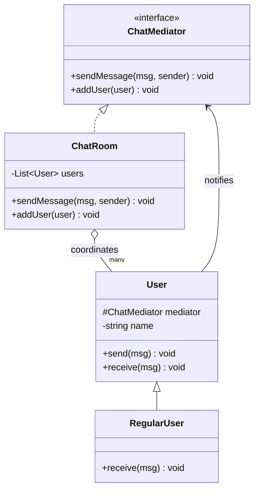
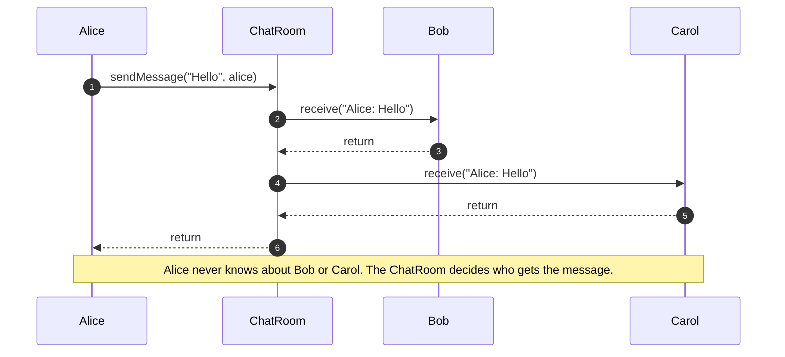

## Overview

Defines an object that **encapsulates how a set of objects interact**. Promotes loose coupling by keeping objects from referring to each other explicitly.

**The problem without it**

1. A dialog box has a checkbox, a text field, and a button. The checkbox enables the text field, which validates input and enables the button.
2. → Every widget holds references to every other widget it affects and calls their methods directly.
3. → Adding a new widget means editing every existing widget that interacts with it. The n-to-n wiring becomes a tangled web that is impossible to reuse or test in isolation.

**The fix:** introduce a single **mediator** (the dialog class itself, or a chat room, or a control tower) that all participants know. When a participant changes, it notifies the mediator. The mediator holds the coordination logic and tells the other participants what to do. No participant knows about any other participant.

**What varies:** how colleagues interact and which rules govern their coordination.

| Principle ([[Foundational Principles]]) | How Mediator applies it |
|---|---|
| Encapsulate what varies | Interaction logic moves into the mediator, out of the individual objects |
| Loose coupling | Colleagues know only the mediator interface, never each other |
| [[1 - Single Responsibility Principle\|Single Responsibility]] | Each colleague handles its own behavior; the mediator handles the coordination |

## Structure



### Participants

| Role | Class in the example | Responsibility |
|---|---|---|
| Mediator | `ChatMediator` | Declares the interface for communication between colleagues |
| ConcreteMediator | `ChatRoom` | Knows all colleagues and implements the coordination logic (who receives which messages) |
| Colleague | `User` | Knows only its mediator; communicates with other colleagues through it, never directly |
| ConcreteColleague | `RegularUser` | Implements `receive()` to display incoming messages |

## How It Works

Scenario: `Alice` sends a message through the `ChatRoom`. The room relays it to every other user.



1. Alice calls `send("Hello")`, which forwards to `mediator->sendMessage("Hello", this)`. Alice talks to the room, not to any person.
2. The `ChatRoom` iterates over its user list.
3. For each user that is not the sender, it calls `receive()`. Bob gets the message.
4. Carol gets the same message.
5. Control returns to Alice. She interacted with zero colleagues directly.
6. If a new user joins later, only `ChatRoom::addUser()` changes. Alice, Bob, and Carol are untouched.

### Direct coupling vs Mediator

| | Direct coupling | With Mediator |
|---|---|---|
| Dependencies | Every object references every object it talks to (n * n) | Every object references one mediator (n * 1) |
| Adding a participant | Edit every existing participant that needs to talk to it | Register it with the mediator; edit only the mediator's logic |
| Reusability | Objects are locked to the ensemble they were wired into | Objects are reusable: swap the mediator to change the interaction |
| Danger | None (coupling is explicit) | The mediator can become a God Object that knows too much |

## When to Use

- When a set of objects communicate in complex but well-defined ways (e.g., a chat room, an air traffic control tower, a dialog box coordinating its widgets)
- When reusing an object is hard because it refers to and communicates with many others
- When behavior distributed among several classes should be customizable without subclassing everything

Signals in your code:

- A class holds references to several siblings and calls their methods when its own state changes → it is doing the mediator's job. Extract that logic into a mediator.
- Adding one participant forces edits in multiple other participants → the interaction rules are scattered. Centralize them.
- You want to swap the coordination rules (regular chat vs moderated chat) without touching the participants → inject a different mediator.
- A UI form's widgets have complex enable/disable/validate dependencies → make the form the mediator. WinForms `Form` and WPF `Window` naturally play this role.

## C++ Example

A chat room where users communicate only through the mediator:

```cpp
#include <algorithm>
#include <iostream>
#include <memory>
#include <string>
#include <vector>

class User;                                            // forward declaration

class ChatMediator {                                   // Mediator
public:
    virtual ~ChatMediator() = default;
    virtual void sendMessage(const std::string& msg, const User* sender) = 0;
    virtual void addUser(User* user) = 0;
};

class User {                                           // Colleague
protected:
    ChatMediator* mediator;
    std::string name;
public:
    User(ChatMediator* m, std::string n) : mediator(m), name(std::move(n)) {}
    virtual ~User() = default;
    const std::string& getName() const { return name; }
    virtual void send(const std::string& msg) {
        mediator->sendMessage(msg, this);              // talks to the mediator, never to peers
    }
    virtual void receive(const std::string& msg) = 0;
};

class RegularUser : public User {                      // ConcreteColleague
public:
    using User::User;
    void receive(const std::string& msg) override {
        std::cout << name << " received: " << msg << '\n';
    }
};

class ChatRoom : public ChatMediator {                 // ConcreteMediator
    std::vector<User*> users;
public:
    void addUser(User* user) override { users.push_back(user); }
    void sendMessage(const std::string& msg, const User* sender) override {
        for (User* u : users) {
            if (u != sender)                           // everyone except the sender
                u->receive(sender->getName() + ": " + msg);
        }
    }
};
```

Usage:

```cpp
int main() {
    ChatRoom room;

    RegularUser alice(&room, "Alice");
    RegularUser bob(&room,   "Bob");
    RegularUser carol(&room, "Carol");

    room.addUser(&alice);
    room.addUser(&bob);
    room.addUser(&carol);

    alice.send("Hello everyone!");   // Bob received: Alice: Hello everyone!
                                     // Carol received: Alice: Hello everyone!
    bob.send("Hey Alice!");          // Alice received: Bob: Hey Alice!
                                     // Carol received: Bob: Hey Alice!
}
```

| GoF term | In the example | .NET analogue |
|---|---|---|
| Mediator | `ChatMediator` | `IMediator` (MediatR), `Hub` (SignalR) |
| ConcreteMediator | `ChatRoom` | `Hub<T>` subclass, the `Form` / `Window` class |
| Colleague | `User` | A service that sends via `IMediator`, a SignalR client |
| `notify` / `sendMessage` | `mediator->sendMessage(msg, this)` | `_mediator.Send(cmd)`, `Clients.Others.SendAsync()` |

````ad-warning
title: The God Object trap
As colleagues grow, the mediator tends to absorb more and more logic. If the mediator knows *how* each colleague works internally — not just *what* to tell them — it has become a **God Object**. Keep the mediator thin: it routes and coordinates; colleagues own their own behavior. If the mediator class is hundreds of lines long, split it into several focused mediators or use events internally.
````

## In .NET / C#

.NET has many built-in mediators, though they aren't always called by that name:

- **MediatR library.** `IMediator.Send(request)` dispatches a request to a single handler. `IMediator.Publish(notification)` broadcasts to all handlers. The calling code never references the handler class. Pipeline behaviors (logging, validation) wrap the handler call, combining Mediator with [[07 - Chain of Responsibility|Chain of Responsibility]].
- **SignalR `Hub`.** Clients don't talk to each other directly. A client sends a message to the `Hub`, and the `Hub` relays it to other clients via `Clients.All`, `Clients.Others`, or `Clients.Group(name)`. The `Hub` is the mediator; connected clients are the colleagues.
- **WinForms / WPF.** The `Form` or `Window` class acts as a mediator between its controls. A checkbox's `CheckedChanged` handler in the form enables or disables a text box. The checkbox and text box don't know each other — the form coordinates them.
- **MVVM `Messenger`.** In MVVM Toolkit, `WeakReferenceMessenger.Default.Send<TMessage>()` broadcasts to registered recipients. View-models subscribe and react without referencing each other.

```csharp
using MediatR;

// --- Request and handler: colleagues that never reference each other ---

public record PlaceOrderCommand(string Product, int Qty) : IRequest<string>;

public class PlaceOrderHandler : IRequestHandler<PlaceOrderCommand, string>
{
    public Task<string> Handle(PlaceOrderCommand cmd, CancellationToken ct)
    {
        // validate, save to database, etc.
        return Task.FromResult($"Order placed: {cmd.Qty}x {cmd.Product}");
    }
}

// --- The caller uses the mediator, never the handler ---

public class OrderController
{
    private readonly IMediator _mediator;
    public OrderController(IMediator mediator) => _mediator = mediator;

    public async Task<string> Post(string product, int qty)
    {
        // The controller sends through the mediator.
        // It has no idea which class handles the command.
        return await _mediator.Send(new PlaceOrderCommand(product, qty));
    }
}

// Registration (one line wires everything):
// services.AddMediatR(cfg =>
//     cfg.RegisterServicesFromAssemblyContaining<PlaceOrderHandler>());
```

```ad-tip
title: Where else you meet it
- **`SynchronizationContext`.** At a lower level, `SynchronizationContext.Post` mediates between a background thread and the UI thread, routing work through a central queue so neither side needs to know about the other.
- **`IEventAggregator` (Prism).** A publish/subscribe hub for loosely coupled modules. Publishers fire events; subscribers react. The aggregator is the mediator.
- **`BackgroundService` coordination.** When several hosted services must respond to the same event (e.g., config reload), `IMediator.Publish(notification)` is cleaner than injecting each service into the others.
- **`System.Windows.Interop.HwndSource`.** Mediates between Win32 messages and WPF's visual tree. Neither side knows the other's details.
```

## Trade-offs

| Pros | Cons |
|---|---|
| Colleagues are decoupled: they know only the mediator, never each other | The mediator centralizes complexity and can become a God Object |
| Changing coordination logic means editing one class, not n classes | Adding a simple direct call between two objects becomes an indirect round-trip through the mediator |
| Colleagues are independently reusable and testable | Debugging is harder: you must trace through the mediator to see who ends up handling what |
| New colleagues can be added without touching existing ones | A mediator that triggers other mediators can create hard-to-follow call chains |

````ad-warning
title: Common misuse
- **Using Mediator to hide coupling.** If two services always appear together and the mediator just relays between them, you have indirection without decoupling. A direct dependency is simpler and easier to trace.
- **Too many message types.** If the mediator handles dozens of unrelated message types, the system is harder to understand than direct calls would have been. Group related interactions or use separate mediators per bounded context.
````

## Related Patterns

- [[01 - Observer|Observer]]: both decouple senders from receivers. Observer lets each subscriber register directly and receive notifications; Mediator routes all communication through a central object. A mediator often *uses* Observer internally (colleagues subscribe to mediator events).
- [[07 - Chain of Responsibility|Chain of Responsibility]]: both decouple senders from receivers. A chain has no center — each link knows only the next. A mediator is one central hub that knows every colleague.
- [[03 - Facade|Facade]]: both simplify interaction with a subsystem. A Facade gives the *outside* a simpler interface but doesn't change how the inside communicates. A Mediator changes how the *inside* communicates — the objects talk through it instead of directly.
- [[03 - Command|Command]]: requests passed through a mediator can be wrapped in Command objects, making them queueable and undoable. MediatR does exactly this: each `IRequest<T>` is a Command dispatched by the Mediator.

```ad-summary
- Mediator centralizes complex many-to-many communication between objects so they don't reference each other directly.
- Each colleague knows only the mediator interface; the mediator knows all colleagues and holds the coordination rules.
- In .NET: MediatR dispatches commands and notifications, SignalR `Hub` relays real-time messages, WinForms/WPF forms coordinate their controls, and MVVM Messenger connects view-models.
- Watch for the God Object trap: if the mediator grows fat with colleague-specific logic, split it or push behavior back into the colleagues.
```
