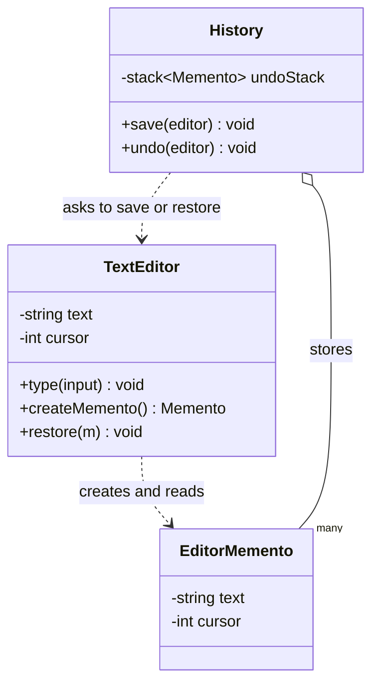
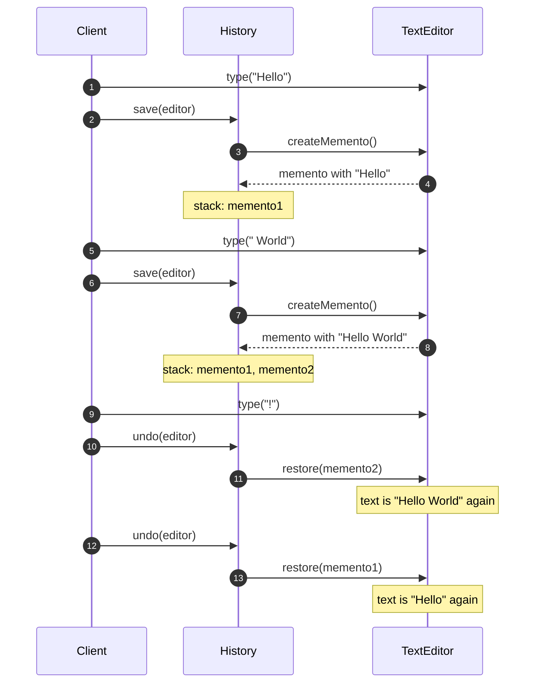

## Overview

Captures and externalizes an object's **internal state** so it can be **restored later**, without violating encapsulation.

**The problem without it**

1. A text editor needs undo. You make all its fields (`text`, `cursorPos`, `selectionStart`) public so an external undo manager can read and write them.
2. → The undo manager is tightly coupled to every field of the editor. Any refactoring of the editor's internals forces changes in the undo manager.
3. → Making fields public lets *any* code modify the editor's state, breaking invariants. Encapsulation is gone.

**The fix:** the editor creates a **memento**, a snapshot object that holds a copy of its own state. The editor is the only class that can read from or write to a memento — the outside world treats it as an opaque token. A **caretaker** (the undo manager) stores mementos and hands them back when undo is requested, but never peeks inside them.

**What varies:** the internal state that needs to be saved and restored.

| Principle ([[Foundational Principles]]) | How Memento applies it |
|---|---|
| Encapsulate what varies | The state that changes is captured inside an opaque snapshot object |
| Don't talk to strangers | The caretaker never reaches into the originator's internals — it holds a sealed token |
| [[1 - Single Responsibility Principle\|Single Responsibility]] | The originator manages its own state; the caretaker manages the history |

## Structure



### Participants

| Role | Class in the example | Responsibility |
|---|---|---|
| Originator | `TextEditor` | Creates a memento containing a snapshot of its current state; restores its state from a memento |
| Memento | `EditorMemento` | Stores the originator's internal state. Opaque to everyone except the originator |
| Caretaker | `History` | Keeps a stack of mementos. Never inspects or modifies their contents |

### Wide vs narrow interface

GoF describes two interfaces for the memento:

| | Wide interface (for the Originator) | Narrow interface (for the Caretaker) |
|---|---|---|
| Who uses it | The class that created the memento | Everyone else |
| Access | Full: can read every saved field | None: can only store and pass back the memento |
| Purpose | Restore internal state exactly | Carry the token without knowing what is inside |
| C++ technique | `friend class` or nested class | Return a base class or an opaque pointer |
| C# technique | Nested private class implementing a public marker interface | The caretaker sees only `IMemento` |

## How It Works

Scenario: the user types in a `TextEditor`, saves two snapshots, then undoes twice.



1. The client types "Hello". The editor's state is `{text: "Hello", cursor: 5}`.
2. Save: the `History` asks the editor for a memento.
3. The editor creates an `EditorMemento` containing a copy of its text and cursor position, and returns it. The History pushes it onto its stack without inspecting it.
4. The client types " World". Another save pushes a second memento.
5. The client types "!". Text is "Hello World!" — but this state was never saved.
6. Undo: the History hands the most recent memento back to `restore()`. The editor replaces its state with the values from the memento. Text is "Hello World" again.
7. Another undo restores "Hello". The History never knew what was inside either memento.

## When to Use

- Undo mechanisms
- Saving game state
- Snapshots
- Transaction rollback

Signals in your code:

- You expose internal fields as `public` just so something external can save and restore them → make the class create its own snapshot.
- An undo feature stores copies of individual fields scattered across the undo manager → bundle them into a memento.
- You serialize an object to JSON for rollback but deserialize it in a different class that then pokes private state back in → the originator should own both directions.
- A wizard or multi-step form needs a "Back" button that restores the previous step's state → save a memento at each step.

```ad-note
GoF treats Memento as a way to capture state *without breaking encapsulation*. If your language has built-in serialization (C# `JsonSerializer`, `[Serializable]`), you can serialize the whole object as the memento — but you lose compile-time control over which fields are included. The explicit memento gives you a defined contract.
```

## C++ Example

A text editor with undo, using a nested class for the memento:

```cpp
#include <iostream>
#include <memory>
#include <stack>
#include <string>

class TextEditor {                                     // Originator
public:
    class Memento {                                    // opaque snapshot
        friend class TextEditor;                       // only TextEditor can read
        std::string text;
        std::size_t cursor;
        Memento(std::string t, std::size_t c) : text(std::move(t)), cursor(c) {}
    public:
        // narrow interface: the outside world can hold a Memento but not read it
    };

    void type(const std::string& input) {
        text += input;
        cursor = text.size();
    }

    std::unique_ptr<Memento> createMemento() const {   // save snapshot
        // uses new instead of make_unique: Memento's constructor is private
        return std::unique_ptr<Memento>(new Memento(text, cursor));
    }

    void restore(const Memento& m) {                   // restore from snapshot
        text = m.text;
        cursor = m.cursor;
    }

    void print() const {
        std::cout << "Text: \"" << text << "\"  cursor: " << cursor << '\n';
    }

private:
    std::string text;
    std::size_t cursor = 0;
};

class History {                                        // Caretaker
    std::stack<std::unique_ptr<TextEditor::Memento>> undoStack;
public:
    void save(const TextEditor& editor) {
        undoStack.push(editor.createMemento());
    }
    void undo(TextEditor& editor) {
        if (undoStack.empty()) return;
        editor.restore(*undoStack.top());              // restore first, then pop
        undoStack.pop();
    }
};
```

Usage:

```cpp
int main() {
    TextEditor editor;
    History history;

    editor.type("Hello");
    history.save(editor);           // snapshot: "Hello"
    editor.print();                 // Text: "Hello"  cursor: 5

    editor.type(" World");
    history.save(editor);           // snapshot: "Hello World"
    editor.print();                 // Text: "Hello World"  cursor: 11

    editor.type("!");
    editor.print();                 // Text: "Hello World!"  cursor: 12

    history.undo(editor);           // restore "Hello World"
    editor.print();                 // Text: "Hello World"  cursor: 11

    history.undo(editor);           // restore "Hello"
    editor.print();                 // Text: "Hello"  cursor: 5
}
```

| GoF term | In the example | Key detail |
|---|---|---|
| Originator | `TextEditor` | Creates and reads from `Memento` via the wide interface (`friend`) |
| Memento | `TextEditor::Memento` | Nested class; `friend` gives the editor the wide interface; public section is empty |
| Caretaker | `History` | Stores `unique_ptr<Memento>` on a stack, never reads the fields |

````ad-warning
title: Memory cost
Every memento is a full copy of the originator's state. If the state is large (a full document, a game world), frequent snapshots consume significant memory. Mitigations:
- **Incremental snapshots**: store only what changed (a diff or a [[03 - Command|Command]] that can undo itself).
- **Limit history depth**: keep the last N mementos and discard older ones.
- **Compress or serialize** the snapshot to reduce its footprint.
- **Copy-on-write**: share unchanged parts between snapshots and copy them only when they are modified.
````

## In .NET / C#

.NET doesn't ship a `Memento` interface, but the pattern appears under many names:

- **Serialization as memento.** `JsonSerializer.Serialize(obj)` creates a string snapshot; `Deserialize<T>(json)` restores it. Quick and flexible, but you lose the compile-time narrow interface — any code with the string can deserialize.
- **Entity Framework change tracking.** EF captures the original values of every loaded entity. `context.Entry(entity).OriginalValues` is the memento. `context.Entry(entity).Reload()` restores the entity to its database state.
- **`DataTable.RejectChanges()`.** The `DataTable` keeps an original copy of every modified row. `RejectChanges()` restores all rows to their last `AcceptChanges()` state — a built-in undo.
- **`TransactionScope`.** In a broader sense, a database transaction captures "before" state. On `Dispose()` without `Complete()`, the transaction rolls back, restoring the data.

```csharp
// Memento via nested class and a marker interface

public interface IMemento { }              // narrow interface: caretaker holds this, cannot read it

public class TextEditor                    // Originator
{
    private string _text = "";
    private int _cursor;

    private class EditorMemento : IMemento // wide interface: only TextEditor can read
    {
        internal string Text { get; }
        internal int Cursor { get; }
        internal EditorMemento(string text, int cursor)
        {
            Text = text;
            Cursor = cursor;
        }
    }

    public void Type(string input)
    {
        _text += input;
        _cursor = _text.Length;
    }

    public IMemento Save() => new EditorMemento(_text, _cursor);

    public void Restore(IMemento memento)
    {
        var m = (EditorMemento)memento;    // only this class can cast to the private type
        _text = m.Text;
        _cursor = m.Cursor;
    }

    public override string ToString() => $"\"{_text}\" (cursor {_cursor})";
}

// --- Caretaker ---

var editor = new TextEditor();
var history = new Stack<IMemento>();

editor.Type("Hello");
history.Push(editor.Save());

editor.Type(" World");
history.Push(editor.Save());

editor.Type("!");
Console.WriteLine(editor);            // "Hello World!" (cursor 12)

editor.Restore(history.Pop());
Console.WriteLine(editor);            // "Hello World" (cursor 11)

editor.Restore(history.Pop());
Console.WriteLine(editor);            // "Hello" (cursor 5)
```

```ad-tip
title: Where else you meet it
- **`IEditableObject`.** `BeginEdit()` saves state (memento), `CancelEdit()` restores it, `EndEdit()` discards the snapshot. `DataGridView` uses this to let a user cancel row edits.
- **WPF `TextBoxBase.Undo()`.** Text controls maintain an undo stack internally. Each edit pushes a memento; `Ctrl+Z` pops it.
- **Immutable objects as natural mementos.** C# `record` types are natural snapshots: `with` creates a modified copy, and the original copy is the memento. No separate memento class needed.
- **`System.Transactions.TransactionScope`.** Enlists resources, captures their state, and rolls back automatically on failure. Each enlisted resource creates its own internal snapshot.
```

## Trade-offs

| Pros | Cons |
|---|---|
| Preserves encapsulation: the caretaker never touches the originator's internals | Each snapshot copies the full state, which can be expensive in memory |
| Simple undo/redo: push to save, pop to undo | The originator must define what "state" means — omit a field and the restore is incomplete |
| The caretaker is generic: it works with any originator that produces mementos | In languages without `friend` or nested private classes, enforcing the narrow interface takes extra work |
| Snapshots are independent: you can branch, compare, or persist them | Frequent saves on a large object can dominate allocation and GC pressure |

````ad-warning
title: Common misuse
- **Storing references instead of copies.** A memento that holds a reference to a mutable `List<T>` does not capture the list's state — it shares it. Mutations after the snapshot corrupt the "saved" state. Always deep-copy mutable data into the memento.
- **Using Memento when Command undo is cheaper.** If each operation has a known inverse (insert text → delete text, move +5 → move -5), storing a [[03 - Command|Command]] that can `undo()` itself uses far less memory than a full-state snapshot. Reserve Memento for cases where the state change is complex, opaque, or not reversible by a simple inverse.
````

## Related Patterns

- [[03 - Command|Command]]: Command can use Memento to store state for its undo operations. Alternatively, if each Command knows its own inverse, it doesn't need a memento at all. Choose Memento when the state change is complex; choose Command-based undo when each step has a clear reverse.
- [[06 - Iterator|Iterator]]: an iterator can save its position in a memento so a traversal can pause and resume (GoF). The memento captures the cursor's internal state without exposing the collection's structure.
- [[05 - Prototype|Prototype]]: both involve copying state. Prototype clones an entire object to get a new independent instance. Memento captures internal state for later *restoration*, not for creating a new usable object.
- [[04 - State|State]]: a memento can snapshot which `State` object the context holds, enabling undo of state transitions.

```ad-summary
- Memento captures an object's internal state in an opaque token so it can be restored later without breaking encapsulation.
- Three roles: the Originator creates and reads snapshots, the Memento holds the data, and the Caretaker stores the history without peeking inside.
- In .NET: serialization, EF change tracking, `DataTable.RejectChanges()`, `IEditableObject`, and `TransactionScope` all embody the pattern.
- Watch the memory cost: full-state snapshots on large objects add up. Use incremental diffs, Command-based undo, or capped history depth when needed.
```
