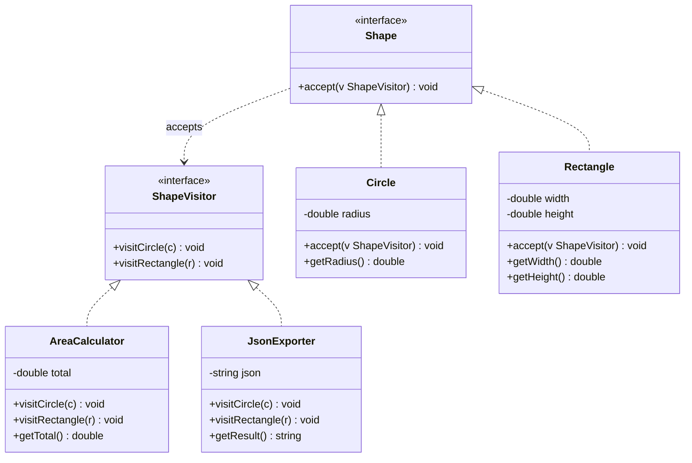
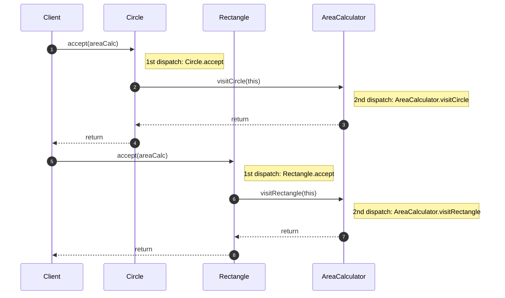

## Overview

Lets you **add new operations** to existing object structures without modifying the structures themselves.

Uses **double dispatch**: the object "accepts" a visitor, which then performs the operation. The combination of the element's type and the visitor's type determines what code runs — something a single virtual call cannot achieve alone.

**The problem without it**

1. A drawing app has `Circle`, `Rectangle`, and `Triangle` classes. You need to compute areas, so you add a `getArea()` method to each class.
2. → Now you need JSON export. You add `toJson()` to each class. Then SVG rendering. Then hit-testing. Each new operation means editing every shape class.
3. → The shape classes accumulate unrelated methods (area, JSON, SVG, hit-test), violating the [[1 - Single Responsibility Principle|Single Responsibility Principle]]. Adding a new operation requires touching stable, tested code.

**The fix:** define a **Visitor** interface with one `visit` method per element type. Each new operation is a new visitor class that implements all the `visit` methods. The element classes get a single `accept(Visitor&)` method that never changes. New operations are added without modifying the elements.

**What varies:** the operations performed on the elements. The element hierarchy stays stable.

| Principle ([[Foundational Principles]]) | How Visitor applies it |
|---|---|
| [[2 - Open-Closed Principle\|Open-Closed]] | New operations are new visitors, no edits to the element classes |
| [[1 - Single Responsibility Principle\|Single Responsibility]] | Each visitor groups one operation's logic for all element types in one place |
| Program to an interface | Elements depend on the `Visitor` interface, not on any concrete visitor |

## Structure



### Participants

| Role | Class in the example | Responsibility |
|---|---|---|
| Visitor | `ShapeVisitor` | Declares one `visit` method per element type |
| ConcreteVisitor | `AreaCalculator`, `JsonExporter` | Implements the operation for each element type |
| Element | `Shape` | Declares `accept(Visitor)` |
| ConcreteElement | `Circle`, `Rectangle` | Implements `accept()` by calling the visitor's type-specific method: `v.visitCircle(this)` |

## How It Works

Scenario: the client runs an `AreaCalculator` visitor over a `Circle` and a `Rectangle`.



1. The client calls `circle.accept(areaCalc)`. This is a virtual call that dispatches on the *element's* runtime type → **first dispatch**.
2. Inside `Circle::accept()`, the circle calls `v.visitCircle(*this)`. This is a virtual call that dispatches on the *visitor's* runtime type → **second dispatch**.
3. `AreaCalculator::visitCircle` runs. It can read the circle's public interface (`getRadius()`) and compute the area. The correct method for the pair (Circle, AreaCalculator) has been selected.
4. The same process repeats for `Rectangle`. The rectangle's `accept()` calls `v.visitRectangle(this)`, which dispatches to `AreaCalculator::visitRectangle`.
5. To add a new operation (e.g., JSON export), you write a new visitor class. No shape class is touched.

### Double dispatch explained

Languages like C++, C#, and Java use **single dispatch**: a virtual call selects the method based on the runtime type of *one* object — the one you call the method on. But `shape.computeWith(operation)` needs to dispatch on *both* the shape and the operation.

Visitor solves this with two consecutive virtual calls:

| Step | Call | Dispatches on |
|---|---|---|
| 1st dispatch | `shape.accept(visitor)` | The element's runtime type (Circle vs Rectangle) |
| 2nd dispatch | `visitor.visitCircle(this)` | The visitor's runtime type (AreaCalculator vs JsonExporter) |

The result: the correct method runs for every (element type, visitor type) combination without a single `if` or type check.

### The expression problem

Visitor's trade-off is the mirror image of standard polymorphism:

| | Add a new operation | Add a new element type |
|---|---|---|
| Virtual methods (no Visitor) | Hard: edit every element class to add the method | Easy: add a new subclass, implement existing methods |
| Visitor | Easy: write a new Visitor class | Hard: add a `visitNewType()` to every existing Visitor |

Visitor is the right choice when the element hierarchy is **stable** (shapes, AST node kinds, document parts) but new operations appear regularly. If new element types appear often, Visitor becomes a maintenance burden.

## When to Use

- When you have a stable class hierarchy but need to frequently add new operations on those classes (e.g., compiler AST nodes with multiple passes: type checking, code generation, optimization)
- When related operations are scattered across many classes and you want to gather them into one class
- When the element classes come from a library you cannot modify

Signals in your code:

- Multiple unrelated methods (`toJson()`, `toXml()`, `validate()`, `calculateCost()`) are being added to the same class hierarchy → each one becomes a visitor.
- You write `if (shape is Circle) ... else if (shape is Rectangle) ...` type-checking ladders to perform an operation → Visitor replaces the ladder with double dispatch.
- A tree or composite structure needs multiple traversal operations (print, serialize, analyze) → pair Visitor with [[06 - Iterator|Iterator]] or [[05 - Composite|Composite]].
- You must add behavior to classes you cannot edit (a third-party library) → a visitor works on any element that has `accept()`.

## C++ Example

A shape hierarchy with two visitors — area calculation and JSON export:

```cpp
#include <cmath>
#include <iostream>
#include <memory>
#include <string>
#include <vector>

class Circle;
class Rectangle;

class ShapeVisitor {                                   // Visitor
public:
    virtual ~ShapeVisitor() = default;
    virtual void visitCircle(const Circle& c) = 0;
    virtual void visitRectangle(const Rectangle& r) = 0;
};

class Shape {                                          // Element
public:
    virtual ~Shape() = default;
    virtual void accept(ShapeVisitor& v) const = 0;
};

class Circle : public Shape {                          // ConcreteElement
    double radius;
public:
    explicit Circle(double r) : radius(r) {}
    double getRadius() const { return radius; }
    void accept(ShapeVisitor& v) const override {
        v.visitCircle(*this);                          // second dispatch
    }
};

class Rectangle : public Shape {                       // ConcreteElement
    double width, height;
public:
    Rectangle(double w, double h) : width(w), height(h) {}
    double getWidth() const { return width; }
    double getHeight() const { return height; }
    void accept(ShapeVisitor& v) const override {
        v.visitRectangle(*this);                       // second dispatch
    }
};

class AreaCalculator : public ShapeVisitor {            // ConcreteVisitor
    double total = 0;
public:
    void visitCircle(const Circle& c) override {
        total += 3.14159265 * c.getRadius() * c.getRadius();
    }
    void visitRectangle(const Rectangle& r) override {
        total += r.getWidth() * r.getHeight();
    }
    double getTotal() const { return total; }
};

class JsonExporter : public ShapeVisitor {              // ConcreteVisitor
    std::string json = "[";
    bool first = true;
    void sep() { if (!first) json += ", "; first = false; }
public:
    void visitCircle(const Circle& c) override {
        sep();
        json += "{\"type\":\"circle\",\"r\":" + std::to_string(c.getRadius()) + "}";
    }
    void visitRectangle(const Rectangle& r) override {
        sep();
        json += "{\"type\":\"rect\",\"w\":" + std::to_string(r.getWidth())
              + ",\"h\":" + std::to_string(r.getHeight()) + "}";
    }
    std::string getResult() { json += "]"; return json; }
};
```

Usage: the client iterates a collection and runs any visitor without knowing the concrete types:

```cpp
int main() {
    std::vector<std::unique_ptr<Shape>> shapes;
    shapes.push_back(std::make_unique<Circle>(5.0));
    shapes.push_back(std::make_unique<Rectangle>(4.0, 6.0));
    shapes.push_back(std::make_unique<Circle>(3.0));

    AreaCalculator area;
    for (const auto& s : shapes)
        s->accept(area);                               // double dispatch per shape
    std::cout << "Total area: " << area.getTotal() << '\n';  // 130.97...

    JsonExporter json;
    for (const auto& s : shapes)
        s->accept(json);
    std::cout << json.getResult() << '\n';
    // [{"type":"circle","r":5.0}, {"type":"rect","w":4.0,"h":6.0}, {"type":"circle","r":3.0}]
}
```

| GoF term | In the example | .NET analogue |
|---|---|---|
| Visitor | `ShapeVisitor` | `ExpressionVisitor`, `CSharpSyntaxVisitor<T>` |
| ConcreteVisitor | `AreaCalculator`, `JsonExporter` | Your subclass of `ExpressionVisitor` |
| Element | `Shape` | `Expression`, `SyntaxNode` |
| ConcreteElement | `Circle`, `Rectangle` | `BinaryExpression`, `IfStatementSyntax` |
| `accept()` | `shape.accept(visitor)` | `expression.Accept(visitor)`, `node.Accept(visitor)` |

````ad-warning
title: Adding a new element type
If you add `Triangle` to the hierarchy, you must add `visitTriangle()` to `ShapeVisitor` and implement it in **every** existing visitor. The compiler will catch the missing overrides (pure virtual in C++, abstract in C#), but the effort grows with the number of visitors. This is the fundamental trade-off: Visitor favors stable type hierarchies.
````

## In .NET / C#

.NET uses Visitor in its expression tree and compiler infrastructure:

- **`System.Linq.Expressions.ExpressionVisitor`.** LINQ expression trees are immutable. To modify one (e.g., rewrite a query for a different provider), you subclass `ExpressionVisitor` and override `VisitBinary`, `VisitMethodCall`, etc. The base class walks the tree; you override only the node types you care about. See [[Deferred Execution in LINQ]].
- **Roslyn `CSharpSyntaxWalker`.** Walks a syntax tree, calling `VisitMethodDeclaration`, `VisitIfStatement`, etc. Override a method to inspect or collect data from that node type.
- **Roslyn `CSharpSyntaxRewriter`.** Like the walker, but returns a new (immutable) tree with modifications. Override a `Visit*` method, modify the node, and return it. The rewriter builds the new tree by composing the returned nodes.

```csharp
// Hand-written Visitor: the same shape example in C#

public interface IShapeVisitor
{
    void VisitCircle(Circle circle);
    void VisitRectangle(Rectangle rectangle);
}

public abstract class Shape
{
    public abstract void Accept(IShapeVisitor visitor);
}

public class Circle : Shape
{
    public double Radius { get; }
    public Circle(double radius) => Radius = radius;
    public override void Accept(IShapeVisitor visitor) => visitor.VisitCircle(this);
}

public class Rectangle : Shape
{
    public double Width { get; }
    public double Height { get; }
    public Rectangle(double w, double h) { Width = w; Height = h; }
    public override void Accept(IShapeVisitor visitor) => visitor.VisitRectangle(this);
}

public class AreaCalculator : IShapeVisitor
{
    public double Total { get; private set; }
    public void VisitCircle(Circle c) => Total += Math.PI * c.Radius * c.Radius;
    public void VisitRectangle(Rectangle r) => Total += r.Width * r.Height;
}

// Usage
Shape[] shapes = { new Circle(5), new Rectangle(4, 6), new Circle(3) };
var area = new AreaCalculator();
foreach (var s in shapes)
    s.Accept(area);
Console.WriteLine($"Total area: {area.Total:F2}");    // 130.97
```

```ad-tip
title: Where else you meet it
- **`ExpressionVisitor.Visit()`** is the `accept()` of the pattern. Each `Expression` node's `Accept()` calls back into the visitor's type-specific method. Override `VisitBinary` to rewrite `a + b` into `Add(a, b)`, for example.
- **Roslyn analyzers and code fixes.** Every custom analyzer subclasses `CSharpSyntaxWalker` or registers a `SyntaxNode` action. The analyzer visits specific node types (e.g., `IfStatementSyntax`) to report diagnostics.
- **`System.Text.Json.Nodes.JsonNode`.** While not a classic Visitor, the `JsonNode` hierarchy (JsonObject, JsonArray, JsonValue) often ends up being visited in a pattern-matched switch expression — a language-level alternative to the Visitor pattern.
- **Pattern matching as an alternative.** C# `switch` expressions with type patterns (`shape switch { Circle c => ..., Rectangle r => ... }`) achieve double dispatch at the language level. This works well for a few types but loses the "add operations without editing" benefit once the switch is duplicated.
```

## Trade-offs

| Pros | Cons |
|---|---|
| New operations are new classes, no edits to the element hierarchy | Adding a new element type means editing every visitor |
| All logic for one operation lives in one visitor class, not scattered across elements | Double dispatch adds indirection: harder to follow than a simple virtual call |
| The visitor can accumulate state as it walks the structure (e.g., a running total) | Elements must expose enough public interface for visitors to work, potentially weakening encapsulation |
| Works with [[05 - Composite|Composite]] trees: the visitor walks and operates in one pass | Overkill when the hierarchy changes often or has few operations |

````ad-warning
title: Common misuse
- **Visitor over an unstable hierarchy.** If new element types appear regularly, every new type forces edits to every visitor. In that situation, plain virtual methods or pattern matching is simpler.
- **Visitor as a replacement for virtual methods.** If you have one operation and it logically belongs on the element (e.g., `Draw()` on a shape), a virtual method is simpler. Visitor earns its complexity when you have multiple unrelated operations or when you cannot modify the element classes.
````

## Related Patterns

- [[06 - Iterator|Iterator]]: often confused with Visitor. Iterator only *walks* the elements. Visitor *runs a type-specific operation* on each element. They often work together: the iterator provides the traversal order, the visitor provides the operation.
- [[05 - Composite|Composite]]: Visitor is often applied to Composite structures (trees). Each node's `accept()` can recursively accept children, or the visitor can manage the traversal itself. See `ExpressionVisitor` for the self-managing approach.
- [[02 - Strategy|Strategy]]: both encapsulate an algorithm behind an interface. Strategy replaces one algorithm inside a single class. Visitor applies one algorithm across many classes via double dispatch.
- [[08 - Mediator|Mediator]]: if the visitor needs to coordinate results between elements during traversal, it acts like a small mediator, accumulating state that no single element can see.
- [[03 - Command|Command]]: each visit method is essentially a command for that element type. A visitor that records its operations can replay or undo them.

```ad-summary
- Visitor lets you add operations to a stable class hierarchy without modifying those classes, using double dispatch to select the right code for each element-visitor pair.
- The Visitor interface has one method per element type; each new operation is a new visitor class.
- In .NET: `ExpressionVisitor` rewrites LINQ trees, Roslyn's `CSharpSyntaxWalker` and `CSharpSyntaxRewriter` analyze and transform source code, and C# pattern matching offers a lighter-weight alternative for small hierarchies.
- The fundamental trade-off: easy to add operations, hard to add element types. Choose Visitor only when the type hierarchy is stable.
```
