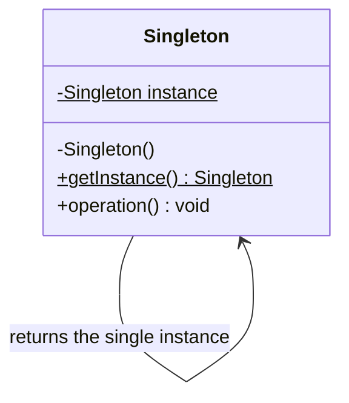
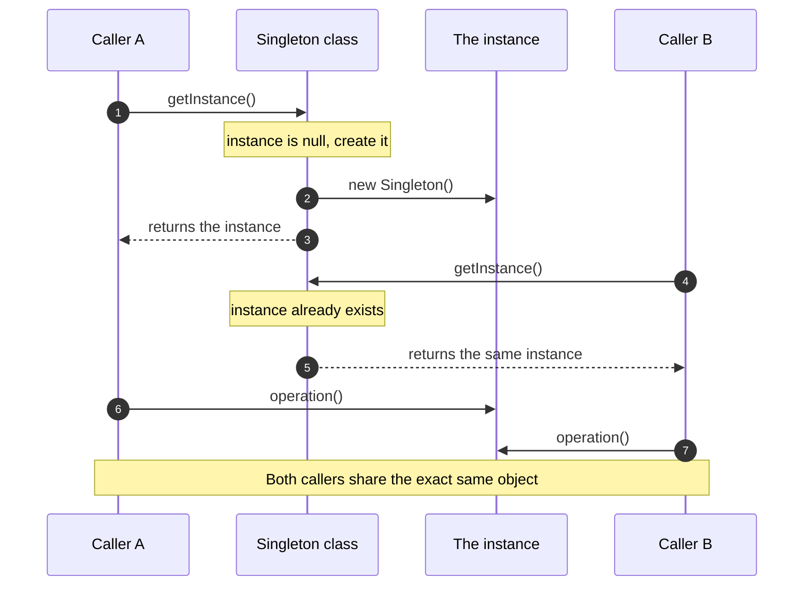

---
tags:
  - design
  - pattern
  - creational
  - singleton
---

## Overview

The Singleton pattern ensures a class has **only one instance** and provides a global point of access to it. The class itself is responsible for keeping track of its sole instance.

**The problem without it**

1. Several parts of the system create their own `Logger` or `ConfigManager` by calling `new` directly.
2. Each instance opens its own file handle or loads its own copy of configuration, wasting resources and potentially causing write conflicts.
3. There is no way to coordinate them: if the configuration changes at runtime, some objects see the old values and others the new.

**The fix:** the class hides its constructor and exposes a single static method, `getInstance()`. The first call creates the instance; every subsequent call returns the same one. All access goes through this single point, so the class controls its own lifecycle and there is never more than one.

**What varies:** nothing about the instance itself --- what varies is *access*: whether clients can create their own copies or must share the one the class provides.

| Principle ([[Foundational Principles]]) | How Singleton applies it |
|---|---|
| Encapsulate what varies | The "how many instances exist" decision is inside the class, hidden from callers |
| [[1 - Single Responsibility Principle\|Single Responsibility]] | Violated: the class manages both its business logic *and* its own lifecycle. This is a known trade-off |

## Structure



### Participants

| Role | Class in the example | Responsibility |
|---|---|---|
| Singleton | `Singleton` | Hides the constructor, holds the static instance, returns it via `getInstance()` |
| Client | `main()` or any calling code | Accesses the instance through `Singleton::getInstance()` only, never `new` |

## How It Works

Scenario: two callers request the singleton for the first time, then one uses it again.



1. Caller A calls `getInstance()` for the first time.
2. The static instance is null, so the class creates it.
3. The newly created instance is returned to Caller A.
4. Caller B calls `getInstance()`.
5. The instance already exists, so no construction happens.
6. Caller B receives the *same* object Caller A got.
7. Both callers operate on the same instance. Changes made by one are visible to the other.

## When to Use

- Logging --- a single logger avoids interleaved output and duplicated file handles
- Configuration / settings --- one config object ensures all parts of the system see the same values
- Thread pools --- one pool prevents accidental creation of competing pools
- Caches --- one cache avoids duplicated entries and wasted memory
- Any resource where having multiple instances would cause conflicts or waste

Signals in your code:

- You are passing the same object through many layers just so everyone can reach it --- a singleton can remove the parameter chain (but consider dependency injection first).
- Multiple `new X()` calls for something that should be shared, and you are fighting bugs where one copy has stale data.
- A class wraps an external resource (hardware, file, connection pool) that must not be opened twice.
- You added a global variable or a `static` field to another class and are accessing it everywhere --- you have an ad-hoc singleton without the lifecycle control.

```ad-warning
title: Singleton is often overused
Singleton introduces **global state**, makes **testing harder** (hard to mock or reset between tests), and **hides dependencies** (callers don't declare what they need). In most modern applications, prefer **dependency injection**: register the service as a singleton in the DI container (`services.AddSingleton<T>()` in .NET) and let the framework hand it to classes that need it. You get the "one instance" guarantee without the tight coupling.
```

## C++ Example

The classic GoF version with the linker-error fix:

```cpp
class Singleton {
private:
    static Singleton* instance;
    Singleton() {}                                  // private constructor
    Singleton(const Singleton&) = delete;           // no copies
    Singleton& operator=(const Singleton&) = delete;
public:
    static Singleton* getInstance() {
        if (!instance)
            instance = new Singleton();
        return instance;
    }
    void operation() { /* ... */ }
};

// Required: define the static member outside the class, or the linker errors
Singleton* Singleton::instance = nullptr;
```

````ad-danger
title: The linker error
Declaring `static Singleton* instance;` inside the class only *declares* the member. Without the definition `Singleton* Singleton::instance = nullptr;` in a `.cpp` file (or below the class in a single-file example), every translation unit that includes this header will get an **unresolved external symbol** / **undefined reference** linker error.
````

The classic version above is also **not thread-safe**: two threads can both see `instance == nullptr` and each create their own copy. The modern fix is the **Meyers' Singleton** --- a function-local `static` that C++11 guarantees is initialized exactly once, even under concurrent access:

```cpp
class Singleton {
private:
    Singleton() {}
    Singleton(const Singleton&) = delete;
    Singleton& operator=(const Singleton&) = delete;
public:
    static Singleton& getInstance() {
        static Singleton s;   // thread-safe since C++11, initialized once
        return s;
    }
    void operation() { /* ... */ }
};
```

Usage:

```cpp
int main() {
    // Classic pointer version
    Singleton* a = Singleton::getInstance();
    Singleton* b = Singleton::getInstance();
    // a == b: same pointer

    // Meyers' version (returns a reference)
    Singleton& x = Singleton::getInstance();
    x.operation();
}
```

| Approach | Thread-safe? | Lazy? | Leak risk | Notes |
|---|---|---|---|---|
| Classic `new` with null check | No | Yes | Yes: never deleted | Needs a mutex or `std::call_once` to be safe |
| Meyers' Singleton (local `static`) | Yes (C++11) | Yes | No: destroyed at program exit | Preferred in modern C++ |
| Eager init (global `static`) | Yes | No | No | Object created before `main()`, order across TUs is undefined |

````ad-warning
title: Destruction order
If Singleton A's destructor uses Singleton B, and B is destroyed first, you get **undefined behavior**. This is the "static initialization/destruction order fiasco". The Meyers' Singleton makes initialization safe but does not fully solve destruction order across singletons.
````

## In .NET / C#

C# offers several clean ways to implement Singleton, but the idiomatic .NET approach is to **let the DI container do it**:

```csharp
// --- Option 1: DI container (preferred) ---
builder.Services.AddSingleton<IConfigService, ConfigService>();
// The framework creates one instance and injects it everywhere.
// No Singleton pattern code needed. Testing: register a mock instead.

// --- Option 2: Manual Singleton (when DI is not available) ---
public sealed class ConfigService
{
    // Lazy<T> is thread-safe by default
    private static readonly Lazy<ConfigService> _instance =
        new(() => new ConfigService());

    private ConfigService() { /* load config */ }

    public static ConfigService Instance => _instance.Value;

    public string GetValue(string key) => /* ... */ "";
}

// Usage
var config = ConfigService.Instance;
```

````ad-tip
title: Where else you meet it
- **`HttpContext.Current`** (classic ASP.NET): a per-request singleton, stored in `CallContext`. In ASP.NET Core, `IHttpContextAccessor` replaces it via DI.
- **`Console`**, **`GC`**: static classes with no instances at all --- the extreme form of "one instance". They can't implement interfaces, which is why `ILogger` is preferred over a static logger.
- **`Lazy<T>`**: the framework type for thread-safe lazy initialization. `new Lazy<T>(() => new T())` is the one-liner Singleton.
- **`ThreadLocal<T>`**: one instance *per thread*, not one globally. Useful when thread-safety requires isolation (e.g., `Random` before .NET 6's `Random.Shared`).
- **`services.AddSingleton<T>()`**: the DI-managed singleton. The container creates one instance on first resolve and returns it for the app's lifetime. This is the recommended way in .NET.
````

## Trade-offs

| Pros | Cons |
|---|---|
| Guarantees a single instance of a class across the application | Introduces global state, making the program harder to reason about |
| Lazy initialization: created only when first needed | Hides dependencies: callers don't declare what they need via constructors |
| Provides a well-known access point | Hard to test: difficult to mock, reset, or substitute in unit tests |
| Can be extended to control the number of instances (multiton variant) | Violates SRP: the class manages both its domain logic and its own lifecycle |

````ad-warning
title: Common misuse
- **Using Singleton as a dumping ground.** A `GlobalState` singleton that holds user preferences, database connections, and caches is a **God Object**, not a pattern. Each responsibility should be its own class (possibly each registered as a singleton in DI).
- **Singletons that hold mutable shared state without synchronization.** If two threads write to the singleton's fields, you need locking. The pattern guarantees one *instance*, not thread-safe *access* to its members.
- **Singleton in libraries.** A library that forces a singleton on its consumers limits how they can use it. Prefer accepting dependencies via constructor parameters.
````

## Related Patterns

- [[02 - Factory Method|Factory Method]]: `getInstance()` is itself a factory method. Some singletons use a factory method to decide *which* subclass to instantiate.
- [[03 - Abstract Factory|Abstract Factory]]: an abstract factory is often implemented as a singleton, since a system typically needs only one factory per product family.
- [[04 - Builder|Builder]]: Builder can be combined with Singleton for step-by-step configuration of the single instance.
- [[03 - Facade|Facade]]: a Facade object is often a singleton, since only one simplified entry point is needed.
- [[04 - State|State]]: State objects are often singletons, since a finite set of states is shared across contexts.

```ad-summary
- Singleton ensures exactly one instance of a class and provides global access to it.
- In modern C++, use the Meyers' Singleton (function-local `static`) for thread-safe lazy creation. In .NET, prefer `services.AddSingleton<T>()` via DI over a manual implementation.
- The pattern trades testability and coupling for convenience. Use it for genuinely shared resources (loggers, configuration), not as a shortcut for global variables.
- The biggest risk is overuse: if you reach for Singleton and the real problem is "I don't want to pass this as a parameter", dependency injection is the better tool.
```
