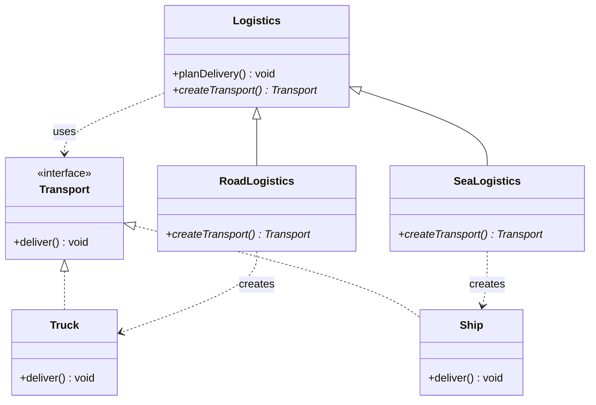
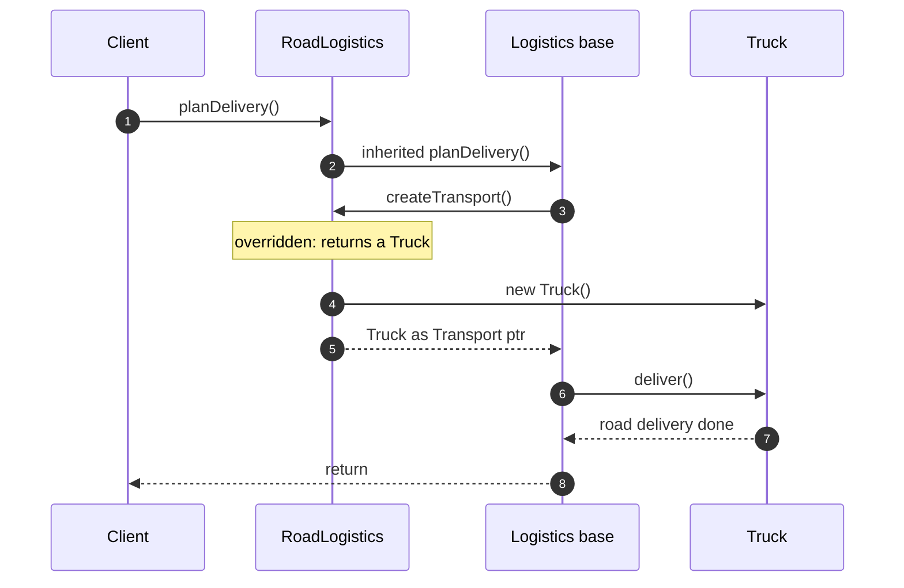

---
tags:
  - design
  - pattern
  - creational
  - factory-method
aliases: [Virtual Constructor]
---

## Overview

The Factory Method pattern defines an interface for creating an object, but lets **subclasses decide** which class to instantiate. The creator class has a method that returns a product, and subclasses override this method to produce different products.

**The problem without it**

1. `Logistics::planDelivery()` calls `new Truck()` directly whenever it needs to ship something.
2. Adding sea delivery means editing `planDelivery()` with `if (type == "sea") new Ship(); else new Truck();` --- and every other place that creates transports.
3. A third delivery mode (drone, rail) means more branches, more edits, and the creation logic is tangled with the delivery logic.

**The fix:** move the `new` call into a method --- `createTransport()` --- that subclasses override. `RoadLogistics` returns a `Truck`, `SeaLogistics` returns a `Ship`. The base class calls `createTransport()` without knowing which product it gets, then works with it through the `Transport` interface. Adding a new transport means writing a new creator subclass, not editing existing code.

**What varies:** which concrete product class is instantiated. The factory method isolates that decision into one overridable point.

| Principle ([[Foundational Principles]]) | How Factory Method applies it |
|---|---|
| [[2 - Open-Closed Principle\|Open-Closed]] | A new product is a new subclass; existing creators and products are untouched |
| Program to an interface | The creator works with `Transport`, never with `Truck` or `Ship` directly |
| Encapsulate what varies | The object-creation decision is encapsulated in one method |
| [[5 - Dependency Inversion Principle\|Dependency Inversion]] | High-level `Logistics` depends on the `Transport` abstraction, not on concrete transports |

## Structure



### Participants

| Role | Class in the example | Responsibility |
|---|---|---|
| Product | `Transport` | The interface all created objects share |
| ConcreteProduct | `Truck`, `Ship` | A specific kind of product |
| Creator | `Logistics` | Declares `createTransport()` and calls it inside `planDelivery()` |
| ConcreteCreator | `RoadLogistics`, `SeaLogistics` | Overrides the factory method to return a specific product |

## How It Works

Scenario: a `RoadLogistics` object plans a delivery.



1. The client calls `planDelivery()` on a `RoadLogistics` object.
2. The method body lives in the base `Logistics` class.
3. Inside, it calls `createTransport()`, which is virtual.
4. `RoadLogistics::createTransport()` runs and creates a `Truck`.
5. The truck is returned as a `Transport*` --- the base class never sees `Truck`.
6. `planDelivery()` calls `deliver()` through the `Transport` interface.
7. `Truck::deliver()` runs the road delivery logic.
8. Control returns to the client. Switching to `SeaLogistics` would produce a `Ship` with zero changes to the base class.

## When to Use

- When a class cannot anticipate the type of objects it needs to create
- When you want subclasses to specify the objects they create
- When you want to localize the knowledge of which helper class to instantiate

Signals in your code:

- A method has a `switch` or `if/else` on a type tag to decide which class to `new` --- each branch can become a creator subclass.
- You are subclassing a class *only* to change the type of object it creates --- that creation is the factory method.
- Adding a new product variant forces you to edit existing code in multiple places --- the factory method confines the change to one new subclass.
- A framework or library provides a base class and expects you to supply the objects it will use --- it is giving you a factory method hook (e.g., `CreateParams` in WinForms).

```ad-note
title: Factory Method vs "simple factory"
A **simple factory** (also called a static factory) is a single method with a `switch` that returns different products. It is *not* a GoF pattern --- it centralizes creation but doesn't use polymorphism. Factory Method uses **inheritance**: each subclass provides its own creation logic. If you only need to remove `new` from client code and the set of products rarely changes, a simple factory is fine. If the set grows or you need polymorphic creation, use Factory Method.
```

## C++ Example

```cpp
#include <iostream>
#include <memory>
#include <string>

// --- Product interface ---
class Transport {
public:
    virtual ~Transport() = default;
    virtual void deliver() const = 0;
};

class Truck : public Transport {
public:
    void deliver() const override {
        std::cout << "Delivering by road in a truck\n";
    }
};

class Ship : public Transport {
public:
    void deliver() const override {
        std::cout << "Delivering by sea in a ship\n";
    }
};

// --- Creator ---
class Logistics {
public:
    virtual ~Logistics() = default;
    virtual std::unique_ptr<Transport> createTransport() const = 0;  // factory method

    void planDelivery() const {
        auto t = createTransport();   // call the factory method
        t->deliver();                 // work with the product through the interface
    }
};

class RoadLogistics : public Logistics {
public:
    std::unique_ptr<Transport> createTransport() const override {
        return std::make_unique<Truck>();
    }
};

class SeaLogistics : public Logistics {
public:
    std::unique_ptr<Transport> createTransport() const override {
        return std::make_unique<Ship>();
    }
};
```

Usage:

```cpp
int main() {
    std::unique_ptr<Logistics> logistics;

    std::string mode = "road";
    if (mode == "road")
        logistics = std::make_unique<RoadLogistics>();
    else
        logistics = std::make_unique<SeaLogistics>();

    logistics->planDelivery();   // "Delivering by road in a truck"
    // Switching mode to "sea" changes the product without touching planDelivery()
}
```

| GoF role | This example | What changes to add "Drone" delivery |
|---|---|---|
| Product | `Transport` | Add `class Drone : public Transport` |
| ConcreteProduct | `Truck`, `Ship` | `Drone` is the new one |
| Creator | `Logistics` | Nothing changes |
| ConcreteCreator | `RoadLogistics`, `SeaLogistics` | Add `class AirLogistics : public Logistics` |

## In .NET / C#

Factory Method is deeply embedded in .NET:

- **`IEnumerable<T>.GetEnumerator()`** is a factory method. Each collection returns its own enumerator type. See [[06 - Iterator|Iterator]].
- **`DbProviderFactory.CreateCommand()`** / `CreateConnection()` --- each database provider (`SqlClientFactory`, `MySqlClientFactory`) returns its own concrete `DbCommand` / `DbConnection`. Your code works through the base `DbCommand` interface.
- **`WebApplication.CreateBuilder()`** --- returns a `WebApplicationBuilder` configured for the host environment.
- **`ControllerBase.View()`** --- the MVC framework calls this factory method to create an `IActionResult`; your controller overrides which view model is passed.
- **`ILoggerFactory.CreateLogger(name)`** --- returns an `ILogger` whose concrete type depends on the providers registered (Console, Debug, Serilog).

```csharp
using System;

// --- Product ---
public interface ITransport
{
    void Deliver();
}

public class Truck : ITransport
{
    public void Deliver() => Console.WriteLine("Road delivery by truck");
}

public class Ship : ITransport
{
    public void Deliver() => Console.WriteLine("Sea delivery by ship");
}

// --- Creator ---
public abstract class Logistics
{
    public abstract ITransport CreateTransport();   // factory method

    public void PlanDelivery()
    {
        ITransport t = CreateTransport();
        t.Deliver();
    }
}

public class RoadLogistics : Logistics
{
    public override ITransport CreateTransport() => new Truck();
}

public class SeaLogistics : Logistics
{
    public override ITransport CreateTransport() => new Ship();
}

// --- Usage ---
// Logistics logistics = new RoadLogistics();
// logistics.PlanDelivery();  // "Road delivery by truck"
```

````ad-tip
title: Where else you meet it
- **`Activator.CreateInstance(type)`** and **`FormatterServices.GetUninitializedObject(type)`**: reflective factory methods that create objects from a `Type` at runtime.
- **DI registration with a factory lambda:** `services.AddTransient<ITransport>(sp => new Truck())` is a factory method stored as a delegate rather than an override. The container calls it when resolving.
- **`Task.Factory.StartNew()`** and **`Task.Run()`**: factory methods for creating and scheduling tasks.
- **`XDocument.Load()` / `JsonDocument.Parse()`**: static factory methods that parse input and return a product. They hide the construction complexity.
````

## Trade-offs

| Pros | Cons |
|---|---|
| Decouples product creation from product usage | Requires a new subclass for each product variant, which can lead to many small classes |
| Adding a new product does not change existing code | Clients must subclass the creator even if the only thing that varies is the product type |
| The creator can provide a default product and let subclasses override only when needed | The indirection can make the code harder to follow: "where does this object actually come from?" |
| Works well with [[5 - Dependency Inversion Principle\|DIP]]: high-level code depends on abstractions | Overkill for a fixed, small set of products: a simple `switch` factory is simpler |

## Related Patterns

- [[03 - Abstract Factory|Abstract Factory]]: uses Factory Methods internally. Abstract Factory creates *families* of products; Factory Method creates *one* product at a time.
- [[05 - Template Method|Template Method]]: Factory Method is often called inside a Template Method. `planDelivery()` is a template method that calls the factory method `createTransport()` as one of its steps.
- [[05 - Prototype|Prototype]]: both avoid `new ConcreteClass()` in the client. Factory Method uses inheritance (subclasses override the method); Prototype uses delegation (clone an existing object).
- [[01 - Singleton|Singleton]]: a factory method can return a singleton when only one product instance is needed.
- [[06 - Iterator|Iterator]]: `createIterator()` / `GetEnumerator()` is a factory method. Each collection returns its own iterator type.

```ad-summary
- Factory Method replaces a direct `new` with a virtual method that subclasses override, so the creator works with products through an interface and never names concrete classes.
- The key benefit is Open-Closed: adding a product means adding a subclass, not editing existing code.
- In .NET, you see it in `DbProviderFactory`, `ILoggerFactory`, `GetEnumerator()`, and throughout the framework.
- When you only have a few fixed product types and they rarely change, a simple factory or DI registration is enough --- Factory Method earns its complexity when the product set grows or when frameworks need extension points.
```
