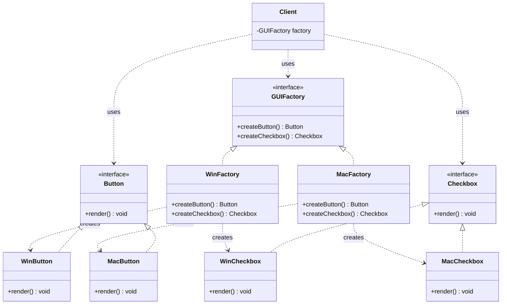
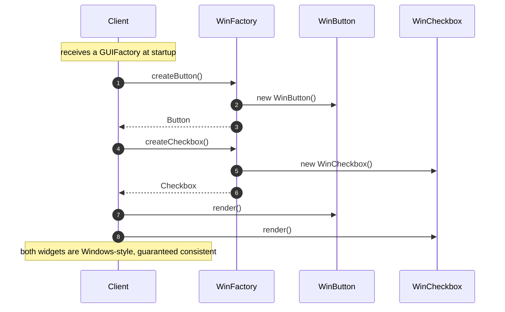

---
tags:
  - design
  - pattern
  - creational
  - abstract-factory
aliases: [Kit]
---

## Overview

The Abstract Factory pattern provides an interface for creating **families of related objects** without specifying their concrete classes. Think of it as a factory of factories.

**The problem without it**

1. Your UI code calls `new WinButton()`, `new WinCheckbox()`, `new MacScrollbar()` directly. A mismatched mix --- Windows button with macOS scrollbar --- compiles fine but looks broken at runtime.
2. Adding a Linux family means hunting every `new Win...` and `new Mac...` call and adding a third branch.
3. The client is coupled to every concrete widget class and to the logic of picking the right family.

**The fix:** define a `GUIFactory` interface with one creation method per product (`createButton()`, `createCheckbox()`). Each family gets a concrete factory (`WinFactory`, `MacFactory`) that returns a consistent set. The client receives a factory object at startup and calls only the interface methods --- it never names a concrete widget, so it can never mix families.

**What varies:** which *family* of products is created. The factory isolates that decision so the client code stays family-agnostic.

| Principle ([[Foundational Principles]]) | How Abstract Factory applies it |
|---|---|
| Program to an interface | Client depends on `GUIFactory`, `Button`, `Checkbox` --- never on `WinButton` or `MacCheckbox` |
| Encapsulate what varies | The "which family" decision lives inside the concrete factory, not in the client |
| [[2 - Open-Closed Principle\|Open-Closed]] | A new family (Linux) means a new factory class, with no edits to the client or existing factories |
| [[5 - Dependency Inversion Principle\|Dependency Inversion]] | High-level client depends on abstract products; concrete classes are details |

## Structure



### Participants

| Role | Class in the example | Responsibility |
|---|---|---|
| AbstractFactory | `GUIFactory` | Declares creation methods for each product in the family |
| ConcreteFactory | `WinFactory`, `MacFactory` | Returns a consistent set of products for one family |
| AbstractProduct | `Button`, `Checkbox` | Interface shared by all variants of one product |
| ConcreteProduct | `WinButton`, `MacButton`, `WinCheckbox`, `MacCheckbox` | A family-specific implementation of one product |
| Client | Application code that receives a `GUIFactory` | Creates products only through the factory interface, never names concrete classes |

## How It Works

Scenario: the client is given a `WinFactory` at startup and creates a button and a checkbox.



1. At startup, configuration or a command-line flag determines which factory the client receives. The client only knows it as a `GUIFactory`.
2. The client calls `createButton()`. The `WinFactory` creates a `WinButton` and returns it as a `Button`.
3. The client calls `createCheckbox()`. The `WinFactory` creates a `WinCheckbox` and returns it as a `Checkbox`.
4. The client renders both widgets. They are guaranteed to be from the same family --- no Windows button next to a macOS checkbox.
5. Switching to `MacFactory` changes *all* products at once, with zero edits to the client code.

## When to Use

- When your system needs to work with multiple families of related products
- When you want to enforce that products from one family are used together, never mixed
- When the set of products is known at design time but the families grow (new platform, new theme)

Signals in your code:

- You have parallel hierarchies --- `WinButton` / `MacButton`, `WinCheckbox` / `MacCheckbox` --- and the client picks from them with `if/else` on a platform flag. The flag check belongs in one factory, not scattered in client code.
- Mixing products from different families causes subtle bugs (a Windows serializer reading macOS-formatted data). The factory ensures consistency.
- A configuration file or environment variable decides which "flavor" of objects to use at startup. That decision should happen once, in the factory selection, not repeatedly at each `new`.
- You already have [[02 - Factory Method|Factory Method]]s for individual products and you realize the products must match each other.

## C++ Example

```cpp
#include <iostream>
#include <memory>

// --- Abstract products ---
class Button {
public:
    virtual ~Button() = default;
    virtual void render() const = 0;
};

class Checkbox {
public:
    virtual ~Checkbox() = default;
    virtual void render() const = 0;
};

// --- Windows family ---
class WinButton : public Button {
public:
    void render() const override { std::cout << "[Win Button]\n"; }
};

class WinCheckbox : public Checkbox {
public:
    void render() const override { std::cout << "[Win Checkbox]\n"; }
};

// --- macOS family ---
class MacButton : public Button {
public:
    void render() const override { std::cout << "(Mac Button)\n"; }
};

class MacCheckbox : public Checkbox {
public:
    void render() const override { std::cout << "(Mac Checkbox)\n"; }
};

// --- Abstract factory ---
class GUIFactory {
public:
    virtual ~GUIFactory() = default;
    virtual std::unique_ptr<Button> createButton() const = 0;
    virtual std::unique_ptr<Checkbox> createCheckbox() const = 0;
};

class WinFactory : public GUIFactory {
public:
    std::unique_ptr<Button> createButton() const override {
        return std::make_unique<WinButton>();
    }
    std::unique_ptr<Checkbox> createCheckbox() const override {
        return std::make_unique<WinCheckbox>();
    }
};

class MacFactory : public GUIFactory {
public:
    std::unique_ptr<Button> createButton() const override {
        return std::make_unique<MacButton>();
    }
    std::unique_ptr<Checkbox> createCheckbox() const override {
        return std::make_unique<MacCheckbox>();
    }
};
```

Usage:

```cpp
void buildUI(const GUIFactory& factory) {
    auto btn = factory.createButton();
    auto chk = factory.createCheckbox();
    btn->render();
    chk->render();
    // Both are guaranteed to be from the same family
}

int main() {
    WinFactory winFactory;
    MacFactory macFactory;

    buildUI(winFactory);   // [Win Button]  [Win Checkbox]
    buildUI(macFactory);   // (Mac Button)  (Mac Checkbox)
}
```

| Adding ... | What you write | What you edit |
|---|---|---|
| A new family (Linux) | `LinuxButton`, `LinuxCheckbox`, `LinuxFactory` | Nothing: client and existing factories are untouched |
| A new product (Scrollbar) | `Scrollbar` interface, `WinScrollbar`, `MacScrollbar` | `GUIFactory` gains `createScrollbar()`, every concrete factory must implement it |

````ad-warning
title: The "new product" problem
Abstract Factory makes adding a new **family** easy (Open-Closed). Adding a new **product type** (e.g., `Scrollbar`) is hard: it requires changing the abstract factory interface, which forces changes in every concrete factory. This is the pattern's main trade-off. If your product types change often, consider combining with [[05 - Prototype|Prototype]] (clone from a registry) or using a parameterized factory method instead.
````

## In .NET / C#

- **`DbProviderFactory`** is the textbook .NET example. `SqlClientFactory.Instance.CreateConnection()` returns a `SqlConnection`; `MySqlClientFactory.Instance.CreateConnection()` returns a `MySqlConnection`. Your code works with `DbConnection` and `DbCommand`, never naming a vendor-specific class. See [[ADO.NET]] if applicable.
- **DI container registrations** serve as a modern abstract factory. You register one set of services for production and a different set for testing. The container itself is the factory.
- **`IServiceScopeFactory`** creates scoped sets of related services --- a factory of dependency scopes.
- **MAUI / Xamarin Handlers**: platform-specific renderers (Android, iOS, Windows) are selected by a handler factory that maps a cross-platform control type to its native implementation.

```csharp
using System;
using System.Data.Common;
using Microsoft.Data.SqlClient;    // NuGet: Microsoft.Data.SqlClient

// --- Using DbProviderFactory as Abstract Factory ---
public class OrderRepository
{
    private readonly DbProviderFactory _factory;

    public OrderRepository(DbProviderFactory factory)
    {
        _factory = factory;   // injected: SqlClientFactory, MySqlClientFactory, etc.
    }

    public void LoadOrders()
    {
        using DbConnection conn = _factory.CreateConnection()!;    // abstract product
        conn.ConnectionString = "Server=.;Database=Shop;Trusted_Connection=True";

        using DbCommand cmd = _factory.CreateCommand()!;           // abstract product
        cmd.Connection = conn;
        cmd.CommandText = "SELECT Id, Total FROM Orders";

        conn.Open();
        using DbDataReader reader = cmd.ExecuteReader();
        while (reader.Read())
            Console.WriteLine($"Order {reader["Id"]}: {reader["Total"]}");
    }
}

// --- Usage ---
// var repo = new OrderRepository(SqlClientFactory.Instance);
// repo.LoadOrders();   // uses SQL Server
```

````ad-tip
title: Where else you meet it
- **WPF themes / skins:** a `ResourceDictionary` per theme provides a consistent family of styles, templates, and brushes. Switching themes swaps the entire dictionary, ensuring visual consistency --- the same idea as swapping the concrete factory.
- **`SocketsHttpHandler` vs `WinHttpHandler`:** `HttpClient` can use different handler families for its transport layer. Each is a family of internal objects (connection pool, TLS handler, proxy resolver) that must be consistent.
- **EF Core database providers:** `UseSqlServer()` vs `UseNpgsql()` vs `UseSqlite()` each register a complete family of services (SQL generator, migration scaffolder, type mapper) that work together.
````

## Trade-offs

| Pros | Cons |
|---|---|
| Guarantees consistency: products from one family are always used together | Adding a new product type forces changes to the abstract factory interface and every concrete factory |
| The client is fully decoupled from concrete product classes | The number of classes grows quickly: each family needs a factory plus all its products |
| Swapping the factory switches the entire family at once | The pattern is overkill if you have only one family or if families rarely change |
| Works naturally with DI containers, which select the family at startup | Finding "which factory created this object" can be hard to trace at runtime |

## Related Patterns

- [[02 - Factory Method|Factory Method]]: each `create...()` in the abstract factory *is* a factory method. Abstract Factory organizes related factory methods into a single object.
- [[01 - Singleton|Singleton]]: concrete factories are often singletons, since a system typically needs only one factory per family (`SqlClientFactory.Instance`).
- [[05 - Prototype|Prototype]]: an alternative to Abstract Factory. Instead of a class hierarchy of factories, you register prototype instances in a map and clone them. This avoids the "new product" problem.
- [[04 - Builder|Builder]]: Builder constructs a complex product step by step; Abstract Factory creates a family of simple products in one call. They can combine: a factory returns a builder, and the builder assembles the product.
- [[06 - Bridge|Bridge]]: Bridge separates abstraction from implementation, and the implementation side can be chosen by an Abstract Factory.

```ad-summary
- Abstract Factory creates families of related products through a single interface, so the client never mixes products from different families.
- Adding a new family is easy (new factory class); adding a new product type is hard (every factory must change). Plan the product set carefully.
- In .NET, `DbProviderFactory` is the classic example. DI container registrations serve the same role in modern apps.
- Use it when consistency across a product family matters. If you have only one family or products that are independent of each other, simpler patterns (Factory Method, DI) are enough.
```
