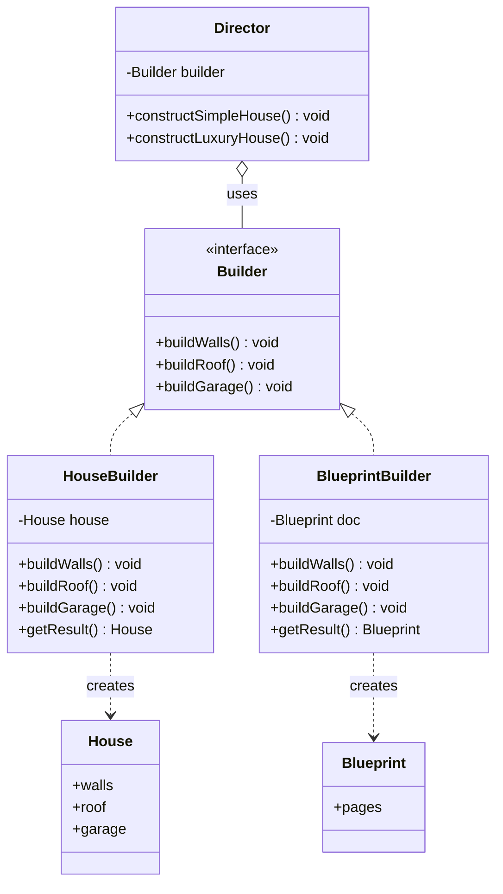
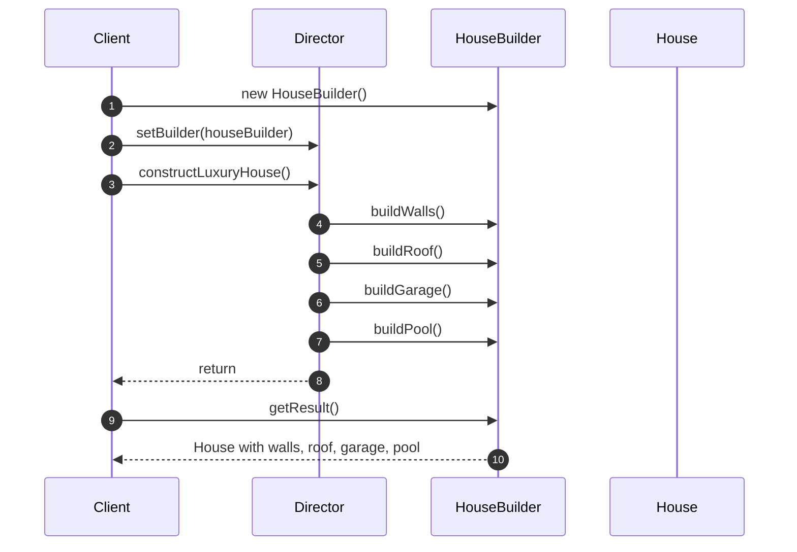

---
tags:
  - design
  - pattern
  - creational
  - builder
---

## Overview

The Builder pattern separates the **construction** of a complex object from its **representation**, so the same construction process can create different representations. It is useful when an object requires many steps to create, or has many optional parameters.

**The problem without it**

1. A `House` needs a foundation, walls, roof, garage, pool, garden, and alarm system. The constructor takes 10 parameters, most of which are optional: `House(walls, roof, garage, pool, garden, alarm, ...)`.
2. Callers pass `null` or `false` for the features they don't want, and the parameter order is easy to mix up: `new House(4, "tile", true, false, true, false)` --- which `bool` is the garage?
3. To avoid the **telescoping constructor**, you create dozens of constructor overloads or use a default object and set fields one by one, losing any ability to enforce required fields or valid combinations.

**The fix:** extract the construction steps into a **Builder** object. The builder has a method for each optional part (`buildGarage()`, `buildPool()`). An optional **Director** encodes common recipes --- `constructLuxuryHouse()` calls all the steps in the right order. The client picks a builder, tells the director (or calls steps directly), and then asks the builder for the finished product. Each builder can produce a different representation (a `House` object, an XML document, a blueprint) from the same steps.

**What varies:** which steps are executed and in what order --- and optionally, which *representation* the same steps produce.

| Principle ([[Foundational Principles]]) | How Builder applies it |
|---|---|
| [[1 - Single Responsibility Principle\|Single Responsibility]] | Construction logic is in the builder, not in the product class |
| Encapsulate what varies | The build steps and their order are encapsulated in the builder / director |
| Program to an interface | The director works with the builder interface, so swapping builders changes the output without changing the recipe |

### Two flavors

| | GoF Builder (with Director) | Fluent Builder (method chaining) |
|---|---|---|
| Who drives the steps | A **Director** object calls the builder's methods in order | The **client** calls methods in any order and finishes with `build()` |
| Focus | Same build *process*, different *representations* | One product with many optional parts, readable construction |
| Typical use | Parsers, document converters, complex game-level loaders | Configuration objects, HTTP requests, query builders, test data |
| Example | `Director::constructLuxuryHouse(builder)` | `HouseBuilder().walls(4).roof("tile").pool(true).build()` |

## Structure



### Participants

| Role | Class in the example | Responsibility |
|---|---|---|
| Builder | `Builder` interface | Declares build steps common to all representations |
| ConcreteBuilder | `HouseBuilder`, `BlueprintBuilder` | Implements the steps for one representation, provides `getResult()` |
| Director | `Director` | Calls the builder's steps in a specific order. Optional --- the client can drive the steps directly |
| Product | `House`, `Blueprint` | The complex object being constructed. Different builders produce different product types |

## How It Works

Scenario: the director constructs a luxury house using a `HouseBuilder`.



1. The client creates a `HouseBuilder`.
2. It hands the builder to the director.
3. The client asks the director to `constructLuxuryHouse()`.
4-7. The director calls each step in the right order. The builder assembles the house internally.
8. The director returns. The house is fully built inside the builder.
9. The client asks the builder for the result.
10. The builder returns the completed `House`.

With a `BlueprintBuilder`, the exact same director calls produce a `Blueprint` document instead of a `House` object --- same process, different representation.

## When to Use

- Constructing objects that would require a telescoping constructor (constructor with many parameters)
- When construction involves several steps that may vary
- When the same construction process should produce different representations
- When you want to build an immutable object but need to set many fields before construction

Signals in your code:

- A constructor has more than 4-5 parameters, several of them optional, and callers pass `null` or default values for the ones they don't need.
- You are setting fields on a mutable object one by one after construction, and the object is "half-built" for a while --- a builder makes construction atomic.
- The same "recipe" of steps should produce different outputs (an in-memory object, an XML string, a database row).
- Test code creates complex objects for fixtures, and you keep repeating the same long constructor calls --- a test builder with sensible defaults simplifies this.

## C++ Example

GoF-style builder with a Director:

```cpp
#include <iostream>
#include <memory>
#include <string>

// --- Product ---
struct Pizza {
    std::string dough;
    std::string sauce;
    std::string topping;
    void describe() const {
        std::cout << dough << " + " << sauce << " + " << topping << '\n';
    }
};

// --- Builder interface ---
class PizzaBuilder {
public:
    virtual ~PizzaBuilder() = default;
    virtual void buildDough() = 0;
    virtual void buildSauce() = 0;
    virtual void buildTopping() = 0;
    virtual std::unique_ptr<Pizza> getResult() = 0;
};

// --- Concrete builder ---
class MargheritaBuilder : public PizzaBuilder {
    std::unique_ptr<Pizza> pizza = std::make_unique<Pizza>();
public:
    void buildDough() override   { pizza->dough   = "thin crust"; }
    void buildSauce() override   { pizza->sauce   = "tomato"; }
    void buildTopping() override { pizza->topping  = "mozzarella + basil"; }
    std::unique_ptr<Pizza> getResult() override { return std::move(pizza); }
};

class PepperoniBuilder : public PizzaBuilder {
    std::unique_ptr<Pizza> pizza = std::make_unique<Pizza>();
public:
    void buildDough() override   { pizza->dough   = "thick crust"; }
    void buildSauce() override   { pizza->sauce   = "BBQ"; }
    void buildTopping() override { pizza->topping  = "pepperoni + onion"; }
    std::unique_ptr<Pizza> getResult() override { return std::move(pizza); }
};

// --- Director ---
class Cook {
    PizzaBuilder* builder = nullptr;
public:
    void setBuilder(PizzaBuilder* b) { builder = b; }
    void makePizza() {
        builder->buildDough();
        builder->buildSauce();
        builder->buildTopping();
    }
};
```

Usage:

```cpp
int main() {
    Cook cook;

    MargheritaBuilder margherita;
    cook.setBuilder(&margherita);
    cook.makePizza();
    auto p1 = margherita.getResult();
    p1->describe();   // "thin crust + tomato + mozzarella + basil"

    PepperoniBuilder pepperoni;
    cook.setBuilder(&pepperoni);
    cook.makePizza();
    auto p2 = pepperoni.getResult();
    p2->describe();   // "thick crust + BBQ + pepperoni + onion"
}
```

Fluent builder variant (common in modern C++):

```cpp
class QueryBuilder {
    std::string table_;
    std::string where_;
    int limit_ = -1;
public:
    QueryBuilder& from(const std::string& t) { table_ = t; return *this; }
    QueryBuilder& where(const std::string& w) { where_ = w; return *this; }
    QueryBuilder& limit(int n)                { limit_ = n; return *this; }

    std::string build() const {
        std::string sql = "SELECT * FROM " + table_;
        if (!where_.empty()) sql += " WHERE " + where_;
        if (limit_ > 0)     sql += " LIMIT " + std::to_string(limit_);
        return sql;
    }
};

// Usage: auto q = QueryBuilder().from("orders").where("total > 100").limit(10).build();
```

## In .NET / C#

Builder is everywhere in modern .NET, almost always in the **fluent** flavor:

- **`WebApplicationBuilder`** (`WebApplication.CreateBuilder(args)`): configures services, configuration, logging, and the Kestrel server step by step, then `Build()` returns the immutable `WebApplication`. See [[05 - WebApplication and WebApplicationBuilder]].
- **`IHostBuilder`** / **`HostBuilder`**: the generic host equivalent. `.ConfigureServices()`, `.ConfigureLogging()`, `.Build()`.
- **`StringBuilder`**: the most basic builder. Appends pieces, then `.ToString()` returns the product.
- **`IConfigurationBuilder`**: `.AddJsonFile()`, `.AddEnvironmentVariables()`, `.Build()`.
- **`DbContextOptionsBuilder`** in EF Core: `.UseSqlServer(conn).EnableSensitiveDataLogging().Options`.
- **`HttpRequestMessage`** construction via fluent helpers in `Refit` and `Flurl`.

```csharp
using System;
using System.Text;

// --- Product (immutable) ---
public class Pizza
{
    public string Dough { get; }
    public string Sauce { get; }
    public string Topping { get; }
    
    internal Pizza(string dough, string sauce, string topping)
        => (Dough, Sauce, Topping) = (dough, sauce, topping);
    
    public override string ToString() => $"{Dough} + {Sauce} + {Topping}";
}

// --- Fluent Builder ---
public class PizzaBuilder
{
    private string _dough = "regular";
    private string _sauce = "tomato";
    private string _topping = "cheese";

    public PizzaBuilder WithDough(string d)   { _dough = d;   return this; }
    public PizzaBuilder WithSauce(string s)   { _sauce = s;   return this; }
    public PizzaBuilder WithTopping(string t)  { _topping = t; return this; }

    public Pizza Build() => new Pizza(_dough, _sauce, _topping);
}

// --- Usage ---
// var pizza = new PizzaBuilder()
//     .WithDough("thin crust")
//     .WithSauce("pesto")
//     .WithTopping("mozzarella + tomato")
//     .Build();
// Console.WriteLine(pizza);   // "thin crust + pesto + mozzarella + tomato"
```

````ad-tip
title: Where else you meet it
- **`WebApplication.CreateBuilder(args)`** is the builder you use in every ASP.NET Core app. The `WebApplicationBuilder` lets you configure services, middleware, endpoints, and hosting in any order, then `Build()` freezes everything into an immutable `WebApplication`.
- **`IServiceCollection`** + `BuildServiceProvider()` is a builder for the DI container. You add registrations step by step, then `Build` produces the immutable `IServiceProvider`.
- **LINQ query syntax** is a builder in disguise: each `.Where()`, `.Select()`, `.OrderBy()` adds a step; the query isn't executed until you enumerate. See [[Deferred Execution in LINQ]].
- **Test fixtures**: libraries like `AutoFixture`, `Bogus`, and hand-rolled `TestDataBuilder` classes use the fluent builder pattern to create complex test objects with sensible defaults.
````

## Trade-offs

| Pros | Cons |
|---|---|
| Avoids telescoping constructors: each optional part is a named method call | More code than a simple constructor for objects that don't have many optional parts |
| Same build process can produce different representations (GoF director) | Without a director, the client must know which steps to call and in what order |
| Construction is atomic: the product is not exposed until `build()` / `getResult()` finishes | The product's fields may not be validated until `build()` --- a builder can silently produce an invalid object |
| Fluent API reads like English: `builder.walls(4).roof("tile").pool(true).build()` | Fluent builders return `this`, which makes inheritance tricky (the "curiously recurring template" workaround is needed) |

````ad-warning
title: Common misuse
- **A builder for a two-field object.** If the constructor is simple and clear, a builder is overhead. Reserve it for objects with 4+ optional parameters.
- **Forgetting validation in `build()`.** A builder that silently accepts `walls(0).roof(null)` shifts the error from compile time to a confusing runtime failure. Validate required fields in `build()` and throw early.
- **Exposing a mutable product.** If the builder returns a reference to an internal mutable object and then the client changes it, the builder's state is corrupted. Return a new copy or an immutable product.
````

## Related Patterns

- [[03 - Abstract Factory|Abstract Factory]]: both create complex objects, but Builder does it step by step and can vary the process; Abstract Factory returns a complete family in one call and focuses on *which* family.
- [[05 - Prototype|Prototype]]: Prototype clones an existing object instead of building from scratch. You might combine them: clone a prototype and then use a builder to customize the copy.
- [[05 - Composite|Composite]]: builders often construct Composite trees step by step (e.g., an HTML document builder that nests elements).
- [[01 - Singleton|Singleton]]: a director can be a singleton, since only one director is usually needed.
- [[02 - Factory Method|Factory Method]]: the director calls builder methods that are themselves factory-method-like hooks.

```ad-summary
- Builder separates an object's construction from its representation, letting the same step-by-step process produce different outputs.
- The GoF version uses a Director that drives the build steps. The modern fluent version lets the client chain method calls and finish with `build()`.
- In .NET, you use it daily: `WebApplicationBuilder`, `IHostBuilder`, `StringBuilder`, `IConfigurationBuilder`, `DbContextOptionsBuilder`, LINQ chains.
- Use it when a constructor has many optional parameters or when the same recipe should produce different products. For simple objects, a constructor or factory is enough.
```
