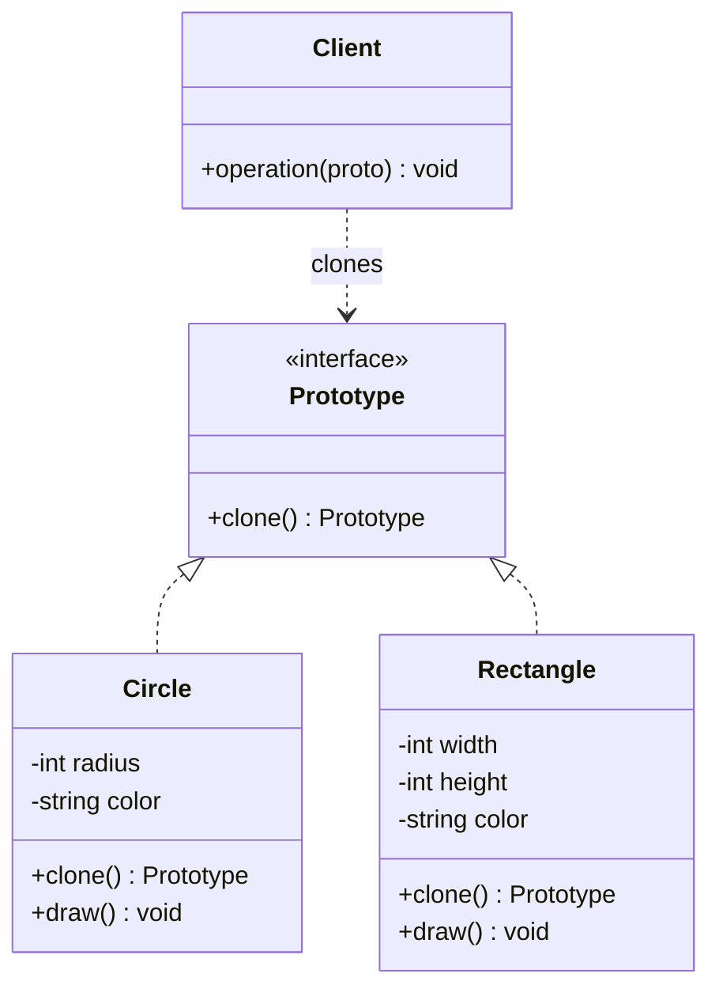
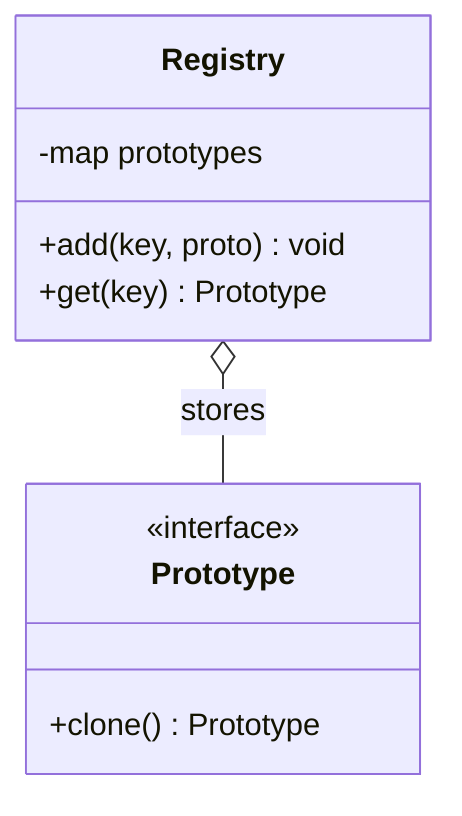
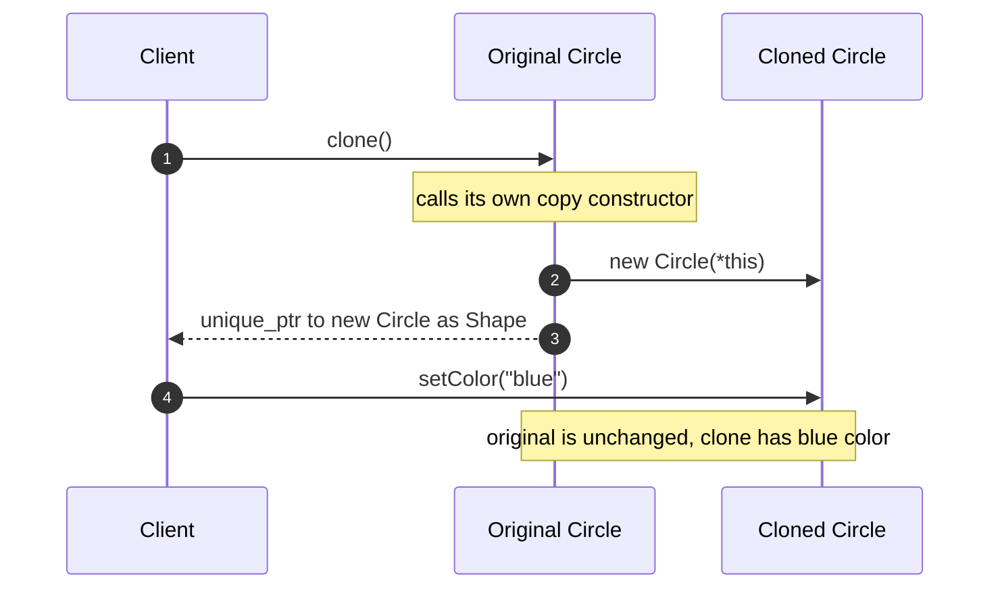

---
tags:
  - design
  - pattern
  - creational
  - prototype
aliases: [Clone]
---

## Overview

The Prototype pattern creates new objects by **cloning an existing object** (the prototype) instead of building from scratch.

**The problem without it**

1. You need a copy of a `Circle` object, but the object's class has private fields, constructor parameters that require expensive database lookups, or subclass-specific state you don't know about from the outside.
2. The copying code calls `new Circle(original.radius, original.color, ...)` --- it must know every field and the exact class, so it breaks when fields are added or when the object is actually a `FilledCircle` subclass.
3. If you hold the object through a base `Shape*` pointer, you can't even call `new` on the right type without a `dynamic_cast` or a type switch.

**The fix:** each class implements a `clone()` method that returns a copy of itself. The caller says `original->clone()` and gets a perfect copy without knowing the concrete class or its internal fields. The clone method has access to `private` members (it is inside the class) and knows the exact type (it runs in the concrete class, not the base).

**What varies:** how the copy is made. Each class knows how to clone its own state, including subclass-specific fields.

| Principle ([[Foundational Principles]]) | How Prototype applies it |
|---|---|
| Program to an interface | The client calls `clone()` through the base class, never naming the concrete type |
| Encapsulate what varies | The copy logic is inside the class that owns the state |
| [[2 - Open-Closed Principle\|Open-Closed]] | New cloneable types implement `clone()` without changing the client |

## Structure



### Participants

| Role | Class in the example | Responsibility |
|---|---|---|
| Prototype | `Shape` / `Prototype` | Declares the `clone()` interface |
| ConcretePrototype | `Circle`, `Rectangle` | Implements `clone()` to copy itself, including private state |
| Client | Code that needs a copy | Calls `clone()` on a prototype, receives a new object of the correct type |

### Optional: Prototype Registry

A **registry** (also called a **prototype manager**) maps keys to pre-configured prototypes. When the client asks for `"large red circle"`, the registry returns `prototypes["large red circle"]->clone()`. This is useful when you have a fixed catalog of starting configurations.



## How It Works

Scenario: the client holds a `Shape*` to a `Circle` and needs an independent copy.



1. The client calls `clone()` on the original. It only knows it as a `Shape*`.
2. `Circle::clone()` runs, because virtual dispatch reaches the concrete class.
3. Inside `clone()`, the circle calls its own copy constructor --- `new Circle(*this)` --- which copies `radius`, `color`, and any private fields.
4. The new circle is returned as a `Shape` pointer. The client never knew it was a `Circle`.
5. The client modifies the clone. The original is unaffected.

## When to Use

- When object creation is expensive (e.g., requires database calls or complex computation), and a similar object already exists
- When you need copies that are independent of their concrete classes
- When you hold objects through a base-class pointer and need to duplicate them without a type switch
- When a registry of pre-configured objects serves as a "palette" the user picks from and customizes (e.g., shapes in a drawing editor, unit templates in a game)

Signals in your code:

- You are holding an object through a base class pointer or interface and need to copy it, but you can't call `new` because you don't know the concrete type.
- A factory or builder creates a complex, expensive object, and you need many slight variations of it --- clone and customize is cheaper than building each from scratch.
- A `switch` on a type enum or `dynamic_cast` ladder exists just to pick the right constructor for copying --- each branch can be replaced by `clone()`.
- You have a catalog of "template" objects (document templates, preset configurations, enemy types in a game) that users duplicate and modify.

## C++ Example

```cpp
#include <iostream>
#include <memory>
#include <string>
#include <unordered_map>

// --- Prototype ---
class Shape {
public:
    virtual ~Shape() = default;
    virtual std::unique_ptr<Shape> clone() const = 0;
    virtual void draw() const = 0;
};

class Circle : public Shape {
    int radius;
    std::string color;
public:
    Circle(int r, const std::string& c) : radius(r), color(c) {}
    // Copy constructor: clones all fields, including private ones
    Circle(const Circle& other) = default;

    std::unique_ptr<Shape> clone() const override {
        return std::make_unique<Circle>(*this);     // uses copy constructor
    }
    void draw() const override {
        std::cout << color << " circle, r=" << radius << '\n';
    }
    void setColor(const std::string& c) { color = c; }
};

class Rectangle : public Shape {
    int w, h;
    std::string color;
public:
    Rectangle(int w, int h, const std::string& c) : w(w), h(h), color(c) {}
    Rectangle(const Rectangle& other) = default;

    std::unique_ptr<Shape> clone() const override {
        return std::make_unique<Rectangle>(*this);
    }
    void draw() const override {
        std::cout << color << " rect " << w << "x" << h << '\n';
    }
};
```

Usage with a prototype registry:

```cpp
int main() {
    // --- Direct clone ---
    auto original = std::make_unique<Circle>(10, "red");
    auto copy = original->clone();   // copy is a Shape*, actually a Circle
    original->draw();                // "red circle, r=10"
    copy->draw();                    // "red circle, r=10" (independent copy)

    // --- Prototype registry ---
    std::unordered_map<std::string, std::unique_ptr<Shape>> registry;
    registry["small circle"] = std::make_unique<Circle>(5, "black");
    registry["wide rect"]    = std::make_unique<Rectangle>(100, 20, "gray");

    auto s1 = registry["small circle"]->clone();  // fresh copy of the template
    auto s2 = registry["wide rect"]->clone();
    s1->draw();   // "black circle, r=5"
    s2->draw();   // "gray rect 100x20"
}
```

````ad-warning
title: Shallow vs deep copy
The default copy constructor copies all fields by value. If a field is a raw pointer, both the original and clone **share the pointed-to object**. Modifying it through one changes both --- or worse, one deletes it and the other is left with a dangling pointer. If the object owns heap-allocated sub-objects, write a custom copy constructor that clones them too (a **deep copy**). In C++, prefer smart pointers (`unique_ptr`, `shared_ptr`) whose copy/move semantics make the ownership explicit.
````

## In .NET / C#

.NET provides two built-in mechanisms:

- **`ICloneable`** (legacy): declares `object Clone()`. It is untyped (returns `object`), doesn't specify shallow vs deep, and is generally **not recommended** for new code. If you use it, document whether the clone is shallow or deep.
- **`MemberwiseClone()`** (protected on `Object`): creates a **shallow copy** --- value-type fields are copied, reference-type fields share the same objects. This is the most common starting point for a `clone()` implementation.

```csharp
using System;
using System.Collections.Generic;

public abstract class Shape
{
    public string Color { get; set; } = "black";
    public abstract Shape Clone();
    public abstract void Draw();
}

public class Circle : Shape
{
    public int Radius { get; set; }

    public override Shape Clone()
    {
        // MemberwiseClone copies Radius (value type) and Color (string, immutable)
        return (Shape)MemberwiseClone();
    }

    public override void Draw()
        => Console.WriteLine($"{Color} circle, r={Radius}");
}

public class Rectangle : Shape
{
    public int Width { get; set; }
    public int Height { get; set; }
    // If this held a mutable reference type, Clone must deep-copy it
    public List<string>? Tags { get; set; }

    public override Shape Clone()
    {
        var copy = (Rectangle)MemberwiseClone();   // shallow copy
        if (Tags is not null)
            copy.Tags = new List<string>(Tags);    // deep copy the mutable list
        return copy;
    }

    public override void Draw()
        => Console.WriteLine($"{Color} rect {Width}x{Height}");
}

// --- Usage ---
// Shape original = new Circle { Radius = 10, Color = "red" };
// Shape copy = original.Clone();
// copy.Color = "blue";
// original.Draw();   // "red circle, r=10"   (unchanged)
// copy.Draw();       // "blue circle, r=10"  (independent copy)
```

````ad-tip
title: Where else you meet it
- **`with` expressions (C# 9+ records):** `var copy = original with { Color = "blue" };` is a language-level Prototype. The compiler generates a clone-and-mutate method. Records are the modern way to get value-based cloning without writing `clone()` by hand.
- **`JsonSerializer.Deserialize(JsonSerializer.Serialize(obj))`**: a brute-force deep clone via serialization round-trip. Works for any serializable object but is slow and loses non-serializable state.
- **Spread syntax in collections:** `List<T>(existingList)`, `new Dictionary<K,V>(existingDict)`, `existingArray.ToArray()` are prototype-like: create a new collection from an existing one.
- **EF Core's `.AsNoTracking()`** combined with re-attaching: detach an entity (effectively cloning it from tracking's perspective), modify it, and save as a new row.
- **`Span<T>.ToArray()`**: creates an independent copy of the data the span points to.
````

## Trade-offs

| Pros | Cons |
|---|---|
| Clone without knowing the concrete class: works through base pointers/interfaces | Every class must implement `clone()`, which is easy to forget for a new subclass |
| Avoids expensive initialization: clone a pre-built object instead of constructing from scratch | Shallow vs deep copy is a constant source of bugs --- must be clearly documented |
| Prototype registry provides a "catalog" of starting configurations without class hierarchies | Cloning objects with circular references (A points to B, B points back to A) requires careful handling |
| Reduces the need for factory subclasses: clone and configure instead of creating a new factory per variant | The clone may share mutable internal state with the original if the copy is shallow |

````ad-warning
title: Common misuse
- **Shallow-copying objects with mutable reference fields.** `MemberwiseClone()` and the default copy constructor copy pointers/references, not the objects they point to. The clone and original share internal mutable state, leading to spooky action at a distance. Deep-copy every mutable owned object.
- **Implementing `ICloneable` without specifying semantics.** `ICloneable` does not say whether the clone is shallow or deep. Callers guess wrong. Prefer a typed `Clone()` method or C# records with `with`.
- **Cloning when a constructor is simpler.** If the object is cheap to construct and has no private state that `clone()` needs, a plain constructor or factory method is clearer.
````

## Related Patterns

- [[03 - Abstract Factory|Abstract Factory]]: Prototype can replace Abstract Factory when the family of products is large or changes frequently. Instead of a factory class per family, you register prototypes in a map and clone them.
- [[02 - Factory Method|Factory Method]]: both avoid `new ConcreteClass()` in the client. Factory Method uses inheritance (subclasses override the method); Prototype uses delegation (clone an existing instance).
- [[04 - Builder|Builder]]: you can combine them: clone a prototype to get a near-finished object, then use a builder to customize it.
- [[09 - Memento|Memento]]: Memento saves an object's state for later restoration. Prototype copies the entire object for duplication. If you need both "undo" and "duplicate", they complement each other.
- [[02 - Decorator|Decorator]]: Prototype simplifies creating decorated objects. Clone the decorated stack instead of rebuilding the decorator chain from scratch.

```ad-summary
- Prototype clones an existing object via a `clone()` method, so the client gets a copy without knowing the concrete class or its private fields.
- In C++, `clone()` calls the copy constructor. In .NET, `MemberwiseClone()` gives a shallow copy; deep-copy mutable reference fields manually, or use C# records with `with` expressions.
- Use it when construction is expensive, when you hold objects through base-class pointers, or when you need a registry of pre-configured templates.
- The main hazard is shallow vs deep copy: always document which one `clone()` performs and deep-copy any mutable owned state.
```
