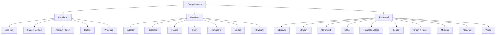

---
tags:
  - design
  - pattern
  - overview
aliases: [GoF Patterns, Gang of Four]
---

## What Are Design Patterns

- **Design patterns** are reusable solutions to commonly occurring problems in software design. They are not code you copy-paste --- they are templates for how to solve a problem that can be adapted to many situations.
- The concept was popularized by the **Gang of Four (GoF)** --- Erich Gamma, Richard Helm, Ralph Johnson, and John Vlissides --- in their 1994 book *Design Patterns: Elements of Reusable Object-Oriented Software*.
- Patterns are grouped into three categories: **[[Creational Patterns]]**, **[[Structural Patterns]]**, and **[[Behavioral Patterns]]**.
- Each pattern names a **problem**, describes its **forces** (the constraints that shape the solution), shows a **structure** (the participants and how they collaborate), and lists **consequences** (the trade-offs you accept).

```ad-important
A pattern is not always the right answer. Applying patterns where they are not needed adds unnecessary complexity. Use a pattern when the problem it solves actually exists in your code.
```

---

## The Three Categories



### [[Creational Patterns]]

Deal with **object creation mechanisms** --- they abstract the instantiation process so that the system is independent of how its objects are created, composed, and represented.

**Reach for a creational pattern when** the way you create objects is tangled with the code that uses them, or when `new ConcreteClass()` is scattered across your codebase and a change to that class's constructor ripples everywhere. Creational patterns move the "which class?" or "how to build it?" decision behind an interface so the rest of the code stays stable.

Includes [[01 - Singleton|Singleton]], [[02 - Factory Method|Factory Method]], [[03 - Abstract Factory|Abstract Factory]], [[04 - Builder|Builder]], and [[05 - Prototype|Prototype]].

### [[Structural Patterns]]

Deal with **object composition** --- how classes and objects are combined to form larger structures while keeping them flexible and efficient.

**Reach for a structural pattern when** you need to make incompatible classes work together, add behavior without subclassing, simplify a complex subsystem's interface, or share objects to save memory. Structural patterns are about *assembling* objects and classes into larger wholes without losing flexibility or efficiency.

Includes [[01 - Adapter|Adapter]], [[02 - Decorator|Decorator]], [[03 - Facade|Facade]], [[04 - Proxy|Proxy]], [[05 - Composite|Composite]], [[06 - Bridge|Bridge]], and [[07 - Flyweight|Flyweight]].

### [[Behavioral Patterns]]

Deal with **communication between objects** --- how objects interact and distribute responsibility.

**Reach for a behavioral pattern when** the logic for *who does what* and *in what order* is growing tangled, when objects need to react to each other without hard-wired references, or when an algorithm should be customizable by subclasses or strategies. Behavioral patterns define clear protocols for interaction so each object's job stays focused.

Includes [[01 - Observer|Observer]], [[02 - Strategy|Strategy]], [[03 - Command|Command]], [[04 - State|State]], [[05 - Template Method|Template Method]], [[06 - Iterator|Iterator]], [[07 - Chain of Responsibility|Chain of Responsibility]], [[08 - Mediator|Mediator]], [[09 - Memento|Memento]], and [[10 - Visitor|Visitor]].

---

## Quick Reference Table

| Pattern | Category | One-Line Summary | Key Principle ([[Foundational Principles]]) |
|---|---|---|---|
| [[01 - Singleton\|Singleton]] | Creational | One instance, global access | Controlled access to a sole instance |
| [[02 - Factory Method\|Factory Method]] | Creational | Subclass decides which object to create | [[2 - Open-Closed Principle\|Open-Closed]]: new products without editing existing code |
| [[03 - Abstract Factory\|Abstract Factory]] | Creational | Create families of related objects | Program to an interface: client never names concrete classes |
| [[04 - Builder\|Builder]] | Creational | Step-by-step complex object construction | [[1 - Single Responsibility Principle\|SRP]]: construction logic lives in the builder, not the product |
| [[05 - Prototype\|Prototype]] | Creational | Clone existing objects | Program to an interface: client clones through the base `clone()` |
| [[01 - Adapter\|Adapter]] | Structural | Convert one interface to another | Program to an interface: the adapter makes incompatible classes fit |
| [[02 - Decorator\|Decorator]] | Structural | Add responsibilities dynamically | [[2 - Open-Closed Principle\|Open-Closed]]: new behavior without subclassing |
| [[03 - Facade\|Facade]] | Structural | Simplified interface to a subsystem | Encapsulate what varies: hides subsystem complexity |
| [[04 - Proxy\|Proxy]] | Structural | Placeholder that controls access | [[1 - Single Responsibility Principle\|SRP]]: access control separated from business logic |
| [[05 - Composite\|Composite]] | Structural | Tree structure, uniform leaf/node treatment | Program to an interface: leaves and composites share one interface |
| [[06 - Bridge\|Bridge]] | Structural | Separate abstraction from implementation | Encapsulate what varies: abstraction and implementation evolve independently |
| [[07 - Flyweight\|Flyweight]] | Structural | Share objects to save memory | Shared intrinsic state vs. per-context extrinsic state |
| [[01 - Observer\|Observer]] | Behavioral | Notify dependents of state changes | Loose coupling: subject and observers know each other only through interfaces |
| [[02 - Strategy\|Strategy]] | Behavioral | Swap algorithms at runtime | Encapsulate what varies: each algorithm in its own class |
| [[03 - Command\|Command]] | Behavioral | Encapsulate request as object (undo/redo) | [[1 - Single Responsibility Principle\|SRP]]: invoker, command, and receiver are separate |
| [[04 - State\|State]] | Behavioral | Behavior changes with internal state | [[2 - Open-Closed Principle\|Open-Closed]]: new states without editing existing ones |
| [[05 - Template Method\|Template Method]] | Behavioral | Algorithm skeleton with customizable steps | Hollywood Principle: "don't call us, we'll call you" |
| [[06 - Iterator\|Iterator]] | Behavioral | Sequential access without exposing internals | [[1 - Single Responsibility Principle\|SRP]]: collection stores, iterator walks |
| [[07 - Chain of Responsibility\|Chain of Responsibility]] | Behavioral | Pass request along a handler chain | Loose coupling: sender knows only "a handler" |
| [[08 - Mediator\|Mediator]] | Behavioral | Centralize complex communication | Loose coupling: colleagues talk through one object, not to each other |
| [[09 - Memento\|Memento]] | Behavioral | Capture and restore state | Encapsulation: state is saved without exposing internals |
| [[10 - Visitor\|Visitor]] | Behavioral | Add operations without modifying classes | [[2 - Open-Closed Principle\|Open-Closed]]: new operations without touching element classes |

---

```ad-tip
**How to pick the right pattern:**
1. Identify the problem (object creation? structure? communication?)
2. That narrows it to one of the three categories
3. Within the category, match the specific constraint (need one instance? need to swap algorithms? need undo?)
4. If two patterns seem to fit, check whether you actually need the pattern at all --- simpler code is always better
5. Read the **trade-offs** section of each candidate: the cons you can live with point to the right choice
```

## Relationships Between Patterns

Patterns are not isolated tools. Many work together or compete for the same problem space:

- **Creational overlap:** [[03 - Abstract Factory|Abstract Factory]] uses [[02 - Factory Method|Factory Method]] internally. [[04 - Builder|Builder]] and Abstract Factory both create complex objects, but Builder does it step by step while Abstract Factory creates a family in one call. [[05 - Prototype|Prototype]] competes with both when you want to avoid a class hierarchy of factories.
- **Structural overlap:** [[02 - Decorator|Decorator]] and [[04 - Proxy|Proxy]] have identical class diagrams but different intents --- Decorator adds behavior, Proxy controls access. [[01 - Adapter|Adapter]] makes things work *after* they are designed; [[06 - Bridge|Bridge]] makes them work *before*.
- **Behavioral overlap:** [[02 - Strategy|Strategy]] and [[04 - State|State]] have the same structure (context delegates to an interface) but different triggers --- Strategy is chosen by the *client*, State transitions happen *internally*. [[03 - Command|Command]] and [[09 - Memento|Memento]] often pair for undo: Command records *what* to undo, Memento saves the *state* to restore.

```ad-summary
- Design patterns are proven templates, not copy-paste code. They name a problem, its forces, and a flexible solution.
- Three categories: **Creational** (how objects are made), **Structural** (how objects are composed), **Behavioral** (how objects communicate).
- The GoF catalog has 23 patterns. Knowing the trade-offs is as important as knowing the structure.
- Always ask: does the problem this pattern solves actually exist in my code right now?
```
