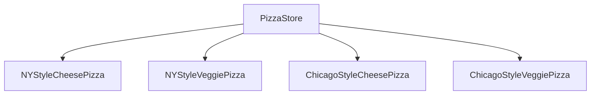
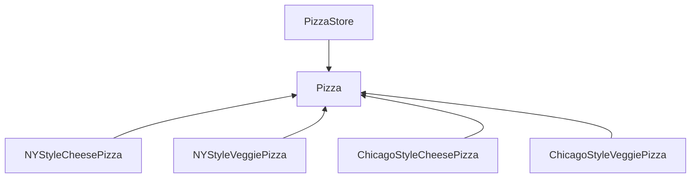
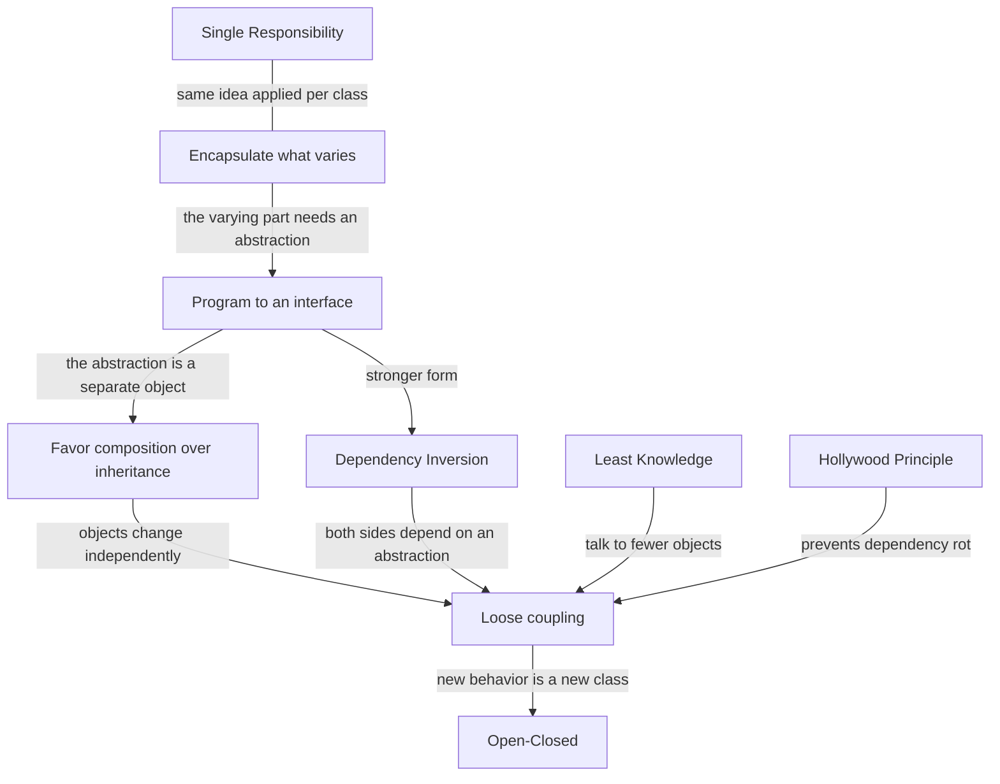

These principles underpin **all** design patterns. The GoF patterns are specific applications of these ideas — knowing the principles helps you recognize when a pattern fits and when a simpler solution is enough.

| # | Principle | Head First introduces it with | SOLID |
|---|---|---|---|
| 1 | Encapsulate what varies | Strategy | — |
| 2 | Program to an interface | Strategy | close to D |
| 3 | Favor composition over inheritance | Strategy | — |
| 4 | Loose coupling | Observer | — |
| 5 | Hollywood Principle | Template Method | — |
| 6 | Open-Closed | Decorator | O |
| 7 | Dependency Inversion | Factory | D |
| 8 | Least Knowledge | Adapter and Facade | — |
| 9 | Single Responsibility | Iterator and Composite | S |

[[3 - Liskov Substitution Principle|Liskov Substitution]] and [[4 - Interface Segregation Principle|Interface Segregation]] (the L and I of SOLID) aren't in Head First's list; see [[SOLID Overview|SOLID]].

---

## 1. Encapsulate What Varies

> Take the parts that vary and encapsulate them, so that later you can alter or extend the parts that vary without affecting those that don't.

This is the first design principle in *Head First Design Patterns*. The GoF book doesn't list it as a numbered principle; it calls "encapsulating the concept that varies" a theme of many design patterns. Almost every pattern is an application of it:

| What varies | Pattern that encapsulates it |
|---|---|
| Algorithm / behavior | [[02 - Strategy\|Strategy]] |
| Object creation | [[02 - Factory Method\|Factory Method]], [[03 - Abstract Factory\|Abstract Factory]] |
| State transitions | [[04 - State\|State]] |
| Response to events | [[01 - Observer\|Observer]] |
| What gets executed | [[03 - Command\|Command]] |
| Traversal logic | [[06 - Iterator\|Iterator]] |
| Steps of an algorithm | [[05 - Template Method\|Template Method]] |

![[Pasted image 20261030110801.png|center]]

---

## 2. Program to an Interface, Not an Implementation

Depend on abstractions (interfaces, abstract classes), not concrete classes. This lets you swap implementations without changing the code that uses them.

```csharp
// Bad — tied to a concrete class
SqlLogger logger = new SqlLogger();

// Good — depends on abstraction
ILogger logger = new SqlLogger();  // can swap to FileLogger, ConsoleLogger, etc.
```

This is why [[02 - Strategy|Strategy]] uses an interface for the behavior, why [[02 - Factory Method|Factory Method]] returns an abstract type, and why [[01 - Observer|Observer]] notifies through an interface.

Closely related to the [[5 - Dependency Inversion Principle|Dependency Inversion Principle]] in SOLID. See section 7.

---

## 3. Favor Composition Over Inheritance

Instead of inheriting behavior from a parent class, **compose** objects by giving them references to other objects that provide the behavior.

```csharp
// Inheritance — rigid, one behavior baked in
class Duck : FlyingBird { }

// Composition — flexible, behavior can change at runtime
class Duck
{
    private IFlyBehavior _flyBehavior;    // can be FlyWithWings, NoFly, RocketFly...
    
    public void PerformFly() => _flyBehavior.Fly();
    public void SetFlyBehavior(IFlyBehavior fb) => _flyBehavior = fb;
}
```

Inheritance creates an **is-a** relationship that's hard to change. Composition creates a **has-a** relationship that's easy to swap. This is the foundation of [[02 - Strategy|Strategy]], [[02 - Decorator|Decorator]], [[04 - State|State]], and [[06 - Bridge|Bridge]].

---

## 4. Strive for Loosely Coupled Designs

Objects that interact should know as little about each other as possible. When two objects are loosely coupled, they can change independently.

[[01 - Observer|Observer]] is the textbook example — the subject doesn't know what its observers do, only that they implement an interface. Adding or removing observers changes nothing about the subject.

---

## 5. The Hollywood Principle — "Don't Call Us, We'll Call You"

High-level components tell low-level components when to participate — not the other way around. The framework calls your code, you don't call the framework.

This applies to [[05 - Template Method|Template Method]] (the base class calls the subclass hooks), [[01 - Observer|Observer]] (the subject calls the observers), and dependency injection in general.

---

## 6. The Open-Closed Principle

> Classes should be open for extension, but closed for modification.

Head First introduces it in the Decorator chapter. Bertrand Meyer first stated it in 1988, and it's the O in SOLID: [[2 - Open-Closed Principle|Open-Closed Principle]].

It means you add new behavior by writing **new code**, usually a new class, instead of editing code that already works and is tested. Take the Starbuzz Coffee example. If `Cost()` uses a `switch` on condiment names, every new condiment means editing it:

```csharp
// Before — every new condiment is an edit to this tested method
public decimal Cost() => basePrice + condiments.Sum(c => c switch
{
    "Mocha" => 0.20m,
    "Whip"  => 0.10m,
    _       => throw new ArgumentException($"Unknown condiment: {c}")
});
```

With [[02 - Decorator|Decorator]], each condiment is its own class that wraps a `Beverage`:

```csharp
public abstract class CondimentDecorator : Beverage
{
    protected readonly Beverage beverage;
    protected CondimentDecorator(Beverage beverage) => this.beverage = beverage;
    public abstract override string GetDescription();
}

public class Caramel : CondimentDecorator
{
    public Caramel(Beverage beverage) : base(beverage) { }
    public override string GetDescription() => beverage.GetDescription() + ", Caramel";
    public override decimal Cost() => beverage.Cost() + 0.25m;
}
```

Adding caramel is one new class. `Beverage`, `DarkRoast` and the existing condiments don't change.

```ad-warning
title: Don't try to close everything
Head First's caution: you can't close every part of a design, and applying OCP everywhere is wasteful and makes code complex and hard to follow. Apply it to the parts most likely to change.
```

Patterns that apply it: [[02 - Decorator|Decorator]], [[02 - Strategy|Strategy]], [[01 - Observer|Observer]] (new observers without changing the subject), [[02 - Factory Method|Factory Method]], [[07 - Chain of Responsibility|Chain of Responsibility]].

---

## 7. The Dependency Inversion Principle

> Depend upon abstractions. Do not depend upon concrete classes.

Head First introduces it in the Factory chapter. Robert C. Martin's original version: high-level modules should not depend on low-level modules; both should depend on abstractions. It's the D in SOLID: [[5 - Dependency Inversion Principle|Dependency Inversion Principle]].

Head First notes that this sounds like "program to an interface" (section 2) but makes a stronger statement. Program to an interface is about the **types** you write code against. DIP is about **direction**: high-level code (`PizzaStore`) and low-level code (`NYStyleCheesePizza`) both depend on the abstraction (`Pizza`).

In both diagrams, an arrow means "depends on". Before, `PizzaStore` depends on every concrete pizza:



After, `PizzaStore` depends only on `Pizza`, and each concrete pizza depends on `Pizza` because it extends it:



The concrete pizzas' arrows now point up to the abstraction; that flip is the inversion. A factory creates the concrete pizzas, so `PizzaStore` never calls `new NYStyleCheesePizza()`.

Head First's guidelines, to strive for rather than follow as hard rules:
- No variable should hold a reference to a concrete class. Use a factory instead of `new`, except for stable classes such as `string`, which are fine to create directly.
- No class should derive from a concrete class.
- No method should override an implemented method of its base classes.

In ASP.NET Core, you usually follow DIP with **constructor injection**. `OrderService` (high-level) and `SqlOrderRepository` (low-level) both depend on `IOrderRepository`:

```csharp
public class OrderService
{
    private readonly IOrderRepository _repository;
    public OrderService(IOrderRepository repository) => _repository = repository;
}

public class SqlOrderRepository : IOrderRepository { /* SQL Server code */ }

// Program.cs
builder.Services.AddScoped<IOrderRepository, SqlOrderRepository>();
```

Dependency injection is one technique for following DIP, not the principle itself. See [[01 - What Is Dependency Injection]].

Patterns that apply it: [[02 - Factory Method|Factory Method]], [[03 - Abstract Factory|Abstract Factory]].

---

## 8. The Principle of Least Knowledge

> Principle of Least Knowledge: talk only to your immediate friends.

Head First introduces it in the Adapter and Facade chapter. It's also called the **Law of Demeter**; Head First prefers "Least Knowledge" because it's a guideline, not a law.

From any method, call methods only on:
- the object itself
- objects passed in as parameters
- objects the method creates
- the object's own components (its fields)

Head First's example, in C#:

```csharp
// Without the principle: depends on Station and on Thermometer
public float GetTemp()
{
    Thermometer thermometer = station.GetThermometer();
    return thermometer.GetTemperature();
}

// With the principle: depends on Station only
public float GetTemp() => station.GetTemperature();
```

The cost, which Head First points out: more "wrapper" code whose only job is to pass calls on to other objects, like `GetTemperature()` on `Station`. That adds complexity and development time, and costs some runtime performance.

```ad-note
title: Fluent chains aren't the target
LINQ (`orders.Where(...).Select(...)`) and builders chain many calls, but each call returns an object designed to be called next, not another object's internals. Count what a class depends on, not the dots.
```

Patterns that apply it: [[03 - Facade|Facade]] (the client talks to one facade instead of many subsystem classes), [[08 - Mediator|Mediator]]. [[SOLID Overview]] discusses it alongside DIP.

---

## 9. The Single Responsibility Principle

> A class should have only one reason to change.

Head First introduces it in the Iterator and Composite chapter. It's the S in SOLID: [[1 - Single Responsibility Principle|Single Responsibility Principle]].

Every change is a chance to break the class. A class with two reasons to change will change more often, and each change can affect two parts of the design.

Head First's example: a menu that both stores its items and handles iteration has two reasons to change — the collection changes, or the way you iterate changes. [[06 - Iterator|Iterator]] moves iteration into its own class: the menu stores, the iterator walks.

A class built around one set of related functions has **high cohesion**, and SRP leads to high cohesion.

```ad-note
title: Composite trades SRP for transparency
Head First points out that [[05 - Composite|Composite]] does this on purpose: the component interface has both child-management and leaf operations, so clients can treat composites and leaves the same way.
```

Also applied by [[02 - Strategy|Strategy]], [[03 - Command|Command]], and [[07 - Chain of Responsibility|Chain of Responsibility]] (one rule per handler).

---

## How They Connect

These principles reinforce each other:



How to read it:
- An arrow means "leads to".
- The plain line between Single Responsibility and Encapsulate what varies means "same idea".
- Open-Closed sits at the bottom because it's the payoff the other principles work toward: new behavior is a new class, not an edit to tested code.

```ad-tip
If you're unsure whether to apply a pattern, ask: **"What part of this code is likely to change?"** If the answer is "nothing," you don't need a pattern. If something clearly varies, encapsulate it — and a pattern may naturally emerge.
```
