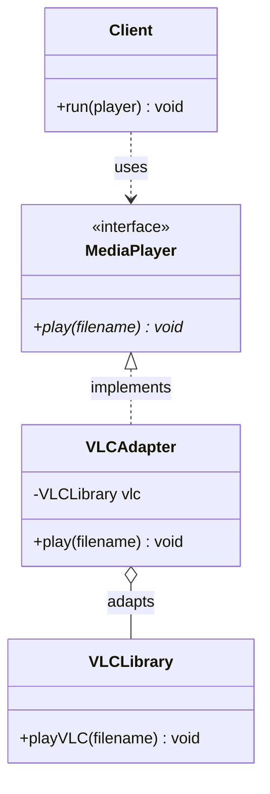
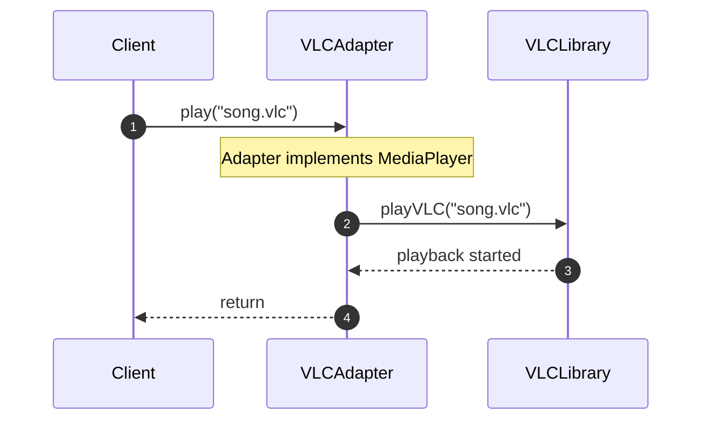

## Overview

Converts the interface of a class into **another interface that clients expect**. Lets classes work together that otherwise couldn't because of incompatible interfaces.

Think of it like a power plug adapter: the wall socket (existing interface) does not change, but the adapter lets your device (client) plug in.

**The problem without it**

1. Your `MediaPlayer` interface has a `play(filename)` method, and every client depends on it.
2. -> A third-party library arrives (`VLCLibrary`) that can play a format you need, but its method is `playVLC(filename)`, not `play(filename)`.
3. -> You cannot pass a `VLCLibrary` where a `MediaPlayer` is expected. Editing the library is off the table (you don't own it), and editing every client to call `playVLC` scatters the dependency everywhere.

**The fix:** create an **adapter** class that implements the interface the client expects (`MediaPlayer`) and internally delegates to the incompatible class (`VLCLibrary`). The client talks to the adapter as if it were a regular `MediaPlayer`, and the adapter translates the call. Neither the client nor the adaptee changes.

**What varies:** the mapping between two interfaces -- the adapter absorbs all the translation logic.

| Principle ([[Foundational Principles]]) | How Adapter applies it |
|---|---|
| Program to an interface | The client depends on `MediaPlayer`, never on `VLCLibrary` directly |
| [[1 - Single Responsibility Principle\|Single Responsibility]] | The translation code lives in one class, not scattered across clients |
| [[2 - Open-Closed Principle\|Open-Closed]] | Support a new library by adding a new adapter, not editing existing code |

### Two forms

| | Object adapter (GoF default) | Class adapter |
|---|---|---|
| Mechanism | Holds a reference to the adaptee, delegates to it | Inherits from *both* the target and the adaptee (multiple inheritance) |
| Flexibility | Can adapt any subclass of the adaptee at runtime | Bound to one adaptee class at compile time |
| Override adaptee behavior | Must wrap calls | Can override adaptee methods directly |
| Language support | Works everywhere | Requires multiple inheritance (C++), or interfaces + single class inheritance (C#, Java) |
| GoF recommendation | Preferred in most situations | Use when you need to override adaptee behavior and multiple inheritance is available |

## Structure



### Participants

| Role | Class in the example | Responsibility |
|---|---|---|
| Target | `MediaPlayer` | The interface the client expects |
| Adaptee | `VLCLibrary` | The existing class with an incompatible interface |
| Adapter | `VLCAdapter` | Implements `Target`, translates calls to the `Adaptee` |
| Client | `Client` / `main()` | Works through the `Target` interface, never touches the adaptee directly |

## How It Works

Scenario: the client wants to play a `.vlc` file through the `MediaPlayer` interface.



1. The client calls `play("song.vlc")` on what it believes is a `MediaPlayer`.
2. The `VLCAdapter` receives the call. It knows how to translate.
3. It delegates to `VLCLibrary::playVLC()`, mapping arguments as needed.
4. `VLCLibrary` does the real work and returns.
5. The adapter returns to the client. The client never knew a translation happened.

## When to Use

- When you want to use an existing class but its interface does not match what you need.
- When integrating third-party or legacy code whose source you cannot (or should not) modify.
- When you want to create a reusable class that cooperates with classes that don't yet exist (future integrations).

Signals in your code:

- You are writing wrapper methods that just rename and forward calls to another class -> extract an adapter.
- Client code `#include`s or `using`s a third-party library directly in many places -> put an adapter in between so only the adapter depends on the library.
- Two libraries that should work together use different names for equivalent operations (`draw()` vs `render()`, `serialize()` vs `toJson()`) -> an adapter bridges them.
- You need to swap one service for another (e.g., switching payment providers) and the interfaces differ -> adapt the new one to match the old contract.

## C++ Example

Object adapter (the recommended form):

```cpp
#include <iostream>
#include <memory>
#include <string>

// Target: the interface your code expects
class MediaPlayer {
public:
    virtual ~MediaPlayer() = default;
    virtual void play(const std::string& filename) = 0;
};

// Adaptee: incompatible third-party class (you do not own this)
class VLCLibrary {
public:
    void playVLC(const std::string& filename) {
        std::cout << "VLC playing: " << filename << '\n';
    }
};

// Adapter: bridges the gap
class VLCAdapter : public MediaPlayer {
    VLCLibrary vlc;                              // composition, not inheritance
public:
    void play(const std::string& filename) override {
        vlc.playVLC(filename);                   // translate play -> playVLC
    }
};

// A second adaptee with yet another interface
class FFmpegLibrary {
public:
    void decode(const std::string& path, bool audio) {
        std::cout << "FFmpeg decoding " << (audio ? "audio" : "video")
                  << ": " << path << '\n';
    }
};

class FFmpegAdapter : public MediaPlayer {
    FFmpegLibrary ffmpeg;
public:
    void play(const std::string& filename) override {
        ffmpeg.decode(filename, true);           // translate play -> decode
    }
};
```

Usage:

```cpp
int main() {
    std::unique_ptr<MediaPlayer> player;

    player = std::make_unique<VLCAdapter>();
    player->play("song.vlc");      // VLC playing: song.vlc

    player = std::make_unique<FFmpegAdapter>();
    player->play("song.mp3");      // FFmpeg decoding audio: song.mp3
}
```

| GoF role | In this example | In .NET |
|---|---|---|
| Target | `MediaPlayer` | The interface your code depends on (`ILogger`, `Stream`) |
| Adaptee | `VLCLibrary`, `FFmpegLibrary` | The foreign class (`SerilogLogger`, a COM object) |
| Adapter | `VLCAdapter`, `FFmpegAdapter` | The wrapper class that implements the target and delegates |

````ad-warning
title: Bug in the original skeleton
The original example used a raw `new` with no `delete`, leaking the `VLCLibrary`. The object adapter above uses composition (a plain member), so the adaptee's lifetime is automatic. If you must hold a pointer, use `std::unique_ptr`.
````

## In .NET / C#

.NET uses the Adapter pattern everywhere a foreign or legacy API must fit a standard interface.

- **`StreamReader` / `StreamWriter`** adapt a raw `Stream` (byte-oriented) into a text-oriented API. The stream is the adaptee; the reader/writer is the adapter that translates `Read(byte[])` into `ReadLine()`.
- **`DbDataAdapter`** (ADO.NET) adapts a database-specific command and connection into the `DataSet`-filling interface (`Fill`, `Update`). `SqlDataAdapter` adapts SQL Server, `MySqlDataAdapter` adapts MySQL, etc.
- **`ILogger<T>` wrappers.** When you integrate a third-party logger (Serilog, NLog) with ASP.NET Core's `ILogger<T>`, the integration package provides an adapter that maps `Log(LogLevel, ...)` to the library's own methods.
- **COM Interop wrappers.** When you add a reference to a COM library, the runtime generates a *Runtime Callable Wrapper* (RCW) that adapts the COM interface to .NET calling conventions.

```csharp
// Target: the interface your application depends on
public interface INotificationSender
{
    void Send(string to, string message);
}

// Adaptee: a third-party SMS library with a different interface
public class TwilioSmsClient
{
    public void SendSms(string phoneNumber, string body, string from)
        => Console.WriteLine($"Twilio SMS to {phoneNumber}: {body}");
}

// Adapter: maps INotificationSender onto the Twilio client
public class TwilioAdapter : INotificationSender
{
    private readonly TwilioSmsClient _client = new();
    private readonly string _fromNumber;

    public TwilioAdapter(string fromNumber) => _fromNumber = fromNumber;

    public void Send(string to, string message)
        => _client.SendSms(to, message, _fromNumber);  // translate
}

// Usage
INotificationSender sender = new TwilioAdapter("+15551234567");
sender.Send("+15559876543", "Your order shipped!");
```

````ad-tip
title: Where else you meet it
- **ASP.NET Core DI.** `services.AddSingleton<INotificationSender>(new TwilioAdapter("+155..."))` registers the adapter. Every class that depends on `INotificationSender` gets the Twilio adapter without knowing it.
- **AutoMapper / Mapster.** At a conceptual level these are adapters: they translate one object shape into another so that layers (e.g., DTOs to domain models) can be decoupled.
- **`IEnumerable<T>` wrappers.** Wrapping a non-generic `IEnumerable` (from legacy APIs) in a generic `IEnumerable<T>` via `Cast<T>()` is a mini-adapter.
````

## Trade-offs

| Pros | Cons |
|---|---|
| The client and the adaptee stay unchanged -- neither needs to know the other exists | Another layer of indirection: one more class to maintain and debug through |
| You can swap adaptees (switch from Twilio to SendGrid) by writing a new adapter, no client changes | If the target and adaptee interfaces differ a lot, the translation logic can get complicated |
| Isolates third-party dependencies: only the adapter `using`s or `#include`s the library | Overuse turns every class boundary into an adapter, adding boilerplate for no real decoupling gain |
| Works with classes you cannot modify (no source, or you don't own them) | Object adapters add a delegation hop per call; class adapters (C++ multiple inheritance) add coupling |

````ad-warning
title: Common misuse
- **Wrapping your own code.** If you own both sides, rename the method or extract an interface instead of introducing an adapter. Adapters are for code you *cannot* change.
- **Adapter chains.** A -> Adapter1 -> Adapter2 -> Adaptee is a sign the interfaces drifted too far. Collapse to one adapter or redesign the target interface.
````

## Related Patterns

- [[03 - Facade|Facade]]: Facade simplifies a complex subsystem into one entry point. Adapter converts one interface to another. Facade creates a *new* interface; Adapter makes an *existing* interface work where it couldn't.
- [[02 - Decorator|Decorator]]: both wrap an object, but Decorator adds behavior while keeping the same interface. Adapter changes the interface.
- [[06 - Bridge|Bridge]]: Bridge separates abstraction from implementation up front. Adapter is applied *after the fact* to make incompatible classes work together.
- [[04 - Proxy|Proxy]]: Proxy keeps the same interface and controls access. Adapter changes the interface to match a different target.
- [[02 - Strategy|Strategy]]: Strategy encapsulates interchangeable algorithms behind a common interface. When the algorithm source is a foreign library, the Strategy implementation is effectively an adapter.

```ad-summary
- Adapter wraps an existing class so it matches an interface the client already depends on. Neither side changes.
- Prefer the object adapter (composition) over the class adapter (multiple inheritance) for flexibility.
- In .NET you see it in `StreamReader`/`StreamWriter`, `DbDataAdapter`, logger integrations, and COM interop wrappers.
- Use it for code you don't own. If you own both sides, change the interface directly.
```
