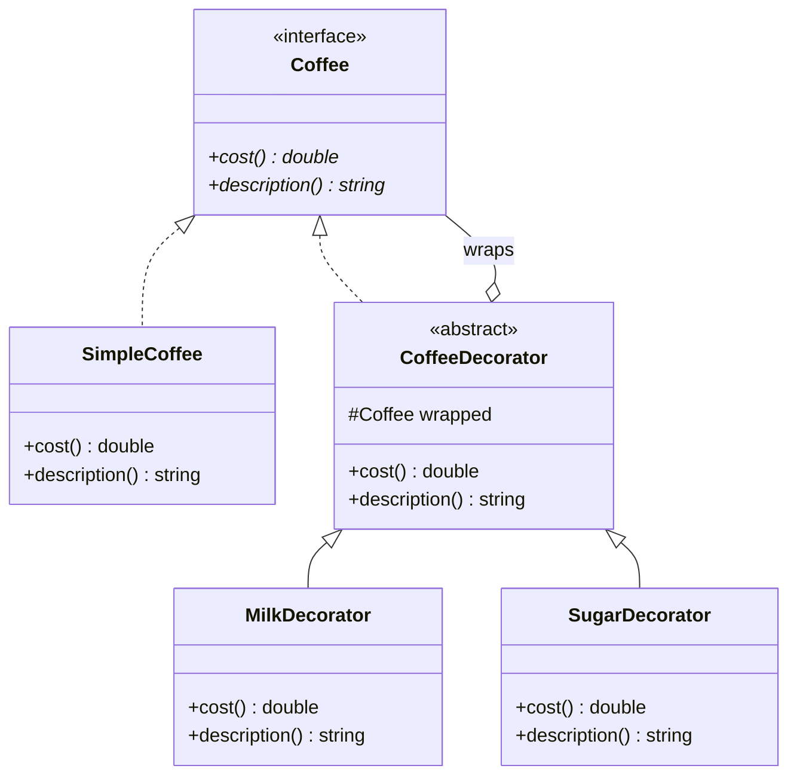
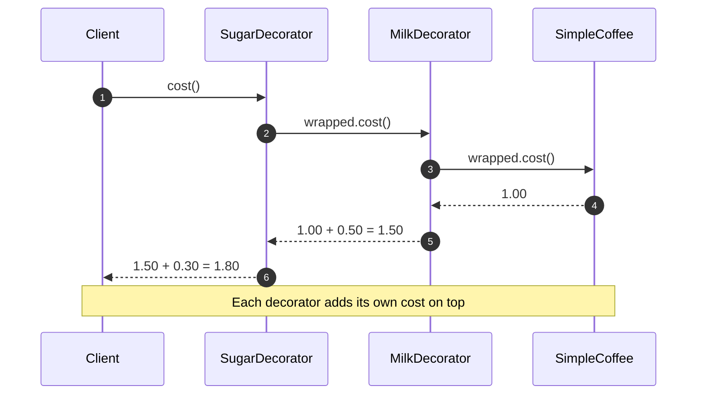

## Overview

Attaches **additional responsibilities** to an object dynamically. Provides a flexible alternative to subclassing for extending functionality.

Decorators wrap the original object and add behavior before or after delegating to it.

**The problem without it**

1. You have a `Coffee` class. You want to offer milk, sugar, and whipped cream as extras.
2. -> Subclassing gives you `MilkCoffee`, `SugarCoffee`, `MilkSugarCoffee`, `MilkSugarWhipCoffee` ... the number of subclasses grows exponentially with each new topping.
3. -> Adding a new topping means creating new subclasses for every existing combination. Removing one means deleting them. Every change ripples through the hierarchy.

**The fix:** make each topping a **decorator** that wraps a `Coffee` and adds its cost and description on top. Decorators stack at runtime: `new Whip(new Sugar(new Milk(new SimpleCoffee())))`. Each decorator implements the same `Coffee` interface, holds a reference to the next `Coffee`, and delegates to it after (or before) doing its own work.

**What varies:** the combination of behaviors attached to an object, decided at runtime instead of compile time.

| Principle ([[Foundational Principles]]) | How Decorator applies it |
|---|---|
| [[2 - Open-Closed Principle\|Open-Closed]] | Add new behavior by writing a new decorator, without modifying existing classes |
| Favor composition over inheritance | Behavior is assembled by wrapping objects, not by extending a class hierarchy |
| [[1 - Single Responsibility Principle\|Single Responsibility]] | Each decorator adds exactly one responsibility |

## Structure



### Participants

| Role | Class in the example | Responsibility |
|---|---|---|
| Component | `Coffee` | Declares the interface shared by decorated and undecorated objects |
| ConcreteComponent | `SimpleCoffee` | The base object that gets decorated |
| Decorator | `CoffeeDecorator` | Holds a reference to a `Component` and forwards calls to it |
| ConcreteDecorator | `MilkDecorator`, `SugarDecorator` | Adds its own behavior before/after delegating to the wrapped component |

## How It Works

Scenario: the client orders a `SimpleCoffee` with milk and sugar.



1. The client calls `cost()` on the outermost decorator (`SugarDecorator`).
2. `SugarDecorator` delegates to its wrapped object (`MilkDecorator`).
3. `MilkDecorator` delegates to *its* wrapped object (`SimpleCoffee`).
4. `SimpleCoffee` returns 1.00, the base cost.
5. `MilkDecorator` adds 0.50 and returns 1.50.
6. `SugarDecorator` adds 0.30 and returns 1.80 to the client.
7. The client sees one `Coffee` and one `cost()` call. It does not know how many layers are inside.

## When to Use

- When you need to add behavior to individual objects without affecting other objects of the same class.
- When extension by subclassing is impractical (combinatorial explosion of subclasses).
- When you need to add and remove responsibilities at runtime.

Signals in your code:

- A class hierarchy is growing with every new combination of features (`LoggingCachingRepository`, `CachingRetryRepository`, ...) -> make each feature a decorator.
- You are conditionally wrapping an object: `if (config.logging) stream = new LoggingStream(stream);` -> you're already using the pattern.
- A method does one main thing plus a cross-cutting concern (logging, timing, caching, retry) -> extract the concern into a decorator.
- You see repeated `base.Method()` calls in deeply nested subclasses -> flatten into decorators that each wrap the next.

## C++ Example

```cpp
#include <iostream>
#include <memory>
#include <string>

class Coffee {                                         // Component
public:
    virtual ~Coffee() = default;
    virtual double cost() const = 0;
    virtual std::string description() const = 0;
};

class SimpleCoffee : public Coffee {                   // ConcreteComponent
public:
    double cost() const override { return 1.0; }
    std::string description() const override { return "Simple coffee"; }
};

class CoffeeDecorator : public Coffee {                // Decorator base
protected:
    std::unique_ptr<Coffee> wrapped;
public:
    explicit CoffeeDecorator(std::unique_ptr<Coffee> c) : wrapped(std::move(c)) {}
    double cost() const override { return wrapped->cost(); }
    std::string description() const override { return wrapped->description(); }
};

class MilkDecorator : public CoffeeDecorator {         // ConcreteDecorator
public:
    explicit MilkDecorator(std::unique_ptr<Coffee> c) : CoffeeDecorator(std::move(c)) {}
    double cost() const override { return wrapped->cost() + 0.5; }
    std::string description() const override {
        return wrapped->description() + ", milk";
    }
};

class SugarDecorator : public CoffeeDecorator {
public:
    explicit SugarDecorator(std::unique_ptr<Coffee> c) : CoffeeDecorator(std::move(c)) {}
    double cost() const override { return wrapped->cost() + 0.3; }
    std::string description() const override {
        return wrapped->description() + ", sugar";
    }
};
```

Usage:

```cpp
int main() {
    // Build the decorator chain at runtime
    std::unique_ptr<Coffee> order = std::make_unique<SimpleCoffee>();
    order = std::make_unique<MilkDecorator>(std::move(order));
    order = std::make_unique<SugarDecorator>(std::move(order));

    std::cout << order->description() << '\n';  // Simple coffee, milk, sugar
    std::cout << order->cost() << '\n';          // 1.8
}
```

| Subclass explosion | Decorator stacking |
|---|---|
| `SimpleCoffee` | `SimpleCoffee` |
| `MilkCoffee` | `MilkDecorator(SimpleCoffee)` |
| `SugarCoffee` | `SugarDecorator(SimpleCoffee)` |
| `MilkSugarCoffee` | `SugarDecorator(MilkDecorator(SimpleCoffee))` |
| N toppings -> 2^N classes | N toppings -> N decorators + mix at will |

````ad-warning
title: Identity trap
After wrapping, `decorated == original` is false even though they share the same interface. If a collection stores the original pointer and you later compare with the decorated pointer, the lookup fails. This matters in C++ (`==` on raw pointers) and in C# (reference equality). Track identity *before* decoration, or avoid identity checks on decorated objects.
````

## In .NET / C#

.NET uses the Decorator pattern heavily, especially in the `System.IO` namespace.

- **`Stream` decorators.** `BufferedStream`, `GZipStream`, `CryptoStream`, and `SslStream` all wrap another `Stream`. You stack them: `new GZipStream(new BufferedStream(fileStream))`. Each adds one responsibility (compression, buffering, encryption) and delegates reads/writes to the inner stream.
- **ASP.NET Core middleware.** Each middleware wraps the next, adding behavior (logging, auth, CORS) before and after `await next(context)`. This is Decorator meets [[07 - Chain of Responsibility|Chain of Responsibility]].
- **`DelegatingHandler`.** Wraps an inner `HttpMessageHandler` for `HttpClient`. Each handler adds one concern (auth header, retry, logging) and calls `base.SendAsync(...)`.
- **`IServiceCollection` decoration.** Libraries like Scrutor let you write `services.Decorate<IRepository, CachingRepository>()` to wrap the registered implementation with a decorator.

```csharp
using System.IO;
using System.IO.Compression;

// Stream decorators stacking: file -> buffered -> compressed
await using var file = File.Create("data.gz");
await using var buffered = new BufferedStream(file, bufferSize: 4096);
await using var gzip = new GZipStream(buffered, CompressionLevel.Optimal);
await gzip.WriteAsync(data);
// gzip wraps buffered, buffered wraps file — each adds one layer
```

```csharp
// Custom decorator for a repository
public interface IOrderRepository
{
    Order? GetById(int id);
}

public class SqlOrderRepository : IOrderRepository   // ConcreteComponent
{
    public Order? GetById(int id) => /* query database */;
}

public class CachingOrderRepository : IOrderRepository // Decorator
{
    private readonly IOrderRepository _inner;
    private readonly IMemoryCache _cache;

    public CachingOrderRepository(IOrderRepository inner, IMemoryCache cache)
    {
        _inner = inner;
        _cache = cache;
    }

    public Order? GetById(int id)
    {
        if (_cache.TryGetValue($"order-{id}", out Order? cached))
            return cached;

        var order = _inner.GetById(id);              // delegate to wrapped
        if (order is not null)
            _cache.Set($"order-{id}", order, TimeSpan.FromMinutes(5));
        return order;
    }
}
```

````ad-tip
title: Where else you meet it
- **LINQ operators.** `Where`, `Select`, `OrderBy` each return a new `IEnumerable<T>` that wraps the previous one. The chain is a decorator stack evaluated lazily. See [[Deferred Execution in LINQ]].
- **Logging wrappers.** An `ILogger` that adds a correlation ID to every log message by wrapping another `ILogger` is a decorator.
- **Polly / resilience.** `new ResiliencePipelineBuilder().AddRetry(...).AddTimeout(...).Build()` stacks retry and timeout behaviors as decorating layers around your delegate.
````

## Trade-offs

| Pros | Cons |
|---|---|
| Add or remove responsibilities at runtime without touching the class | Many small objects: a decorated object may have 3-4 layers, making the object graph harder to read in a debugger |
| Avoids combinatorial subclass explosion: N decorators cover 2^N combinations | Order of wrapping can matter: `Encrypt(Compress(data))` differs from `Compress(Encrypt(data))` |
| Each decorator is small, focused, and independently testable | The decorated object loses identity: `decorated != original` even though both implement the same interface |
| Follows Open-Closed: new behavior is a new class, not a code change | If the Component interface is large (many methods), the decorator must forward every method, which is tedious boilerplate |

````ad-warning
title: Common misuse
- **Decorating with too many layers.** If every call passes through 5+ decorators, consider whether a [[03 - Facade|Facade]] or a pipeline pattern is cleaner.
- **Decorator that does not delegate.** A decorator that *replaces* the wrapped behavior instead of *adding to it* is really a [[04 - Proxy|Proxy]] or a [[02 - Strategy|Strategy]] swap.
````

## Related Patterns

- [[01 - Adapter|Adapter]]: both wrap an object, but Adapter changes the interface to match a different target, while Decorator keeps the same interface and adds behavior.
- [[04 - Proxy|Proxy]]: Proxy wraps an object with the same interface but controls *access* (lazy loading, permissions). Decorator wraps to add *behavior*.
- [[05 - Composite|Composite]]: Composite and Decorator both use recursive composition, but Composite aggregates *multiple* children, while Decorator wraps *one* component and adds behavior.
- [[07 - Chain of Responsibility|Chain of Responsibility]]: same shape (each link holds the next and forwards), but a chain handler may *stop* the request, while a decorator *always* forwards. ASP.NET Core middleware sits between the two.
- [[02 - Strategy|Strategy]]: Strategy replaces the *entire* algorithm. Decorator enhances an existing object without replacing it.

```ad-summary
- Decorator wraps an object with the same interface to add behavior, avoiding the 2^N subclass explosion.
- Each decorator adds one responsibility and delegates the rest to the wrapped object. They stack at runtime.
- In .NET you see it in `Stream` wrappers (`BufferedStream`, `GZipStream`), `DelegatingHandler`, LINQ operators, and middleware.
- Watch for identity traps, wrapping-order dependencies, and excessive layer depth.
```
