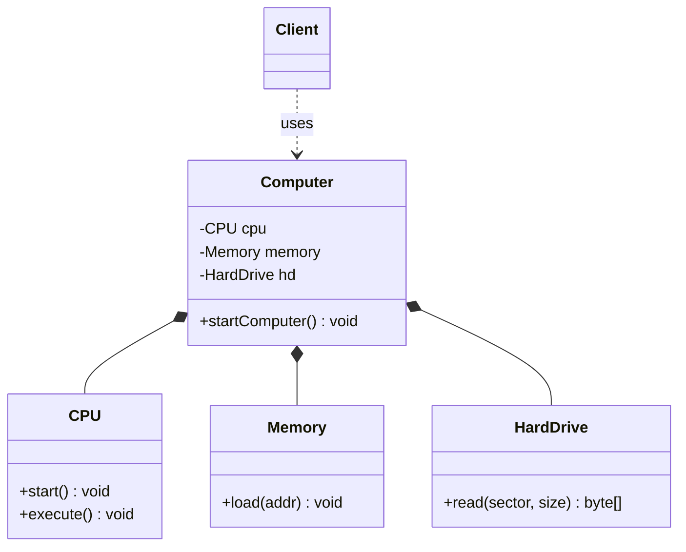
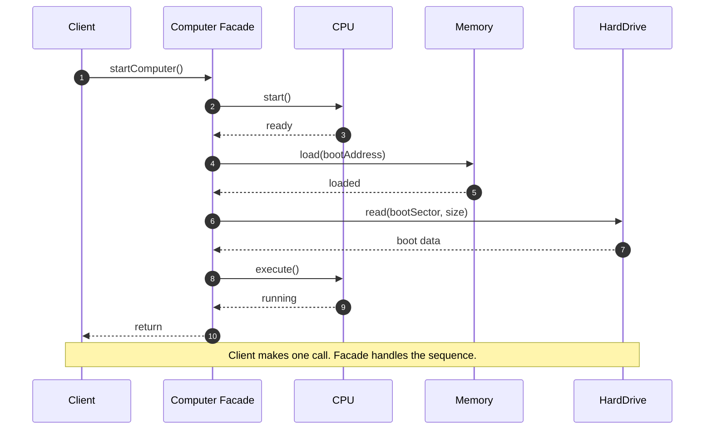

## Overview

Provides a **simplified interface** to a complex subsystem. It does not hide the subsystem -- it just provides a convenient entry point.

**The problem without it**

1. Starting a computer involves the CPU, memory, hard drive, BIOS, and GPU, each with its own initialization API.
2. -> Every client that boots the machine must call the right methods in the right order: `cpu.start()`, `memory.load(addr)`, `hd.read(sector, size)`, ...
3. -> The client is coupled to every subsystem class, and the boot sequence is duplicated wherever a "start" is needed. A change in any subsystem method ripples into all clients.

**The fix:** create a **Facade** class (`Computer`) that exposes one method (`startComputer()`). Internally it orchestrates the subsystem in the correct order. Clients call the facade and never touch the subsystem classes directly -- though they *can* if they need fine-grained control.

**What varies:** the complexity behind a single entry point. The subsystem stays accessible; the facade just makes the common case easy.

| Principle ([[Foundational Principles]]) | How Facade applies it |
|---|---|
| Encapsulate what varies | The subsystem's wiring and call order are hidden behind one method |
| Least Knowledge ([[Law of Demeter]]) | The client talks to one object (the facade), not to a dozen subsystem classes |
| [[1 - Single Responsibility Principle\|Single Responsibility]] | The facade's job is *orchestration*. Each subsystem class keeps its own responsibility |

## Structure



### Participants

| Role | Class in the example | Responsibility |
|---|---|---|
| Facade | `Computer` | Knows which subsystem classes handle a request and delegates in the correct order |
| Subsystem classes | `CPU`, `Memory`, `HardDrive` | Do the real work. They don't know the facade exists |
| Client | `main()` | Uses the facade's simple interface instead of calling subsystems directly |

## How It Works

Scenario: the client calls `startComputer()`.



1. The client calls `startComputer()` -- one method, no subsystem knowledge.
2. The facade calls `CPU::start()` first, because the CPU must initialize before anything else.
3. Then it loads boot data into memory.
4. Then it reads the boot sector from the hard drive.
5. Finally it tells the CPU to execute.
6. The client gets a running computer. If the boot sequence changes (new GPU initialization step), only the facade changes.

## When to Use

- When a subsystem has many classes and the client only needs a simple high-level interface.
- When you want to layer your system (presentation -> facade -> business logic -> data access).
- When you want to reduce coupling between clients and a complex subsystem.

Signals in your code:

- Multiple client classes repeat the same sequence of subsystem calls in the same order -> extract a facade.
- A "setup" or "initialization" method touches 5+ classes to get them into a working state -> that is a facade waiting to be named.
- Tests `new` several subsystem objects just to exercise one scenario -> a facade gives tests a single entry point.
- You are building a library and want to offer a "quick start" API alongside the full API -> the quick start *is* a facade.

## C++ Example

```cpp
#include <cstdint>
#include <iostream>
#include <string>
#include <vector>

// Subsystem classes: each does one thing
class CPU {
public:
    void start()   { std::cout << "CPU started\n"; }
    void execute() { std::cout << "CPU executing\n"; }
};

class Memory {
public:
    void load(uint64_t address) {
        std::cout << "Memory loaded at 0x" << std::hex << address << '\n';
    }
};

class HardDrive {
public:
    std::vector<uint8_t> read(uint64_t sector, std::size_t size) {
        std::cout << "HD read sector " << sector << " (" << size << " bytes)\n";
        return std::vector<uint8_t>(size, 0);
    }
};

// Facade: one simple call for the common case
class Computer {
    CPU cpu;
    Memory memory;
    HardDrive hd;
public:
    void startComputer() {
        cpu.start();
        memory.load(0x7C00);                       // BIOS loads boot sector here
        auto bootData = hd.read(0, 512);           // first sector, 512 bytes
        cpu.execute();
        std::cout << "Computer is running\n";
    }
};
```

Usage:

```cpp
int main() {
    Computer pc;
    pc.startComputer();    // one call -- the client doesn't touch CPU, Memory, or HardDrive

    // If fine-grained control is needed, subsystems are still accessible:
    // CPU cpu; cpu.start(); cpu.execute();
}
```

````ad-warning
title: Facade vs God Object
A facade *delegates* to subsystem classes; it does not contain business logic itself. If the facade starts growing its own fields, conditions, and loops, it is becoming a God Object. Keep it thin: orchestrate, don't implement.
````

## In .NET / C#

Facades are everywhere in .NET because the framework exposes complex subsystems through simple entry points.

- **`WebApplication.CreateBuilder(args)`** is a facade over `HostBuilder`, `ConfigurationBuilder`, `ServiceCollection`, `LoggingBuilder`, Kestrel options, and more. One call sets up a web host. See [[01 - WebApplication Startup]].
- **`File.ReadAllText(path)`** is a facade for opening a `FileStream`, wrapping it in a `StreamReader`, reading to the end, and disposing both.
- **`HttpClient.GetStringAsync(url)`** is a facade over creating an `HttpRequestMessage`, sending it through the handler pipeline, reading the response stream, and converting to string.
- **`DbContext.SaveChanges()`** (EF Core) is a facade over change tracking, validation, SQL generation, connection management, and transaction handling.

```csharp
// Without a facade: the client must orchestrate the subsystem
var config = new ConfigurationBuilder()
    .AddJsonFile("appsettings.json")
    .AddEnvironmentVariables()
    .Build();
var services = new ServiceCollection();
services.AddLogging(b => b.AddConsole());
services.AddSingleton<IConfiguration>(config);
var provider = services.BuildServiceProvider();
var logger = provider.GetRequiredService<ILogger<Program>>();
logger.LogInformation("Ready");

// With the facade: one line
var builder = WebApplication.CreateBuilder(args);   // facade
var app = builder.Build();
app.Logger.LogInformation("Ready");
```

```csharp
// Custom facade: email sending
public class EmailService    // Facade
{
    private readonly SmtpClient _smtp;
    private readonly ITemplateEngine _templates;
    private readonly IConfiguration _config;

    public EmailService(SmtpClient smtp, ITemplateEngine templates, IConfiguration config)
    {
        _smtp = smtp;
        _templates = templates;
        _config = config;
    }

    public async Task SendWelcomeEmailAsync(string to, string userName)
    {
        var body = _templates.Render("welcome", new { Name = userName });
        var from = _config["Email:From"];
        var msg = new MailMessage(from, to, "Welcome!", body) { IsBodyHtml = true };
        await _smtp.SendMailAsync(msg);
    }
}
// Client: emailService.SendWelcomeEmailAsync("user@example.com", "Alice");
```

````ad-tip
title: Where else you meet it
- **`IHost` / `IHostBuilder`.** The Generic Host is a facade over DI, configuration, logging, and hosted services. All .NET apps (web, worker, console) use it.
- **`JsonSerializer.Serialize<T>(obj)`** (System.Text.Json). A facade over `Utf8JsonWriter`, `JsonConverterFactory`, reflection / source generators, and buffer management.
- **NuGet package facades.** Packages like `Microsoft.AspNetCore.App` are meta-packages that facade dozens of individual packages into one reference.
````

## Trade-offs

| Pros | Cons |
|---|---|
| Clients are decoupled from subsystem complexity | The facade can become a God Object if you keep adding methods instead of splitting facades |
| Reduces the learning curve: new developers start with the facade and dig deeper when needed | Hides the subsystem, which can be a problem when callers need fine-grained control or diagnostics |
| Subsystem classes can evolve independently as long as the facade's contract stays stable | Every new subsystem capability may demand a new facade method, so the facade can lag behind |
| Makes the common case easy while still allowing direct subsystem access | A "do-everything" facade method with many boolean flags defeats the purpose -- split into focused methods |

````ad-warning
title: Common misuse
- **Forced facade.** Not every subsystem needs one. If clients only ever call one subsystem class, a facade adds indirection for no gain.
- **Facade as the only entry point.** Making subsystem classes `internal` and exposing *only* the facade removes flexibility. Keep subsystems accessible for advanced callers.
````

## Related Patterns

- [[01 - Adapter|Adapter]]: Adapter converts an existing interface so it matches a different target. Facade creates a *new*, simpler interface for a subsystem.
- [[08 - Mediator|Mediator]]: Mediator coordinates communication *between* peers, and the peers know the mediator. A facade provides a one-way simplification: clients call the facade, but subsystem classes don't know it exists.
- [[03 - Abstract Factory|Abstract Factory]]: an Abstract Factory can serve as a facade for creating a family of related objects without exposing the concrete classes.
- [[01 - Singleton|Singleton]]: facades are often singletons because only one entry point is needed.

```ad-summary
- Facade gives clients a single, simple entry point to a complex subsystem. The subsystem stays accessible for fine-grained use.
- It reduces coupling: clients depend on the facade, not on a dozen subsystem classes.
- In .NET: `WebApplication.CreateBuilder`, `File.ReadAllText`, `HttpClient.GetStringAsync`, and `DbContext.SaveChanges` are all facades.
- Keep it thin -- a facade orchestrates, it does not contain business logic. Split if it grows too large.
```
