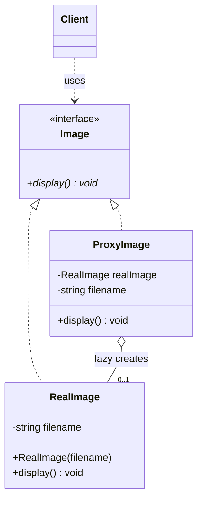
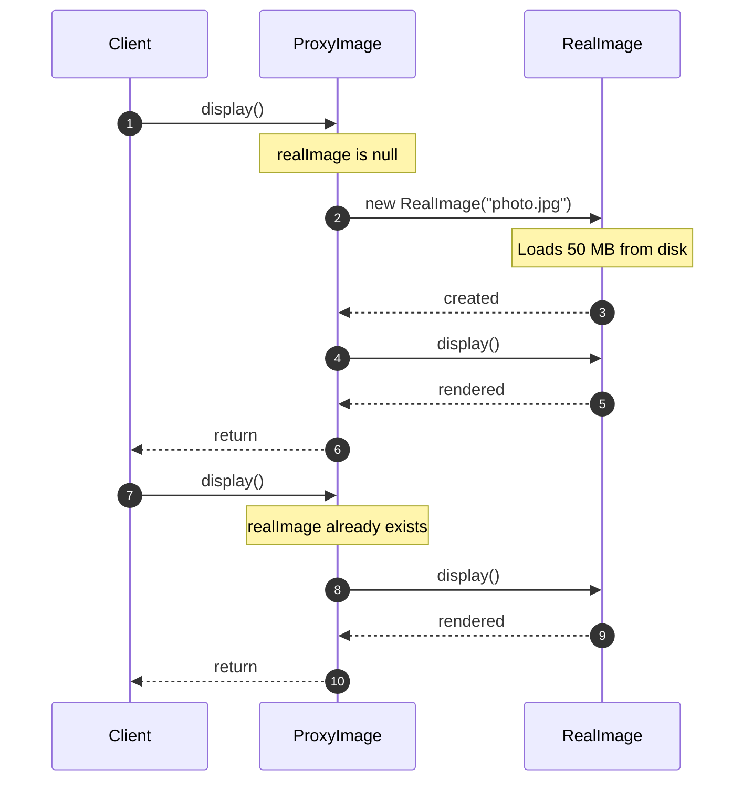

## Overview

Provides a **surrogate or placeholder** for another object to control access to it.

**The problem without it**

1. A `RealImage` loads a 50 MB file from disk in its constructor, even if the image is never displayed.
2. -> A gallery page creates 100 `RealImage` objects on startup. That is 5 GB of disk I/O before the user sees anything.
3. -> You cannot add lazy loading, access checks, or logging without editing `RealImage` itself, which may belong to a library you don't own.

**The fix:** create a **Proxy** that implements the same `Image` interface. The proxy holds a reference to the `RealImage` but creates it only when `display()` is actually called (lazy loading). The client talks to the proxy as if it were the real object. The proxy can also add access control, caching, or logging around the real call.

**What varies:** *when* and *whether* the real object is accessed, not *what* it does. The proxy controls the gate.

| Principle ([[Foundational Principles]]) | How Proxy applies it |
|---|---|
| Program to an interface | The client depends on `Image`, not on `RealImage` or `ProxyImage` |
| [[1 - Single Responsibility Principle\|Single Responsibility]] | The proxy handles access control / lazy loading. The real object handles the actual work |
| Encapsulate what varies | The "when to create" and "whether to allow" logic is encapsulated in the proxy |

### Types of proxies

| Type | What it controls | Example |
|---|---|---|
| **Virtual** | Creation timing (lazy init) | Load a heavy image only when `display()` is called |
| **Protection** | Access rights | Check permissions before forwarding the call |
| **Remote** | Network location | Represent an object on another machine (WCF, gRPC client) |
| **Caching** | Repeated results | Store and return previous results for the same input |
| **Logging** | Observation | Record every call before/after forwarding |
| **Smart reference** | Lifetime / reference counting | `std::shared_ptr` is a smart-reference proxy around a raw pointer |

## Structure



### Participants

| Role | Class in the example | Responsibility |
|---|---|---|
| Subject | `Image` | Declares the interface shared by `RealImage` and `ProxyImage` |
| RealSubject | `RealImage` | The actual object that does the expensive work |
| Proxy | `ProxyImage` | Controls access to `RealImage`: creates it lazily, checks permissions, caches, etc. |
| Client | `main()` | Works through the `Image` interface, unaware that it holds a proxy |

## How It Works

Scenario: the client displays an image twice. The proxy loads it from disk only on the first call.



1. The client calls `display()` on what it thinks is an `Image`.
2. The proxy checks: `realImage` is null, so the real object has not been created yet.
3. It creates the `RealImage`, which performs the expensive disk load.
4. Now it delegates `display()` to the real object.
5. The image renders and control returns to the client.
6. On the second call, `realImage` already exists -- no disk load, just a direct delegation.

## When to Use

- Lazy loading of expensive objects (virtual proxy).
- Access control -- check permissions before forwarding (protection proxy).
- Logging, metrics, or auditing around method calls (logging proxy).
- Caching results of expensive operations (caching proxy).
- Working with remote services (remote proxy: WCF, gRPC, RPC stubs).

Signals in your code:

- A constructor does heavy work (disk I/O, network, large allocation) but the object might never be used -> wrap it in a virtual proxy.
- Permission checks are duplicated before every call to a service -> centralize them in a protection proxy.
- You want to log every call to an interface without editing every implementation -> a logging proxy wraps any implementation.
- Client code creates an object only to call `Dispose()` most of the time without using it -> a proxy avoids creating it at all.

## C++ Example

```cpp
#include <iostream>
#include <memory>
#include <string>

class Image {                                          // Subject
public:
    virtual ~Image() = default;
    virtual void display() = 0;
};

class RealImage : public Image {                       // RealSubject
    std::string filename;
public:
    explicit RealImage(const std::string& f) : filename(f) {
        std::cout << "Loading " << filename << " from disk (expensive)\n";
    }
    void display() override {
        std::cout << "Displaying " << filename << '\n';
    }
};

class ProxyImage : public Image {                      // Proxy (virtual)
    std::unique_ptr<RealImage> realImage;
    std::string filename;
public:
    explicit ProxyImage(const std::string& f) : filename(f) {}  // cheap
    void display() override {
        if (!realImage)                                 // lazy load
            realImage = std::make_unique<RealImage>(filename);
        realImage->display();                           // delegate
    }
};
```

Usage:

```cpp
int main() {
    // Create 3 proxies: no images loaded yet
    ProxyImage img1("photo1.jpg");
    ProxyImage img2("photo2.jpg");
    ProxyImage img3("photo3.jpg");

    // Only img1 gets loaded from disk
    img1.display();   // Loading photo1.jpg from disk (expensive)
                      // Displaying photo1.jpg
    img1.display();   // Displaying photo1.jpg          (no reload)

    // img2 and img3 are never loaded -- zero cost
}
```

| Without proxy | With proxy |
|---|---|
| 3 images, 3 disk loads at construction | 3 proxies, 0 disk loads at construction |
| All 150 MB loaded before any display | Only `photo1.jpg` loaded when displayed |
| Cannot add caching or access checks without editing `RealImage` | Proxy adds behavior transparently |

````ad-warning
title: Bug in the original skeleton
The original example used raw `new` with no `delete`, leaking `RealImage`. The version above uses `std::unique_ptr` and the proxy owns the real object's lifetime. The original also took `std::string` by value without `const&`, causing unnecessary copies.
````

## In .NET / C#

.NET offers both manual and framework-generated proxies.

- **`Lazy<T>`** is a virtual proxy built into the BCL. It wraps a factory (`Func<T>`) and creates the object only on the first access to `.Value`. Thread-safe by default.
- **Entity Framework lazy loading proxies.** When you call `order.Customer`, EF intercepts the property access through a runtime-generated proxy (Castle.Core / `Microsoft.EntityFrameworkCore.Proxies`) and loads the related entity from the database on demand. See [[Lazy Loading]].
- **gRPC / WCF client proxies.** A generated client class implements the service interface and forwards calls over the network. The caller sees a local object; the proxy handles serialization, connection, and retry.
- **`DispatchProxy`** (`System.Reflection`). A base class for creating runtime proxies in .NET. You override `Invoke(MethodInfo, object[])` to add logging, caching, or auth before forwarding to the real object.

```csharp
using System;

// Virtual proxy with Lazy<T>
public interface IExpensiveService
{
    string Compute(int input);
}

public class RealExpensiveService : IExpensiveService
{
    public RealExpensiveService()
        => Console.WriteLine("Heavy initialization...");  // expensive

    public string Compute(int input) => $"Result: {input * 2}";
}

// Option 1: Lazy<T> — simplest virtual proxy
Lazy<IExpensiveService> service = new(() => new RealExpensiveService());
// Nothing created yet
Console.WriteLine(service.Value.Compute(5));   // "Heavy initialization..." then "Result: 10"
Console.WriteLine(service.Value.Compute(3));   // "Result: 6" — no re-init

// Option 2: hand-rolled proxy with access control
public class ProtectionProxy : IExpensiveService
{
    private readonly IExpensiveService _real;
    private readonly string _role;

    public ProtectionProxy(IExpensiveService real, string role)
    {
        _real = real;
        _role = role;
    }

    public string Compute(int input)
    {
        if (_role != "admin")
            throw new UnauthorizedAccessException("Admin only");
        return _real.Compute(input);   // delegate
    }
}
```

````ad-tip
title: Where else you meet it
- **`HttpMessageHandler` stubs in tests.** A mock `HttpMessageHandler` is a proxy that returns canned responses instead of making real HTTP calls.
- **`Channel<T>` (System.Threading.Channels).** The writer and reader ends are proxies that control how producers and consumers access a shared buffer.
- **AOP with `DispatchProxy`.** You can create a generic logging proxy that wraps *any* interface at runtime, logging every method call and return value without editing the implementation.
````

## Trade-offs

| Pros | Cons |
|---|---|
| Separates expensive creation from cheap referencing (virtual proxy) | Extra indirection: every call passes through the proxy |
| Access control in one place, not scattered across callers (protection proxy) | The proxy must match the Subject interface exactly, so interface changes require updating the proxy |
| Works transparently: the client doesn't know it's using a proxy | Lazy proxies introduce *first-call latency*: the first `display()` is suddenly much slower than the rest |
| Can be generated at runtime (`DispatchProxy`, Castle.Core) for cross-cutting concerns | Generated proxies add reflection overhead and make debugging harder (stack traces include proxy internals) |

````ad-warning
title: Common misuse
- **Proxy doing too much.** If the proxy starts transforming data, computing results, or managing state beyond access control, it is becoming a [[02 - Decorator|Decorator]] or a [[03 - Facade|Facade]]. Keep the proxy thin.
- **Lazy loading everything.** Not every object is expensive to create. Wrapping a cheap POCO in `Lazy<T>` adds complexity for no measurable benefit.
- **N+1 queries with EF proxies.** Lazy-loading navigation properties in a loop fires one query per iteration. Prefer `Include()` (eager loading) or explicit `LoadAsync()`. See [[Eager Loading]] and [[N+1 Problem]].
````

## Related Patterns

- [[02 - Decorator|Decorator]]: both wrap an object with the same interface. Proxy controls *access* (creation, permissions). Decorator adds *behavior* (extra cost, logging around the result). The line blurs: a logging proxy is close to a decorator.
- [[01 - Adapter|Adapter]]: Adapter changes the interface. Proxy keeps the interface identical.
- [[03 - Facade|Facade]]: Facade simplifies a subsystem into a new interface. Proxy provides the same interface and controls what happens behind it.
- [[07 - Flyweight|Flyweight]]: Flyweight shares intrinsic state across objects to save memory. A proxy *controls access* to one object. They can combine: a proxy that returns shared flyweights.

```ad-summary
- Proxy wraps an object with the *same* interface to control access: lazy loading, permission checks, caching, logging, or remote calls.
- Virtual (lazy), protection, remote, caching, and logging are the five common proxy types.
- In .NET: `Lazy<T>`, EF lazy-loading proxies, gRPC/WCF clients, `DispatchProxy`, and `HttpMessageHandler` test stubs.
- Keep the proxy thin. If it starts adding behavior rather than controlling access, it's becoming a Decorator.
```
