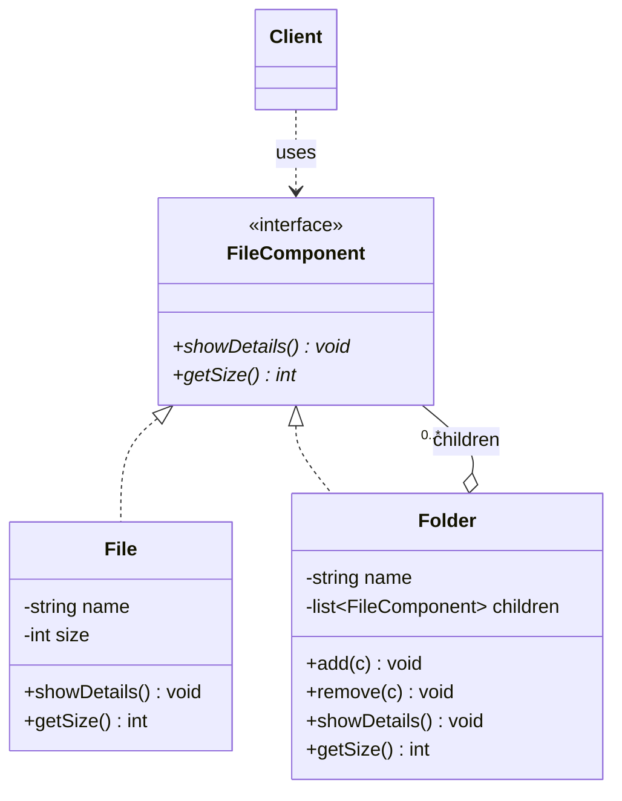
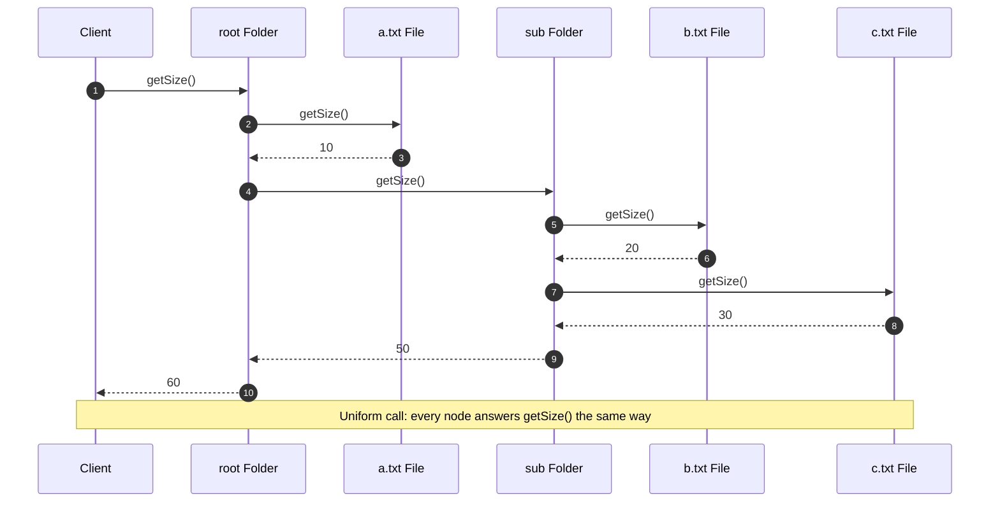

## Overview

Composes objects into **tree structures** to represent part-whole hierarchies. Lets clients treat individual objects and compositions of objects uniformly.

**The problem without it**

1. A file system has files and folders. You want a `showDetails()` method that prints sizes.
2. -> Calling `showDetails()` on a file returns its size. But calling it on a folder means looping through its children, checking whether each child is a file or a folder, and recursing if it's a folder.
3. -> Every client that walks the tree needs `if (child is File) ... else if (child is Folder) ...` type checks. Adding a new node type (e.g., `Shortcut`) means updating every such check.

**The fix:** define a **Component** interface (`FileComponent`) with the operation you want (`showDetails()`). Both `File` (leaf) and `Folder` (composite) implement it. `Folder` holds a list of `FileComponent` children and its `showDetails()` simply iterates and calls `showDetails()` on each child -- no type checks, uniform treatment. The tree is walked recursively through one interface.

**What varies:** whether an object is a leaf or a container, and how many children it has. The client sees only a `Component` and calls the same operation regardless.

| Principle ([[Foundational Principles]]) | How Composite applies it |
|---|---|
| Program to an interface | The client depends on `FileComponent`, not on `File` or `Folder` |
| [[2 - Open-Closed Principle\|Open-Closed]] | New node types (`Shortcut`, `SymLink`) implement `FileComponent` without changing existing code |
| Favor composition over inheritance | The tree is built by composing `Component` objects, not by subclassing |

## Structure



### Participants

| Role | Class in the example | Responsibility |
|---|---|---|
| Component | `FileComponent` | Declares the interface for objects in the tree, including child-management methods in some designs |
| Leaf | `File` | Has no children. Implements the operation directly (returns its own size) |
| Composite | `Folder` | Stores children and implements the operation by iterating over them |
| Client | `main()` | Manipulates objects through the `Component` interface. Does not distinguish leaves from composites |

### Where do `add()` and `remove()` go?

| Design | Where declared | Trade-off |
|---|---|---|
| **Transparency** (GoF default) | In `Component`. Leaves throw or no-op on `add()`/`remove()` | Uniform interface, but calling `add()` on a leaf is a runtime error, not a compile error |
| **Safety** | Only in `Composite` | The client must downcast to `Folder` to add children, but the compiler prevents mistakes |
| **Modern compromise** | In `Component` with a virtual `isComposite()` or in the interface with a default no-op | Middle ground used in most real frameworks |

## How It Works

Scenario: the client asks a root folder for its total size. The tree is `root/[a.txt (10), sub/[b.txt (20), c.txt (30)]]`.



1. The client calls `getSize()` on `root`. It doesn't know (or care) that `root` is a composite.
2. `root` iterates over its children. First child: `a.txt`, a leaf that returns 10.
3. Second child: `sub`, another composite. It recurses.
4. `sub` asks `b.txt` (20) and `c.txt` (30), sums them, returns 50.
5. `root` sums 10 + 50 and returns 60 to the client.
6. The recursion is invisible to the client: one call, one answer.

## When to Use

- When you have a tree-like structure (file system, UI components, organization charts, menus, AST nodes) and want to treat leaves and containers the same way.
- When client code should not care whether it is working with a single object or a group of objects.
- When you want recursive structures where operations on a parent propagate to all children.

Signals in your code:

- Client code checks `if (node is Leaf) ... else if (node is Container) ...` before calling the same operation -> unify behind a `Component` interface.
- You are building a tree where every node can hold children *or* be a leaf (menus, XML/HTML DOM, org charts) -> that is a composite.
- An operation must aggregate a value over an entire subtree (total size, total cost, combined permissions) -> let the composite delegate `getSize()` to its children recursively.
- A UI framework has `Control` and `Panel`. `Panel` contains `Control`s, and `Panel` itself is a `Control` -> that is the Composite pattern.

## C++ Example

```cpp
#include <iostream>
#include <memory>
#include <numeric>
#include <string>
#include <vector>

class FileComponent {                                   // Component
public:
    virtual ~FileComponent() = default;
    virtual void showDetails(int indent = 0) const = 0;
    virtual int getSize() const = 0;
};

class File : public FileComponent {                     // Leaf
    std::string name;
    int size;
public:
    File(std::string n, int s) : name(std::move(n)), size(s) {}
    void showDetails(int indent) const override {
        std::cout << std::string(indent, ' ') << name << " (" << size << ")\n";
    }
    int getSize() const override { return size; }
};

class Folder : public FileComponent {                   // Composite
    std::string name;
    std::vector<std::unique_ptr<FileComponent>> children;
public:
    explicit Folder(std::string n) : name(std::move(n)) {}
    void add(std::unique_ptr<FileComponent> c) { children.push_back(std::move(c)); }
    void showDetails(int indent) const override {
        std::cout << std::string(indent, ' ') << name << "/\n";
        for (const auto& child : children)
            child->showDetails(indent + 2);             // recursive, uniform call
    }
    int getSize() const override {
        return std::accumulate(children.begin(), children.end(), 0,
            [](int sum, const auto& c) { return sum + c->getSize(); });
    }
};
```

Usage:

```cpp
int main() {
    auto root = std::make_unique<Folder>("root");
    root->add(std::make_unique<File>("a.txt", 10));

    auto sub = std::make_unique<Folder>("sub");
    sub->add(std::make_unique<File>("b.txt", 20));
    sub->add(std::make_unique<File>("c.txt", 30));
    root->add(std::move(sub));

    root->showDetails();
    // root/
    //   a.txt (10)
    //   sub/
    //     b.txt (20)
    //     c.txt (30)

    std::cout << "Total size: " << root->getSize() << '\n';  // 60
}
```

````ad-warning
title: Shared children and ownership
If a child appears in two composites (a shared `Shortcut`), `std::unique_ptr` won't work because it enforces single ownership. Use `std::shared_ptr` for shared nodes, but beware of cycles: a folder that contains itself (directly or indirectly) causes infinite recursion in `getSize()` and `showDetails()`. Guard against cycles with a visited set, or forbid them structurally.
````

## In .NET / C#

Composite is one of the most common patterns in UI and document frameworks.

- **WPF / WinForms controls.** `UIElement` is the component. `Panel` (and subclasses like `Grid`, `StackPanel`) is the composite that holds `Children`. A `Button` is a leaf. Calling `Measure()` or `Arrange()` on a `Panel` recurses into all children. See [[WPF Layout System]].
- **ASP.NET Core Tag Helpers / Razor Components.** A component can contain other components, forming a tree rendered recursively.
- **`System.Xml.Linq` (LINQ to XML).** `XNode` is the component. `XElement` is the composite (holds child nodes). `XText` is a leaf.
- **Menu systems.** A `MenuItem` can contain sub-items. `ToolStripMenuItem` in WinForms is a composite.

```csharp
using System;
using System.Collections.Generic;
using System.Linq;

public abstract class FileComponent                     // Component
{
    public string Name { get; }
    protected FileComponent(string name) => Name = name;
    public abstract void ShowDetails(int indent = 0);
    public abstract long GetSize();
}

public class FileNode : FileComponent                   // Leaf
{
    public long Size { get; }
    public FileNode(string name, long size) : base(name) => Size = size;

    public override void ShowDetails(int indent)
        => Console.WriteLine($"{new string(' ', indent)}{Name} ({Size})");
    public override long GetSize() => Size;
}

public class FolderNode : FileComponent                 // Composite
{
    private readonly List<FileComponent> _children = new();
    public FolderNode(string name) : base(name) { }

    public void Add(FileComponent child) => _children.Add(child);
    public void Remove(FileComponent child) => _children.Remove(child);

    public override void ShowDetails(int indent)
    {
        Console.WriteLine($"{new string(' ', indent)}{Name}/");
        foreach (var child in _children)
            child.ShowDetails(indent + 2);              // uniform recursion
    }

    public override long GetSize() => _children.Sum(c => c.GetSize());
}

// Usage
var root = new FolderNode("root");
root.Add(new FileNode("a.txt", 10));
var sub = new FolderNode("sub");
sub.Add(new FileNode("b.txt", 20));
sub.Add(new FileNode("c.txt", 30));
root.Add(sub);
root.ShowDetails();                                     // prints the tree
Console.WriteLine($"Total: {root.GetSize()}");          // 60
```

````ad-tip
title: Where else you meet it
- **Expression trees** (`System.Linq.Expressions`). `Expression` is the component. `BinaryExpression` (composite) holds `Left` and `Right`. `ConstantExpression` is a leaf. LINQ providers walk this tree to generate SQL.
- **Roslyn syntax trees.** `SyntaxNode` is the component. Nodes like `ClassDeclarationSyntax` contain child nodes. `SyntaxToken` is a leaf.
- **`DirectoryInfo` / `FileInfo`.** Not a strict Composite (different types), but `DirectoryInfo.EnumerateFileSystemInfos()` returns both, and recursive calls follow the pattern.
- **Unity `GameObject`.** Each `GameObject` has a `transform.parent` and can hold child game objects, forming a scene tree.
````

## Trade-offs

| Pros | Cons |
|---|---|
| Clients treat leaves and composites identically: one loop, no type checks | Hard to restrict what types of children a composite can hold (e.g., a `File` inside a `SymLink`) |
| Easy to add new component types without changing existing code | Overly general designs can make it hard to enforce constraints (maximum depth, no duplicate children) |
| Recursive operations (`getSize`, `render`, `validate`) are concise and natural | Deep trees can cause stack overflow on recursive calls. Mitigate with explicit stack or iteration |
| Mirrors real-world structures (file systems, UIs, org charts) naturally | The transparency design (child methods on `Component`) lets you call `add()` on a leaf, which is a runtime error |

````ad-warning
title: Common misuse
- **Forcing Composite where there is no tree.** If your structure is flat (a list of items), don't use Composite. A simple `List<T>` is enough.
- **Infinite recursion.** A composite containing itself (directly or through a cycle) causes unbounded recursion. Guard with a visited set or structural rules.
````

## Related Patterns

- [[06 - Iterator|Iterator]]: iterators are often used to traverse Composite trees. *Head First* teaches Iterator and Composite in the same chapter.
- [[10 - Visitor|Visitor]]: Visitor runs a type-specific operation on each node of a Composite tree. Composite provides the tree; Visitor provides the operation.
- [[02 - Decorator|Decorator]]: both use recursive composition, but Composite has many children, Decorator has one. Decorator adds behavior, Composite represents a tree.
- [[07 - Chain of Responsibility|Chain of Responsibility]]: a chain often follows a Composite's parent links. A UI control that can't handle an event passes it up to its container.
- [[07 - Flyweight|Flyweight]]: leaf nodes in a Composite tree are often shared as flyweights to save memory (e.g., shared character glyphs in a document tree).

```ad-summary
- Composite lets clients treat individual objects and groups of objects uniformly through a shared interface.
- The tree structure recurses naturally: a composite delegates operations to its children, which may be leaves or more composites.
- In .NET: WPF panels and controls, expression trees, Roslyn syntax trees, LINQ to XML, and Unity scene graphs.
- Guard against cycles, stack overflows on deep trees, and calling `add()` on leaves.
```
