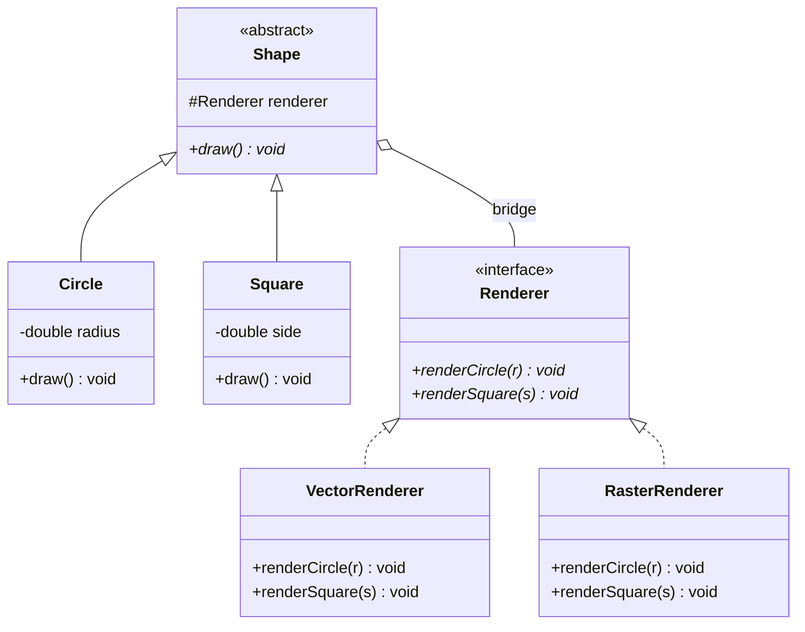
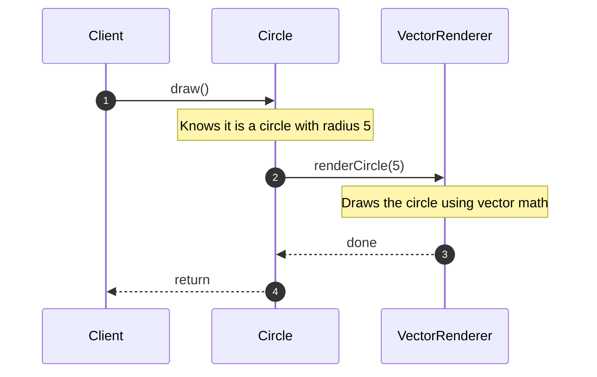

## Overview

Decouples an **abstraction from its implementation** so the two can vary independently.

Think of it as: shape (abstraction) and color (implementation) can change independently without a `RedCircle`, `BlueCircle`, `RedSquare`, `BlueSquare` explosion.

**The problem without it**

1. You have two dimensions of variation: shapes (`Circle`, `Square`) and rendering modes (`Vector`, `Raster`).
2. -> Single inheritance forces you to combine them: `VectorCircle`, `RasterCircle`, `VectorSquare`, `RasterSquare`. That is M shapes * N renderers = M*N classes.
3. -> Adding a third shape adds N new classes. Adding a third renderer adds M new classes. Every new axis of variation multiplies the total.

**The fix:** split the two dimensions into separate hierarchies: **Abstraction** (shapes) and **Implementation** (renderers). The abstraction holds a reference to an implementation and delegates to it. Now M shapes + N renderers = M + N classes. Each varies independently.

**What varies:** both the abstraction and its implementation, independently. The bridge is the reference between them.

| Principle ([[Foundational Principles]]) | How Bridge applies it |
|---|---|
| Favor composition over inheritance | The shape holds a renderer by reference, not by inheritance |
| [[2 - Open-Closed Principle\|Open-Closed]] | New shapes or new renderers are added without changing existing classes |
| [[5 - Dependency Inversion Principle\|Dependency Inversion]] | The abstraction depends on an interface (`Renderer`), not on a concrete rendering class |
| Encapsulate what varies | The *what* (shape) and the *how* (renderer) vary separately and are encapsulated separately |

## Structure



### Participants

| Role | Class in the example | Responsibility |
|---|---|---|
| Abstraction | `Shape` | Defines the high-level interface. Holds a reference to an `Implementor` |
| RefinedAbstraction | `Circle`, `Square` | Extends the abstraction with shape-specific details |
| Implementor | `Renderer` | Declares the interface for platform/rendering operations |
| ConcreteImplementor | `VectorRenderer`, `RasterRenderer` | Implements the rendering for one platform or mode |

## How It Works

Scenario: the client draws a `Circle` using the `VectorRenderer`.



1. The client calls `draw()` on a `Circle`, which it received as a `Shape`.
2. `Circle::draw()` knows it is a circle and knows its radius, but not *how* to render.
3. It delegates to the renderer: `renderer->renderCircle(radius)`.
4. The `VectorRenderer` draws using vector math. If the renderer were `RasterRenderer`, it would draw pixels instead.
5. The shape and the renderer never know about each other's siblings. Swap either independently.

### Without Bridge vs With Bridge

| Without Bridge | With Bridge |
|---|---|
| 2 shapes * 2 renderers = 4 classes | 2 shapes + 2 renderers = 4 classes |
| 3 shapes * 3 renderers = 9 classes | 3 shapes + 3 renderers = 6 classes |
| 5 shapes * 4 renderers = 20 classes | 5 shapes + 4 renderers = 9 classes |
| Growth: M * N (multiplicative) | Growth: M + N (additive) |

## When to Use

- When both the abstraction and the implementation may change, and you want to avoid a combinatorial explosion of subclasses.
- When you want to switch implementations at runtime (e.g., swap a file-based logger for a database logger without changing the calling code).
- When a class hierarchy grows in two or more independent dimensions.
- When you want to share an implementation among several abstractions.

Signals in your code:

- Class names combine two concepts: `SqlWindowsLogger`, `FileLinuxLogger` -> separate the two dimensions (Logger + Output, Platform).
- A single inheritance tree tries to accommodate two orthogonal variations and keeps growing -> split into two hierarchies connected by a bridge.
- You want to swap the platform or backend at runtime (test vs production, local vs cloud) -> inject the implementor.
- A class has platform-specific `#ifdef` blocks -> extract a platform interface (implementor) and inject the right one.

## C++ Example

```cpp
#include <iostream>
#include <memory>
#include <string>

// Implementor: the "how"
class Renderer {
public:
    virtual ~Renderer() = default;
    virtual void renderCircle(double radius) = 0;
    virtual void renderSquare(double side) = 0;
};

class VectorRenderer : public Renderer {
public:
    void renderCircle(double r) override {
        std::cout << "Vector circle, r=" << r << '\n';
    }
    void renderSquare(double s) override {
        std::cout << "Vector square, side=" << s << '\n';
    }
};

class RasterRenderer : public Renderer {
public:
    void renderCircle(double r) override {
        std::cout << "Raster circle, r=" << r << " (pixels)\n";
    }
    void renderSquare(double s) override {
        std::cout << "Raster square, side=" << s << " (pixels)\n";
    }
};

// Abstraction: the "what"
class Shape {
protected:
    Renderer& renderer;                             // bridge to the implementor
public:
    explicit Shape(Renderer& r) : renderer(r) {}
    virtual ~Shape() = default;
    virtual void draw() = 0;
};

class Circle : public Shape {
    double radius;
public:
    Circle(Renderer& r, double rad) : Shape(r), radius(rad) {}
    void draw() override { renderer.renderCircle(radius); }
};

class Square : public Shape {
    double side;
public:
    Square(Renderer& r, double s) : Shape(r), side(s) {}
    void draw() override { renderer.renderSquare(side); }
};
```

Usage:

```cpp
int main() {
    VectorRenderer vector;
    RasterRenderer raster;

    Circle c1(vector, 5);
    c1.draw();                  // Vector circle, r=5

    Circle c2(raster, 5);
    c2.draw();                  // Raster circle, r=5 (pixels)

    Square s1(vector, 3);
    s1.draw();                  // Vector square, side=3

    // Same shape type, different renderer — no new subclass needed
}
```

````ad-warning
title: Bridge vs Strategy
Both inject an interface. The difference is *intent*. **Bridge** is an architectural split designed up front to prevent class explosion across two dimensions. **Strategy** is an algorithm slot: the client picks which algorithm to use for a single, well-defined step. If your "bridge" has only one method and the abstraction hierarchy is flat, it is probably a Strategy.
````

## In .NET / C#

Bridge is less explicitly named in .NET than other patterns, but the structure appears whenever two hierarchies are decoupled through composition.

- **`DbConnection` / `DbCommand` / `DbDataReader`** (ADO.NET). These abstract classes are the abstraction. Each database provider (`SqlConnection`, `MySqlConnection`, `NpgsqlConnection`) is a concrete implementor. Your data access code works against `DbConnection`; the provider DLL bridges to the actual database protocol.
- **`ILogger` / `ILoggerProvider`** (Microsoft.Extensions.Logging). `ILogger` is the abstraction your app code uses. `ILoggerProvider` is the implementor. Console, Debug, Serilog, NLog each supply a provider. The logger factory bridges them.
- **`Stream` subclasses + transport.** `FileStream` vs `NetworkStream` vs `MemoryStream` bridge the same `Stream` abstraction to different storage backends. Higher-level classes (`StreamReader`, `BinaryWriter`) work through the `Stream` interface without knowing the backend.
- **Cross-platform UI (MAUI).** `Button` is the abstraction. The platform-specific handler (`ButtonHandler` on iOS, Android, Windows) is the implementor. The MAUI framework bridges them, so one `Button` type works across platforms.

```csharp
// Implementor: notification channel
public interface INotificationChannel
{
    void Send(string recipient, string message);
}

public class EmailChannel : INotificationChannel
{
    public void Send(string recipient, string message)
        => Console.WriteLine($"Email to {recipient}: {message}");
}

public class SmsChannel : INotificationChannel
{
    public void Send(string recipient, string message)
        => Console.WriteLine($"SMS to {recipient}: {message}");
}

// Abstraction: notification type
public abstract class Notification
{
    protected INotificationChannel Channel;

    protected Notification(INotificationChannel channel) => Channel = channel;
    public abstract void Notify(string recipient);
}

public class UrgentNotification : Notification
{
    private readonly string _issue;
    public UrgentNotification(INotificationChannel channel, string issue)
        : base(channel) => _issue = issue;

    public override void Notify(string recipient)
        => Channel.Send(recipient, $"URGENT: {_issue}");
}

public class ReminderNotification : Notification
{
    private readonly string _task;
    public ReminderNotification(INotificationChannel channel, string task)
        : base(channel) => _task = task;

    public override void Notify(string recipient)
        => Channel.Send(recipient, $"Reminder: {_task}");
}

// Usage: mix any notification type with any channel
var urgent = new UrgentNotification(new SmsChannel(), "Server down");
urgent.Notify("+15551234567");       // SMS to +15551234567: URGENT: Server down

var reminder = new ReminderNotification(new EmailChannel(), "Submit report");
reminder.Notify("alice@example.com"); // Email to alice@example.com: Reminder: Submit report
```

````ad-tip
title: Where else you meet it
- **Dependency Injection itself.** Registering `services.AddScoped<IRepository, SqlRepository>()` is bridging an abstraction (`IRepository`) to an implementation (`SqlRepository`). Swap the registration to change the backend without touching consumers.
- **Device drivers (OS level).** The OS exposes a uniform file/block/network API (abstraction). Each driver (implementor) bridges to a specific piece of hardware.
- **Graphics APIs.** `ID3D12Device` vs `VkDevice` are implementors. A game engine's rendering abstraction bridges to whichever API is available on the platform.
````

## Trade-offs

| Pros | Cons |
|---|---|
| M + N instead of M * N classes: two small hierarchies instead of one large one | Adds indirection: the abstraction delegates to an implementor through a pointer/reference |
| Change abstraction or implementation independently, even at runtime | Harder to understand up front: two hierarchies instead of one |
| The implementor can be shared across multiple abstractions | Overkill if you have only one dimension of variation -- use plain inheritance |
| Clean DI: inject the implementor at construction, easy to test with a mock | The Renderer interface in the example must know about every shape (`renderCircle`, `renderSquare`). Adding a shape means updating the implementor interface -- see the double dispatch trap below |

````ad-warning
title: Double dispatch trap
In the example, `Renderer` has one method per shape type (`renderCircle`, `renderSquare`). Adding a `Triangle` means adding `renderTriangle` to every `Renderer`, which violates Open-Closed for the implementor side. Solutions:
- Pass generic data (vertices, path) instead of shape-specific methods.
- Combine Bridge with [[10 - Visitor|Visitor]] for double dispatch.
- Accept the trade-off: shapes change rarely, renderers change often (or vice versa).
````

## Related Patterns

- [[01 - Adapter|Adapter]]: Adapter is applied *after the fact* to make incompatible interfaces work together. Bridge is designed *up front* to let abstraction and implementation evolve separately.
- [[03 - Abstract Factory|Abstract Factory]]: an Abstract Factory can create the right implementor for a given platform, pairing well with Bridge.
- [[02 - Strategy|Strategy]]: Strategy is a degenerate Bridge where the abstraction hierarchy is flat (one class). If you find yourself with a single abstraction and multiple "implementations", you likely have a Strategy.
- [[02 - Decorator|Decorator]]: Decorator adds behavior by wrapping. Bridge splits a class into two dimensions. They can combine: decorate the abstraction while bridging to different implementors.

```ad-summary
- Bridge splits a class into two hierarchies (abstraction and implementation) connected by a reference. Growth is M + N, not M * N.
- The abstraction defines *what*. The implementor defines *how*. Either can vary independently.
- In .NET: ADO.NET providers (`DbConnection`), `ILogger` / `ILoggerProvider`, `Stream` subclasses, and MAUI platform handlers.
- Design it up front. If you add it after the fact, that is usually an Adapter, not a Bridge.
```
