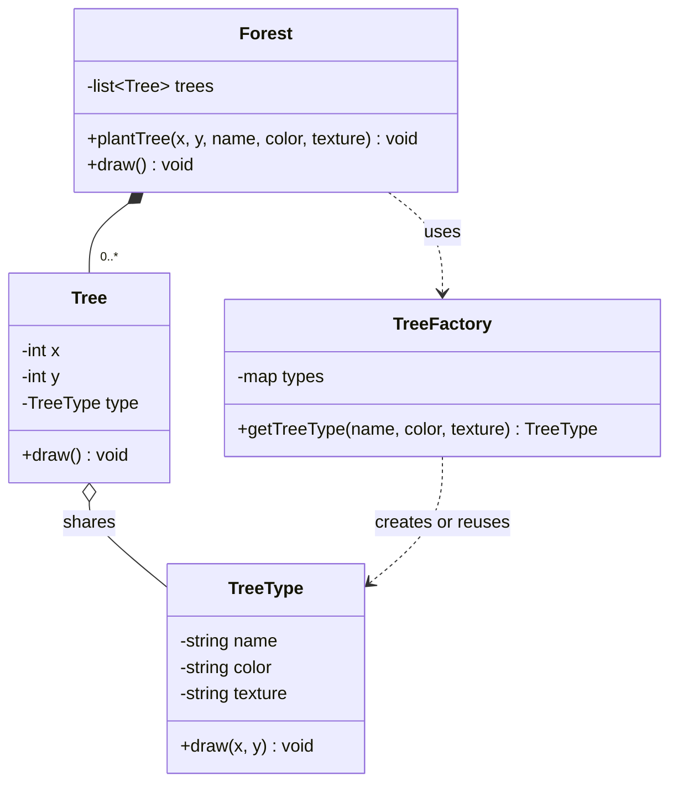
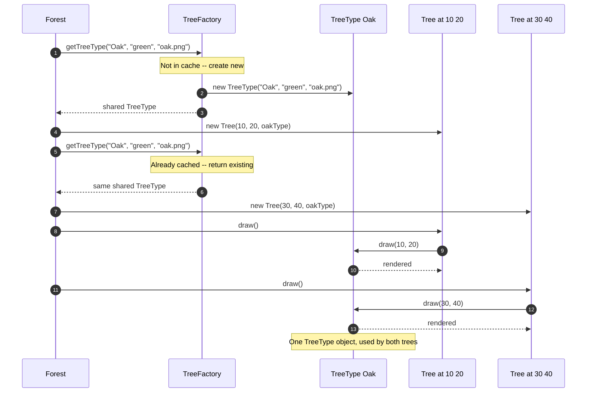

## Overview

Uses **sharing** to support large numbers of fine-grained objects efficiently.

Separates **intrinsic state** (shared, immutable) from **extrinsic state** (unique, passed in by the client).

**The problem without it**

1. A game renders a forest of 100,000 trees. Each tree stores its name, color, texture, mesh data, x, and y.
2. -> The name, color, texture, and mesh are the same for every "Oak" tree. With 50,000 oaks, that data is duplicated 50,000 times.
3. -> Memory balloons. The mesh data alone (textures, vertices) might be 10 MB per tree type. 50,000 copies = 500 GB.

**The fix:** extract the shared, immutable data (name, color, texture, mesh) into a **flyweight** object (`TreeType`). A factory ensures only one `TreeType` per unique combination exists. Each placed tree stores only its unique position (x, y) and a reference to the shared `TreeType`. 50,000 oaks share one `TreeType` object.

**What varies:** the extrinsic state (position, per-instance data). The intrinsic state is shared and must not change.

| Principle ([[Foundational Principles]]) | How Flyweight applies it |
|---|---|
| Encapsulate what varies | The unique per-instance state is separated from the shared immutable state |
| [[1 - Single Responsibility Principle\|Single Responsibility]] | The flyweight stores shared data. The context stores per-instance data. The factory manages sharing |

### Intrinsic vs extrinsic state

| | Intrinsic (shared) | Extrinsic (unique) |
|---|---|---|
| Stored in | The flyweight object | The client or a context object |
| Mutability | **Immutable** -- must never change after creation | Changes per use |
| Examples | Tree: name, color, texture. Character: font, glyph bitmap | Tree: x, y. Character: position in document, paragraph index |
| Shared across | All instances that have the same intrinsic key | Nothing -- unique to each instance |

## Structure



### Participants

| Role | Class in the example | Responsibility |
|---|---|---|
| Flyweight | `TreeType` | Stores the intrinsic (shared, immutable) state |
| Context | `Tree` | Stores the extrinsic state (position) and holds a reference to the flyweight |
| FlyweightFactory | `TreeFactory` | Creates and caches flyweight objects, ensuring sharing |
| Client | `Forest` | Maintains a collection of contexts and passes extrinsic state to flyweight operations |

## How It Works

Scenario: the forest plants two oaks at different positions. Both share the same `TreeType`.



1. The forest asks the factory for an "Oak" tree type.
2. The factory has no oak cached, so it creates one and stores it.
3. A `Tree` is created at position (10, 20), holding a reference to the shared oak type.
4. The forest asks for "Oak" again. The factory returns the *same* object from its cache.
5. A second `Tree` at (30, 40) shares the same `TreeType`.
6. When drawing, each tree passes its extrinsic state (x, y) to the shared `TreeType::draw()`. The tree type uses its intrinsic data (texture, color) to render at the given position.

### Memory savings

| | Without Flyweight | With Flyweight |
|---|---|---|
| 50,000 oaks | 50,000 * (name + color + texture + mesh + x + y) | 1 * (name + color + texture + mesh) + 50,000 * (x + y + pointer) |
| If mesh = 10 MB | ~500 GB | ~10 MB + ~1 MB = ~11 MB |

## When to Use

- When your application creates a huge number of similar objects that eat up memory (e.g., characters in a text editor, trees in a game forest, particles, map tiles).
- When most of the object's state can be made extrinsic (passed in rather than stored).
- When the identity of each object doesn't matter -- they are interchangeable once you supply the extrinsic state.

Signals in your code:

- Profiling shows millions of objects consuming most of your memory, and many share the same field values -> extract the shared fields into a flyweight.
- You create many objects whose data differs only in a few fields (position, timestamp) -> the rest is intrinsic and can be shared.
- A factory or cache already deduplicates objects by a key -> you are halfway to Flyweight.
- `string.Intern()` or dictionary-based deduplication is already in your code -> that is the Flyweight pattern.

## C++ Example

```cpp
#include <iostream>
#include <map>
#include <memory>
#include <string>
#include <vector>

// Flyweight: shared, immutable data
class TreeType {
    std::string name, color, texture;
public:
    TreeType(std::string n, std::string c, std::string t)
        : name(std::move(n)), color(std::move(c)), texture(std::move(t)) {}

    void draw(int x, int y) const {
        std::cout << "Draw " << name << " [" << color << ", " << texture
                  << "] at (" << x << ", " << y << ")\n";
    }
};

// FlyweightFactory: ensures sharing
class TreeFactory {
    std::map<std::string, std::shared_ptr<TreeType>> types;
public:
    std::shared_ptr<TreeType> getTreeType(
        const std::string& name, const std::string& color, const std::string& texture)
    {
        auto key = name + "_" + color + "_" + texture;
        auto it = types.find(key);
        if (it == types.end()) {
            auto type = std::make_shared<TreeType>(name, color, texture);
            types[key] = type;
            return type;
        }
        return it->second;
    }

    std::size_t uniqueTypes() const { return types.size(); }
};

// Context: per-instance extrinsic state + reference to flyweight
class Tree {
    int x, y;
    std::shared_ptr<TreeType> type;
public:
    Tree(int x, int y, std::shared_ptr<TreeType> t) : x(x), y(y), type(std::move(t)) {}
    void draw() const { type->draw(x, y); }
};

// Client: manages all trees
class Forest {
    std::vector<Tree> trees;
    TreeFactory factory;
public:
    void plantTree(int x, int y,
                   const std::string& name, const std::string& color, const std::string& texture)
    {
        auto type = factory.getTreeType(name, color, texture);
        trees.emplace_back(x, y, std::move(type));
    }

    void draw() const {
        for (const auto& tree : trees) tree.draw();
    }

    void stats() const {
        std::cout << trees.size() << " trees, "
                  << factory.uniqueTypes() << " unique types\n";
    }
};
```

Usage:

```cpp
int main() {
    Forest forest;
    forest.plantTree(10, 20, "Oak", "green", "oak.png");
    forest.plantTree(30, 40, "Oak", "green", "oak.png");    // shares TreeType
    forest.plantTree(50, 60, "Pine", "darkgreen", "pine.png");
    forest.plantTree(70, 80, "Oak", "green", "oak.png");    // shares TreeType

    forest.draw();
    forest.stats();   // 4 trees, 2 unique types
}
```

````ad-warning
title: Flyweight immutability
If a flyweight's intrinsic state is mutated after sharing, every object that references it sees the change. This is almost always a bug. Make flyweight fields `const`, or make the class immutable. In C#, use `readonly` fields or `record` types.
````

## In .NET / C#

.NET uses flyweight-style sharing extensively, often without naming it.

- **`string.Intern()`** and the **intern pool**. The CLR maintains a pool of unique string instances. `string.Intern(s)` returns the pooled copy; subsequent calls with the same value return the *same* object. String literals are interned automatically. This is a textbook flyweight factory.
- **`HttpMethod.Get`, `.Post`, etc.** These are cached, immutable flyweight instances. Calling `new HttpMethod("GET")` creates a new object, but `HttpMethod.Get` returns the shared singleton.
- **`System.Drawing.Brushes.Red`** (GDI+). Pre-created, cached brush objects shared across the application.
- **`ArrayPool<T>.Shared` / `MemoryPool<T>.Shared`**. Shared pools that rent and return arrays, avoiding repeated allocations. The pooled buffer is the flyweight; the rent/return cycle is the factory.

```csharp
using System;
using System.Collections.Generic;

// Flyweight: immutable shared data
public record TreeType(string Name, string Color, string Texture)
{
    public void Draw(int x, int y)
        => Console.WriteLine($"Draw {Name} [{Color}, {Texture}] at ({x}, {y})");
}

// FlyweightFactory
public class TreeTypeFactory
{
    private readonly Dictionary<string, TreeType> _cache = new();

    public TreeType Get(string name, string color, string texture)
    {
        var key = $"{name}_{color}_{texture}";
        if (!_cache.TryGetValue(key, out var type))
        {
            type = new TreeType(name, color, texture);
            _cache[key] = type;
        }
        return type;
    }

    public int UniqueCount => _cache.Count;
}

// Context: per-instance data + flyweight reference
public class PlantedTree
{
    public int X { get; }
    public int Y { get; }
    public TreeType Type { get; }

    public PlantedTree(int x, int y, TreeType type) => (X, Y, Type) = (x, y, type);
    public void Draw() => Type.Draw(X, Y);
}

// Client
var factory = new TreeTypeFactory();
var trees = new List<PlantedTree>();

trees.Add(new PlantedTree(10, 20, factory.Get("Oak", "green", "oak.png")));
trees.Add(new PlantedTree(30, 40, factory.Get("Oak", "green", "oak.png")));  // shared
trees.Add(new PlantedTree(50, 60, factory.Get("Pine", "darkgreen", "pine.png")));

foreach (var tree in trees) tree.Draw();
Console.WriteLine($"{trees.Count} trees, {factory.UniqueCount} unique types");
// 3 trees, 2 unique types
```

````ad-tip
title: Where else you meet it
- **`ConcurrentDictionary` as a flyweight cache.** `GetOrAdd(key, valueFactory)` is a thread-safe flyweight factory in one method call.
- **`Encoding.UTF8`** is a shared, cached flyweight. Creating `new UTF8Encoding()` allocates a new object; `Encoding.UTF8` returns the singleton.
- **Enum boxing cache.** Some serializers cache boxed enum values to avoid allocating a new box on every use -- a flyweight for boxed value types.
- **Font caching in WPF / GDI+.** The system caches font objects so that creating `new Font("Arial", 12)` many times returns shared internal data.
````

## Trade-offs

| Pros | Cons |
|---|---|
| Massive memory savings when many objects share the same intrinsic state | Code complexity: splitting state into intrinsic and extrinsic is not always obvious |
| Fewer allocations, less GC pressure in managed languages | Extrinsic state must be passed on every call, adding parameters and reducing encapsulation |
| Factory enables easy metrics: how many unique types exist, cache hit rate | Thread safety: the factory cache must be synchronized in concurrent scenarios |
| Works transparently with the rest of the code: clients use objects normally | Flyweights must be immutable. If you need to mutate shared state, Flyweight is the wrong pattern |

````ad-warning
title: Common misuse
- **Premature optimization.** Don't introduce Flyweight until profiling proves memory is the bottleneck. The pattern adds complexity (factory, state splitting) that isn't worth it for a few hundred objects.
- **Mutable flyweights.** A "shared" object that gets mutated is a concurrency bug waiting to happen, not a flyweight. Enforce immutability with `const` (C++) or `readonly` / `record` (C#).
- **Confusing Flyweight with caching.** Caching stores *results* of expensive operations. Flyweight shares *objects* with identical intrinsic state. They overlap but the intent differs.
````

## Related Patterns

- [[05 - Composite|Composite]]: leaf nodes in a Composite tree are often shared as flyweights. A document editor's character objects (glyphs) are flyweights inside a Composite paragraph/line tree.
- [[01 - Singleton|Singleton]]: a Flyweight factory is often a singleton. But a single flyweight instance is *not* a singleton -- there are many flyweights, one per unique key.
- [[02 - Factory Method|Factory Method]]: the flyweight factory uses a factory method to create or retrieve flyweights. `getTreeType()` is a factory method with caching.
- [[02 - Strategy|Strategy]]: Strategy objects are often stateless and can be shared as flyweights. If a strategy has no per-instance state, one instance serves all users.
- [[04 - Proxy|Proxy]]: a proxy *controls access* to one object. A flyweight *shares* one object among many users. They can combine: a proxy that lazily loads a flyweight from a pool.

```ad-summary
- Flyweight shares immutable intrinsic state across many objects to save memory. Each object keeps only its unique extrinsic state.
- A factory ensures that only one flyweight exists per unique key. Clients get a reference to the shared object.
- In .NET: `string.Intern()`, `HttpMethod.Get`, `Encoding.UTF8`, `ArrayPool<T>.Shared`, and GDI+ brushes/pens are all flyweights.
- Only apply when profiling shows memory pressure from many similar objects. Enforce immutability on shared state.
```
